# CatgirlTracker Forever

CatgirlTracker Forever is a roleplay addon for World of Warcraft: Forever. Install the folder `CatgirlTracker_Forever`. The table of contents declares interface `16001`, the title CatgirlTracker Forever, and the account-wide saved table `CatgirlTrackerDB`.

Copy that folder into the Forever `Interface/AddOns` directory. Forever loads this folder. The classic `CatgirlTracker` folder is a local reference and is not part of this repository. The two copies do not share saved data.

The build specification is [docs/CatgirlTracker-Forever-Design.md](docs/CatgirlTracker-Forever-Design.md).

Owners and kittens can read the player guide in [readme-draft.md](readme-draft.md). The same guide, with these screenshots in the pages, is [Domestic-Catgirl-Corp-Player-Guide.pdf](Domestic-Catgirl-Corp-Player-Guide.pdf). The shots live in `Interface-screenshots-for-Readme/`.

## The three roles

**Kitten.** The character the addon acts on. The guild note on that character contains `owner=First Last`. That name is the Owner. `owner=First-Last` is the same person. A comma ends the name, and only the first two words are kept. When the officer note has text, the client reads the owner from the officer note. When the officer note is empty, `owner=` on the public note still counts. Forever has no realm in a character name. A first name alone is a different character.

**Owner.** One person for that kitten. The Owner opens `/cgcc` and applies gear from that window. A click from anyone else, including the Guild Master, does nothing.

**Guild Master.** One character for the whole guild. Set the name with `/cctmaster First Last`. `First-Last` is the same name. The name starts empty. While it is empty, no character is Guild Master and kittens do not send the weekly report. The name is typed. It is not taken from a guild rank.

## Commands

| Command | What it does |
| --- | --- |
| `/cgcc` | Opens the owner control window. |
| `/cgcc advertise` | Opens the five-line advertise window. |
| `/cctdebug` | Turns debug printing on or off. It starts off. |
| `/cctmodule` | Lists the five modules. `/cctmodule Name` turns that module on or off. |
| `/cctmaster` | Prints the Guild Master name, or says it is not set. |
| `/cctmaster First Last` | Sets the Guild Master. `First-Last` is the same name. |

`/cctcmd` is not a command.

## What a click does

An owner button sends a hidden addon message. The kitten accepts that message only from the Owner, then changes the gear. The sentence shown in the whisper window is not the switch.

After the kitten accepts the message, the roleplay lines still appear for both of you. A small gag whispers the owner that she has been gagged with a small gag, and whispers her that a small silken gag is over her mouth and speech is now garbled. A heavy gag still tells you that your owner secured a heavy gag. Typing one of those lines by hand does not change the gear.

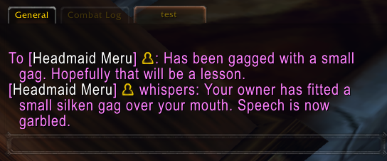

Guild lines for a headpet, a nap, slacking, or a heel fall can still be posted. They are flavor, and they are on by default. They are not how the addon decides what happened. The addon keeps no guild-chat transcript.

## Owner controls

A draggable **cgcc** button at the top of the screen opens the same window as `/cgcc`. The window title is Catgirl Control. Close is at the top right. The line under the title names the kitten and shows her current heat and submissiveness, as `Kitten: Name. heat N sub N`. If she has never sent a snapshot, that line says `no snapshot`.

The tabs are Stats, Control, Toys, Discipline, and Settings. The selected tab is the grey one. Control, Toys, and Discipline keep each group collapsed until you open it. A closed group is marked `[+]`. An open group is marked `[-]`. The panels scroll.

The window opens with no assigned kitten. Kitten actions stay disabled until one is assigned. Stats then says that most functions are not available.

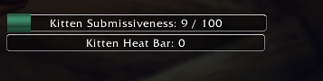

### Stats

Refresh is the first button. With a snapshot, the page shows Kitten Skills (maid heels, high heels, ballet boots), then Kitten Heat Status: the heat bar, the orgasm counter, the last orgasm, orgasms today, orgasms this week, and denied orgasms. The two bars are drawn again under that list. Kitten Gear is the icon row. Timed removals follow, or the line `Timed removals: none`. Controls Status lists gag, blindfold, earmuffs, paw mittens, heels, bell, tail bell, tracking jewel, chastity belt, chastity bra, and leash. Applied toys are a later block, with vibe or inflation when those are set. Distance is the last line. It reads unknown while the tracking jewel is off, or while you are on a different map.

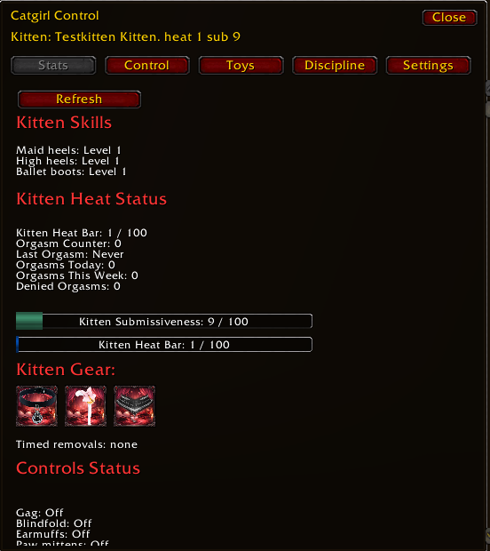

### Control

The groups, in order, are Leash, Gags and Masks, Blindfolds, Earmuffs, Bells, Mittens, Chastity, Heels, and Tracking. Open a group and the rows split into Apply and Remove. A piece with a picture has a small icon beside the button. Hovering the name or the icon opens a larger preview to the right of the window.

Gags and Masks applies Cute Kitten Mask, Small Gag, Heavy Gag, Kitty Mask With Gag!, Inflatable Gag, Inflate Gag, and Deflate Gag. Remove is Ungag, plus Remove Gag in X Hours. The hours box sits beside that row and starts at `1.5`. Each timed removal has its own box. The leash, the tracking jewel, and the toys have no timer.

The other groups use the same shape. Blindfolds are Light Blindfold, Cute Kitty Blindfold, and Full Blindfold. Mittens are Lockable Paw Mittens and Squeking Paw Mittens. Heels are Locking Maid Heels 3-CM, Locking High Heels 8-CM, and Locking Ballet Boot 12-CM. Chastity is Lock Chastity Belt, Lock Chastity Bra, Deny Orgasm, and Allow Orgasm. Tracking is Attach Tracking Jewel, Force Kitty Group, and Remove Tracking Jewel. Bells are Attach Bell and Attach Tail Bell, each with its own removal and its own hours box.

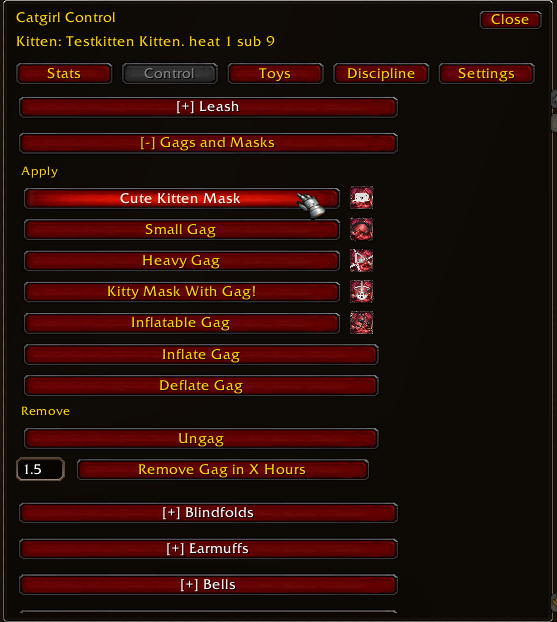

A command counts only after the message is accepted and the kitten answers that it applied. This window is the live controls. The weekly scorecard is a separate saved file, and this window does not draw it.

Force Kitty Group invites the Owner. If the kitten is already in a party, the addon leaves that party and then sends the invite. There is no confirm frame.

While the tracking jewel is off, distance reads unknown, and the discipline buttons warn and do not send.

### Toys

Each toy is a collapsed group. Open it for Apply, Remove, and only the controls that toy has. A vibe is a row of buttons from 1 to 5. A shock is a row from 1 to 3. An inflatable toy has Inflate and Deflate instead. The dildo has both a vibe row and a shock row. The list is Dildo, Inflatable Butplug, Inflatable Dildo, Small Butplug, Large Butplug, Taill Butplug, Vibes Pussy, Vibes Nipples, Vibes Ears, Nipple Piercings, Ear Piercings, and Pussy Lipps Piercings. One buttplug replaces another. A toy under the belt or the bra is refused while that lock is on.

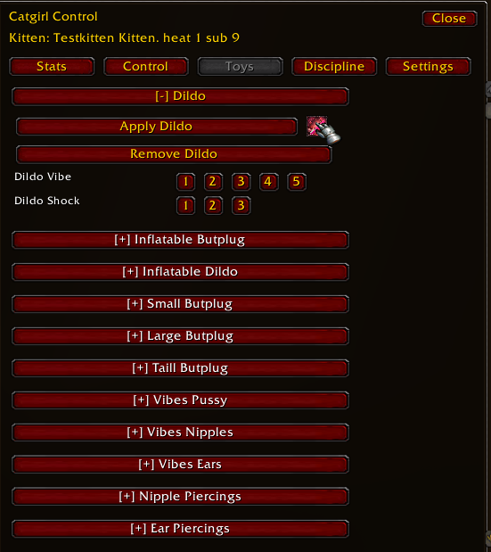

### Discipline

The tools are Spank Hand, Pinch, Vibrating Wand, Shock Wand, Crop, Paddle, Heart Crop, and Whip. Open one and each place it can land is a row of strength buttons. The vibrating wand lands on Tits, Pussy, and Ears, with three strengths each. The other tools open onto their own places. A place the belt or the bra covers is refused.

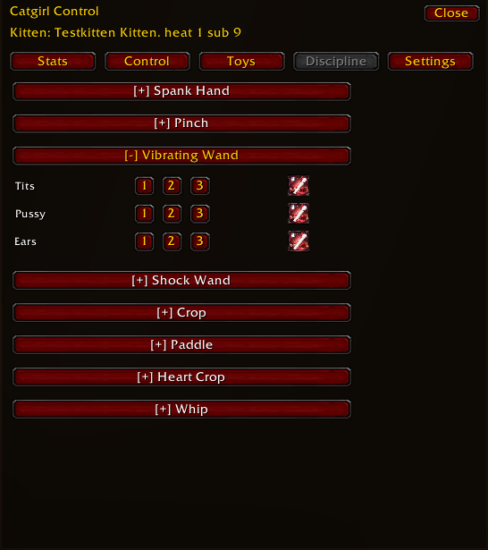

### Settings

From the top: Enable debug output, then the five module checkboxes, then the Advertise button, then Map history day, then Maid Tasks, then Maid Instructions. NyaChat is below the maid count, so scroll the tab to reach it.

Map history day prints the date. Offset 0 reads `YYYY-MM-DD (Today)`. The slider runs from 0 to 30. An empty maid list says `No maid tasks yet. Paste an item and click Add Task.` An empty instruction list says `No maid instructions yet. Add one above.` The count line under them reads how many items and instructions are stored.

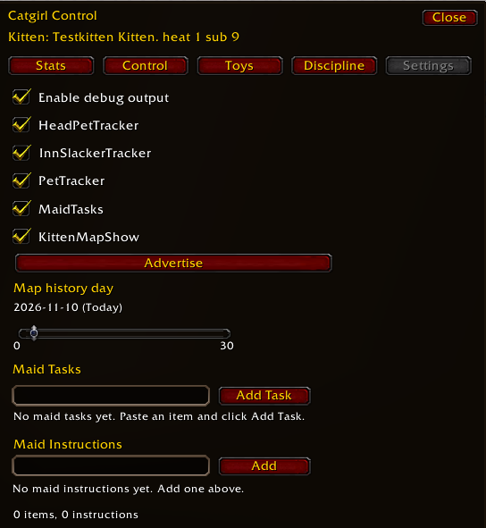

The maid list is edited from this window. The Nya checkboxes sit on the same window, under the maid editors.

## Pictures and the binds strip

When gear is applied, a picture pops for five seconds. Removing gear does not pop a picture. The binds strip along the top of the screen shows what is worn right now. It is drawn from the current gear, and you can drag it. A timed piece shows the time left under its icon.

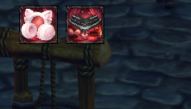

Cute Kitty Blindfold draws a mask with two eye holes. The rest of the screen goes black. The cursor still moves. Full Blindfold captures the mouse.

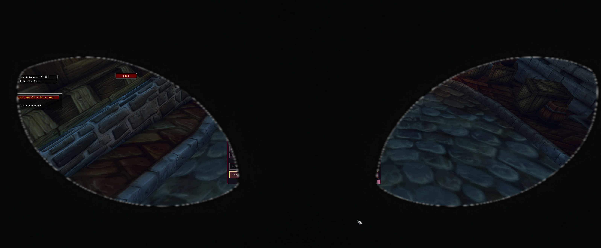

## Advertise

The advertise window holds five lines. Open it with `/cgcc advertise` or the Advertise button on Settings. Sending starts off for each character. Lines that do go out still pass through the gag. Advertise is separate from the five modules, and it is separate from the weekly scorecard.

## Maid sync

The Owner's maid list is sent to the kitten as a hidden addon message. The kitten keeps the items and the instructions. An unchanged refresh does not add a task. A real change to the list adds one task on the kitten when the new list is applied, and one task on the Owner after the kitten accepts it. A list that is too large is refused, adds no task, and is not retried.

## The CatNya pet button

A small draggable window summons a cat from the pet collection. The seven cat-carrier cats count. The carrier item itself does not summon one anymore. The button label follows whether that cat is out. While the cat is out it reads `Good Kitten!, You Cat is Summoned`, and the line under the button reads `Cat is summoned`. The label changes back to summon when you die. The window shows how much time is left before the next check. A hunter pet does not count, and neither does any other companion. Pet tracking starts on. Every ten minutes, if one of those cats is not out, you get a warning. If it is still not out on the next check, one guild line says the kitten forgot to summon the cat. That line is not a row on the weekly report.

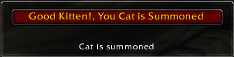

## Nya

Nya rewrites outgoing chat. It stays off until Enable Nya is turned on in the owner window. The block is titled NyaChat and sits under the maid editors on Settings, so scroll to it. The other Nya checkboxes do nothing while Enable Nya is off.

## What you hear

Heel steps play only while the kitten is walking. They repeat about every seven seconds and stop when the kitten stops. The collar bell waits between two and five minutes. The tail bell jingles about every five or six seconds while the kitten is walking. When the kitten stops, a jingle that is already playing stops. These clips are ogg files. A custom wav does not play.

The kitten hears the sound on this computer. The Owner hears the heels only when close on the map, and hears either bell inside a wider map distance. Inside that distance the sound is full volume. Farther away, the Owner hears nothing. There is no fade.

A party member who has the addon hears the sound too. Party members are not checked for distance, and they are not sent the kitten's position. Someone without the addon hears nothing, because the sound travels as an addon message.

## The map

The map stays off until you enable KittenMapShow. The owner then sees where the kitten is, and about one point a minute of where the kitten walked for the last 30 days. The settings slider picks the day. Pins are cat-face markers on the world map of the kitten's zone. Hover a pin for the time. The tooltip is `YYYY-MM-DD HH:MM`, and a stay in one place adds the end time. Today also shows the current pin. Another day shows only that day's walk. The kitten does not see their own trail. The player's own map marker is still the player.

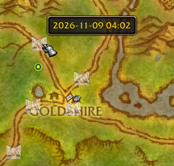

## The weekly report

Each kitten counts the week on their own computer. A week starts on Monday. The label looks like `2026-W45`, taken from that computer's clock. The week in progress, and one finished week behind it, are what can be sent.

When the Guild Master is online, those weeks are written into `CatgirlTrackerDB`. The game draws no scorecard, no copy box, and no leaderboard. The saved file is the report. A week this Guild Master never stored can be noted as missed. A finished week that rolls off the one saved slot can be noted as rotated. Those notes are not printed as a scorecard.

The report includes time worn, tasks, heat, headpets, naps, slacking, and zones. The Owner's accepted commands are stored beside the kitten's own counts.

## Discord

The addon cannot talk to Discord. It opens no webhook and no web request. A companion program, written later, reads `CatgirlTrackerDB` while the game is closed, posts a week, and deletes that week only after Discord has accepted it. The addon does not delete a week on its own.

## What this version leaves out

The layer list, `llist`, `linv`, and the login advertisement that used to read a layer addon are absent. They do not send guild addon messages. Force group is the owner button described above, and that button is in the addon.

There is no cleanup window. Stored lists are capped.

There is no sync debug window. `/cctdebug` prints rate-limited lines.

## Modules

`/cctmodule` lists only these five:

- HeadPetTracker, on
- InnSlackerTracker, on
- PetTracker, on
- MaidTasks, on
- KittenMapShow, off

The Settings checkboxes use those same names, under Enable debug output and above Advertise.
