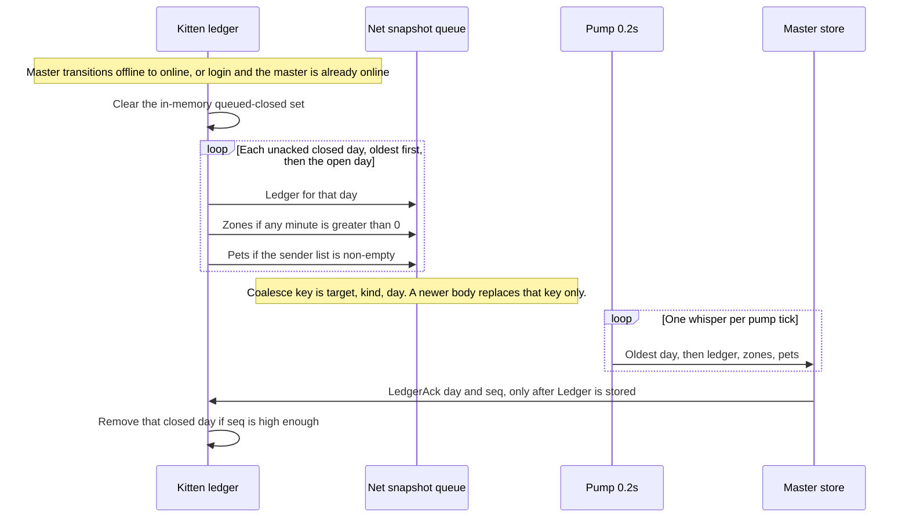
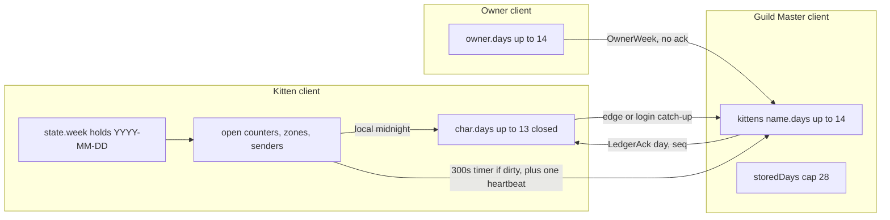

# CatgirlTracker Forever — Daily Scorecard

| | |
| --- | --- |
| Author | placeholder |
| Date | 2026-11-10 |
| Status | Draft |
| Supersedes | Only the scorecard period, the one-archive rule, and the two-row master store in `docs/CatgirlTracker-Forever-Design.md` |
| Does not supersede | Gameplay, the owner window, chat, heat, submissiveness stamp lists, the 30-day walk, pictures, maid sync, or Nya |
| Implement next | PR 9 only. Stop. PR 10 is specified here and is not part of that session. |

## Overview

The shipped scorecard is one ISO week per client clock, one unacked archive, and two master rows (`applied` and `previous`). That period is what this document replaces. The scorecard becomes one local calendar day, `YYYY-MM-DD` from `date("*t")` / `time()` on that computer. Each of the kitten, the owner tally, and the Guild Master store keeps 14 day rows, counting the open day, so that is the open day plus up to 13 closed days. A 15th day drops the oldest. The dropped id is remembered. The totals are not.

There is still one scorecard, not a weekly ledger beside a daily one. `CCT.Week` stops being the scorecard clock. Wire field `week` on `Ledger`, `Zones`, `Pets`, `OwnerWeek`, and `LedgerAck` becomes `day`. `seq` still starts at 1 per period and still names one snapshot version. The kitten does not keep a closed day after `LedgerAck`. The owner does not get an ack and keeps a day until the 14-row window drops it. The master stores up to 14 day rows per kitten and, on the master's login, removes a row more than 13 local days before the master's today.

PR 9 is that clock, those stores, the send policy, the upgrade zero, and the caps. It does not add pet counters or a Worn whisper. PR 10, after PR 9, adds `petMiss`, `petMin`, and Worn minutes for the restraints and toys that are not already `gagMin` or `heelsMin`. No scorecard window. No webhook.

## Background & Motivation

### What is shipping today

`docs/CatgirlTracker-Forever-Design.md` (Week id, about lines 749–861) defines `YYYY-Www` from each client's local clock, not UTC. On a week change `Kitten/Ledger.lua` `CCT.Ledger.EnsureWeek` keeps one `char.archive` and drops the older archive. `Master/Store.lua` keeps `applied` and `previous`. `CCT.Store.Age` deletes `previous` when `WeeksAhead(localWeek, previous.week) >= 2`. `storedWeeks` is cap 16. `Owner/Corroboration.lua` `WeekRow` writes `db.owner.weeks[name]` and parks the previous row in the one slot `db.owner.closed[name]`. There is no `OwnerWeek` ack.

The minute clock is `whole = floor((now - minuteStamp) / 60)` then `minuteStamp = now` (`CCT.Ledger.AddMinutes`). Login sets the stamp and adds nothing (`CCT.Ledger.OnLogin`). Minute counters and zone minutes clamp to `0..10080`. Event counters clamp to `0..9999`. `heatPeak` and `sub` clamp to `0..100`. The same `MINUTE_CAP = 10080` in `Kitten/State.lua` also clamps lock minutes (`CCT.State.SetLock` and the lock normalizer). That lock cap stays.

`Core/Net.lua` splits a logical body at `MAX_BYTES = 255`. Snapshot coalesce key is `(target, kind, week)` for `ledger`, `zones`, `pets`, and `ownerweek` (`SnapshotKey`, `WEEK_KINDS`). `SnapshotBetter` orders by ISO year, then week number, then `KIND_RANK`. Reassembly for those kinds is type + sender + `fields.week` + `seq` (`BufferIdentity`). The pump interval is `PUMP_INTERVAL = 0.2`. One whisper goes out per pump tick.

`Kitten/Report.lua` `CCT.Report.StateFields` always emits token `week` from `state.week`. The orgasm counters on that same snapshot are different tokens: `orgWeek` is `state.counters.orgasm`, `orgDay` / `orgDenyDay` / `dayReset` come from `CCT.Submissiveness` (local-midnight stamp lists, cap 50). `Owner/ControlCenter.lua` prints those as "Orgasms This Week". That label is not the period id.

`README.md` calls this report weekly: the Guild Master paragraph (kittens do not send the weekly report), the owner-controls sentence (the weekly scorecard is a separate saved file), the advertise sentence, the CatNya sentence (not a row on the weekly report), and the section "The weekly report" (Monday, `2026-W45`, one finished week).

### Why it changes

A week is the wrong reward bucket for how this guild plays, and one archive plus two master rows cannot hold a fortnight of closed days. The replacement is a day id and 14 rows on each side. Old `YYYY-Www` data is not converted. Two computers can still file one evening under two ids. That was already accepted for weeks. It stays accepted for days. There is no realm timezone.

### What this document does not change

Heat decay, the deny-to-70 path, heel levels, locks as gameplay, the submissiveness formula, the bar, picture popups, the binds strip, advertise, maid fragment sync, Nya, the 30-day walk (`TRAIL_CAP` 45000 in `Kitten/Report.lua`), chat, and the owner window stay as written in `docs/CatgirlTracker-Forever-Design.md` and as implemented on main. PR 9 does not edit `Owner/ControlCenter.lua`. The string "Orgasms This Week" stays. `orgWeek` stays the wire name for the scorecard orgasm counter even though that counter now resets at local midnight.

## Goals & Non-Goals

### Goals

- One scorecard period: local calendar day `YYYY-MM-DD`.
- 14 day rows on the kitten, the owner tally, and the master, including the open day.
- Closed days sent on the master-online edge and on login when the master is already online, oldest first, then drained by the existing pump.
- The 300-second timer sends the open day only.
- `LedgerAck` from `settings.masterName` drops that closed day only.
- Week ids are not read, not converted, and not sent. The kitten zeros scorecard counters once and says so.
- Minute counters clamp to `0..1440`. Lock minutes stay `1..10080`.
- `MASTER_CAP` is `4 * 1024 * 1024`. `CHAR_CAP` is `262144`. `KITTEN_CAP` stays 40.
- `lua tools/pr1_selfcheck.lua` through `lua tools/pr8_selfcheck.lua` stay green. New day behavior is `tools/pr9_selfcheck.lua`.

### Non-Goals

- A second weekly ledger, a UTC day, or a realm timezone.
- Converting `YYYY-Www` rows into days.
- Pet counters, worn-minute fields, or a Worn whisper in PR 9. Those are PR 10.
- An `OwnerWeek` ack.
- A scorecard window, a copy box, a leaderboard, or a webhook.
- Changing the lock command cap, the 30-day walk, maid sync, or Nya.
- Persisting the pet `warned` / `forgotSent` flags.
- Renaming the Stats line "Orgasms This Week" or the `orgWeek` token.
- Resetting `life.total`, `life.denied`, `life.orgasms`, `life.denials`, worn gear, heat, locks, or heel levels on upgrade.

## Key Decisions

1. **The period is a local calendar day, not a week and not UTC.** `CCT.Day.Id` formats `date("*t", now or time())` as `%04d-%02d-%02d`. Monday-start ISO weeks in `CCT.Week.Id` (`Core/Net.lua`) are the scorecard clock being removed. Two PCs can file the same evening as two dates. A retry cannot merge them, because the day id is part of the key. The same acceptance already written for `YYYY-Www` applies here. There is no realm-timezone API on this client.

2. **One scorecard. `CCT.Week` is not kept as a second clock.** Callers that already say `CCT.Ledger.EnsureWeek` (`Kitten/Headpet.lua`, `Kitten/Slack.lua`, `Kitten/Nap.lua`) are not in the PR 9 file list. `CCT.Ledger.EnsureWeek` remains the function name and rolls the local day. `CCT.State.SetWeek` remains the setter and stores the day id in `state.week` and `counters.week`. Those field names stay because PR 9's `State.lua` edit is the clamp split, not a schema rename. The wire token is `day`. `Kitten/Report.lua` reads `state.week` and emits `day`.

3. **Submissiveness "today" is not this clock.** `CCT.Submissiveness.DayStart` (`Kitten/Submissiveness.lua`) is local midnight for the stamp lists `life.orgasms` and `life.denials` (cap 50), `orgDay`, `orgDenyDay`, and `dayReset`. Scorecard `orgasm` and `deny` are the other pair. Both pairs still increment together. After this change the scorecard pair resets when the day id changes. The stamp lists do not. They were never the weekly counters. `Recompute` already calls `CCT.Report.SendState` when `DayStart` moves. That branch calls `CCT.Ledger.EnsureWeek(now)` first, so the whispered `orgWeek` is the new day's scorecard orgasm, not yesterday's. The PR 9 edit is that one call. `orgWeek` stays. `Owner/ControlCenter.lua` still prints "Orgasms This Week" and is not in the PR 9 file list.

4. **Retention is 14 rows, including the open day.** The 15th drops the oldest row. Remember that id. Do not keep its totals and do not add them into a neighbor. This count is locked. Do not propose 7, 16, or "however many fit." That count is the scorecard row cap while `Bytes(char)` is under `CHAR_CAP`. Once the walk alone exceeds 262144, the kitten does not keep 13 closed days. That steady state is in Storage estimate. The cap stays 262144.

5. **Ack removes the kitten's copy of a closed day and nothing else.** `LedgerAck` is still ignored unless `CCT.SameName(sender, settings.masterName)`. It drops a closed day only when `fields.day` equals that day's id and `tonumber(fields.seq)` is at least that day's seq. The open day stays. There is still no `OwnerWeek` ack. The owner keeps a day until the 14-row rule drops it.

6. **Closed days are not on the 300-second timer.** The timer sends the open day only, and only when that day's counters, zone map, or sender list changed, plus one unchanged heartbeat of the open day per master-online session. Catch-up enqueue of every unacked closed day, oldest first, then the open day, happens on the roster offline-to-online edge and on login if the master is already online. One enqueue of at most 14 days. The existing `CCT.Net` pump drains it. A closed day that was successfully queued is not enqueued again until the next edge or the next login. An offline login does not flush and does not print. The offline line is a side effect of `Flush` when `MasterOnline()` is false, on the first timer flush. A closed day the master refuses stays in `char.days` and is sent once per later edge until it is the oldest of 14 rows or an ack arrives. That retry is not on the timer and is not a resend every five minutes.

7. **The master store is a 14-day map, not `applied` / `previous`.** `Age`'s two-ISO-week rule goes away. On the master's login, a stored day more than 13 local days before the master's today is removed even if nobody is sending. Removing a retained row sets `rotatedDay` and does not set `droppedDay`. `dropped:` sets `droppedDay` only when that id is absent from the remembered-id list. Remembered ids, newest last, cap 28. An id that was stored and later aged out stays a retained id.

8. **Caps.** `KITTEN_CAP` stays 40. `MASTER_CAP = 4 * 1024 * 1024`. Starting point is the existing doc's ~2–4 KB per row: `40 * 14 * 4 KB = 2240 KB`, and 4 MiB is the cap with headroom. `CHAR_CAP = 262144` on the existing `CCT.Ledger.Guard` walker. Do not raise it to hold the 30-day walk. The 14-row rule is the scorecard row cap while `Bytes(char)` is under 262144. It is not what the kitten retains after the walk alone exceeds that cap: `Guard` then empties `char.days` and stops, and it never removes `trail`, `life`, gear, or the open day. While a closed day still exists and a write would pass 262144, drop the oldest closed day the same way a 15th day does, print, and put `dropped` on later sends. Do not drop it quietly. Scorecard minutes clamp to `0..1440`. The lock cap stays 10080. Do not share one constant between them.

9. **Week ids are ignored, not migrated.** On the kitten, a saved period id matching `^%d%d%d%d%-W%d%d$` is not copied into the day list. Scorecard counters zero, today starts, one non-debug line is printed. Lifetime stats, worn gear, heat, locks, and heel levels stay. Owner rows whose id is a week id are not sent. Master rows whose id is a week id stay in the saved file and are ignored by `CCT.Store` and by the future extractor.

10. **PR 9 carries today's ledger fields only.** `heelsMin`, `gagMin`, `tasks`, `heatPeak`, `orgasm`, `deny`, `playMin`, `sub`, `pets`, `hugs`, `kisses`, `spanks`, `earPinch`, `slack`, `slackMin`, `napOk`, `napEarly`, `napOver`, `napMiss`, plus zones and the 20-pair sender list, plus OwnerWeek `On`/`Off`, `tasks`, and `disc`. `gagMin` and `heelsMin` stay on the ledger. No `petMiss`, no `petMin`, no Worn.

11. **PR 10 adds pet time and worn minutes without moving the window.** `petMiss` increments once when the `PET_SUMMON_BAD` guild line is sent. `petMin` is whole online minutes while `state.petSummoned` is true, written by the existing minute clock, and only while the PetTracker module is on. Worn minutes for the other gear and all 12 toys are a new snapshot kind `worn`, same `(day, seq)` version rules as Zones, zeros omitted. They are not extra fields on the ledger line.

## Proposed Design

### Clock

```lua
local function IsDayId(id)
    return type(id) == "string" and id:match("^%d%d%d%d%-%d%d%-%d%d$") ~= nil
end

local function IsWeekId(id)
    return type(id) == "string" and id:match("^%d%d%d%d%-W%d%d$") ~= nil
end

-- Local calendar day. date("*t") is already the machine zone. Not UTC.
function CCT.Day.Id(now)
    if type(date) ~= "function" or type(time) ~= "function" then
        return nil
    end
    local stamp = date("*t", now or time())
    if type(stamp) ~= "table" or stamp.year == nil then
        return nil
    end
    return string.format("%04d-%02d-%02d", stamp.year, stamp.month, stamp.day)
end

-- Noon plus half a day, so a one-hour DST step cannot turn adjacent dates into 0.
local function DayNumber(id)
    if not IsDayId(id) or type(time) ~= "function" then
        return nil
    end
    local y, m, d = id:match("^(%d%d%d%d)%-(%d%d)%-(%d%d)$")
    local noon = time({ year = tonumber(y), month = tonumber(m), day = tonumber(d), hour = 12 })
    local epoch = time({ year = 2020, month = 1, day = 1, hour = 12 })
    if type(noon) ~= "number" or type(epoch) ~= "number" then
        return nil
    end
    return math.floor((noon - epoch) / 86400 + 0.5)
end

-- -1 if a is older, 0 if equal, 1 if a is newer. A non-day is older than a day.
function CCT.Day.Cmp(a, b)
    local an, bn = DayNumber(a), DayNumber(b)
    if an == nil and bn == nil then
        return 0
    end
    if an == nil then
        return -1
    end
    if bn == nil then
        return 1
    end
    if an == bn then
        return 0
    end
    return an < bn and -1 or 1
end
```

`CCT.Day` lives in `Core/Net.lua`, replacing `CCT.Week` as the scorecard clock. Delete `CCT.Week.Id`, `CCT.Week.Cmp`, and `CCT.Week.Parts`. Do not leave a second function that still returns `YYYY-Www` for the ledger. `pr7_selfcheck.lua` is the only production caller of `CCT.Week` outside `Ledger.lua`, `Store.lua`, `Corroboration.lua`, and `Report.lua`, and that file is updated in PR 9.

`DaysBefore(todayId, rowId)` returns nil unless both `DayNumber` results are numbers. Do not subtract when either side is nil. In Lua that subtraction throws, and one bad id would abort `CCT.Store.Maintain` on `PLAYER_LOGIN`. A nil result must not remove a row and must not count as greater than 13. `Maintain`, and the same sweep at the start of `Accept`, continue with the next id. `Maintain` continues with the next kitten. One failed id does not abort the sweep.

`IsDayId` stays a shape check only (`^%d%d%d%d%-%d%d%-%d%d$`). It does not ask `time` whether that calendar day exists, so `2026-99-99` is a day id. If `time` of that table returns nil, `DayNumber` is nil, `DaysBefore` is nil, and the row stays. A shape-valid id whose `time` call normalizes (for example day 31 in a short month) is ordered as that normalized noon. It is not rejected for naming a different civil day than the digits.

A row is outside the master's login window only when `DaysBefore` is a number greater than 13. Difference 13 is kept. For `2026-11-10`, `2026-10-28` is kept and `2026-10-27` is not. That is the open day plus 13 closed days when every calendar day has a row.

String order of a zero-padded `YYYY-MM-DD` matches this order for ids `time` does not normalize. Compare with `CCT.Day.Cmp` anyway. A week id fails `IsDayId` and is older than every real day under `Cmp`. The store does not use that ordering to file it. `IsDayId` rejects it first.

### Where the open day lives

The open day stays in the kitten struct the week already uses:

- `state.week` and `state.counters.week` hold the day id. `CCT.State.SetWeek` writes both. Callers are not renamed.
- `state.counters` holds the open day's counters and `seq`.
- `char.zones` and `char.senders` are the open day's maps. `CCT.Ledger.PushSender` still caps the list at 20.
- `char.days` is the closed unacked days, oldest first, each `{ day, seq, counters, sub, zones, senders }`. Cap 13 entries. Together with the open day that is 14.
- `char.droppedDay` is the latest dropped id (one string). `char.dropSend` is the id still printed on the wire. `char.dropUntil` is the open day id that was current when that drop was recorded. Ack of `dropUntil` clears `dropSend` and `dropUntil` and does not by itself delete a closed day. This is the current `droppedWeek` / `dropSend` / `dropUntil` rule with day ids.
- `char.sent` is `{ day, seq, mark }` for the open day. `PlanSeq` and `Dirty` compare `sent.day` to the open day id. They do not read `sent.week`. A missing `sent`, or a `sent.day` that is not the open day, makes `Dirty` true and makes `PlanSeq` use the counter seq without treating the old mark as this day. The in-memory set of closed day ids already queued this session is not saved.

`seq` starts at 1 for a day. `PlanSeq` increments only when `sent.day` is this day and `sent.mark` differs from the newly built mark. The mark is the counter list, `sub`, the zone map, and the sender list (`CCT.Ledger` `Mark`). A retry resends the same bytes and the same seq. The heartbeat reuses the seq, and only after the open-day whisper has been queued (see Send policy).

Zone minutes use the scorecard minute cap, 1440, in `AddZone` and in `CCT.Store`'s zone clamp. They are minute counters of the day.

### Kitten day roll

`CCT.Ledger.EnsureWeek(now)`:

1. Run the upgrade check below before any roll.
2. Let `id = CCT.Day.Id(now)`. If `state.week == id`, return false.
3. If `state.week` is already a day id, close it. If `char.days` is not a table, set it to `{}` before any length test. `#char.days` on nil is an error, and `Char()` does not create `days`. If `#char.days >= 13`, drop `char.days[1]` first (see Drop). The closed row's seq is the value `PlanSeq` would send for this open day, including the increment when `sent.day` is this day and the mark differs. Copy that seq onto the closed row before the counters are zeroed. Do not copy `counters.seq` without that bump. The master treats a seq it has already applied as a no-op, and the closed day would be ignored. Append `{ day = state.week, seq = that value, counters = copy, sub = state.sub, zones = copy, senders = copy }`. Then clear `char.sent`. A cleared `char.sent` is what makes the new day dirty.
4. Zero every name in `COUNTERS`. `CCT.State.SetSeq(1)`. `CCT.State.SetWeek(id)`. `char.zones = {}`. `char.senders = {}`.
5. If the shown heat (`floor(heat + 0.5)`) is greater than 0, set `heatPeak` to that integer. This is the existing reseed at the end of `EnsureWeek`. Heat itself is not zeroed.
6. Call `CCT.Ledger.Guard`.

Do not reset heel levels, `life.*`, heat, worn flags, locks, or `lastUnixUpdate`.

`CCT.Ledger.AddMinutes` and `CCT.Ledger.MinuteTick` keep the current formula. `whole = floor((stamp - minuteStamp) / 60)`, then `minuteStamp = stamp`. A negative whole becomes 0. The first call in a session only stamps. `OnLogin` sets `minuteStamp` and `nextMinute` and adds nothing. Offline gaps do not add minutes. The zone-change path in `Kitten/Zone.lua` already calls `AddMinutes`; it does not grow its own clock. Slack still writes `slackMin` once at the end of a counting session (`Kitten/Slack.lua`). That write is an `AddCounter` into the open day. It is not a second clock.

`Flush("now")` from `Kitten/Nap.lua` and `Kitten/Slack.lua` still sends the open day immediately. It does not enqueue closed days.

### Dropping a closed day

Used both for the 15th row and for `Guard`.

- Remove the oldest closed day from `char.days`. Do not touch the open day.
- Set `char.droppedDay`, `char.dropSend` to that id, and `char.dropUntil` to the open day id passed in (the day being started, or the current open day when `Guard` runs).
- One id. A newer drop replaces `dropSend`. Older dropped ids are not queued as a list.
- Print, not behind `/cctdebug`: `|cffffff00CatgirlTracker:|r Unacked day <id> was dropped before it was retained.`
- Later `Ledger` sends of days that are still sent include `dropped:<that id>` until an ack's day equals `dropUntil`.
- The totals on the removed row are discarded. They are not added to another day.

`CCT.Ledger.Guard` still measures `Bytes(char, 0, {})` with the walker in `Ledger.lua` (string length, 8 per number or boolean, depth 6, the whole character table, including `trail`). The threshold changes from `32768` to `262144`. Do not raise it. If the character is over the cap and a closed day exists, drop the oldest one as above and return true. One closed day per call. The next mutation calls `Guard` again. If no closed day remains, return false and stop. Do not delete `trail`, `life`, `pictures`, gear, or the open day to get under the cap, and do not drop a closed day without the print and the token.

Accepted steady state when the walk alone exceeds 262144: `Guard` empties `char.days` and then stops. The kitten does not keep 13 closed days in that state. The 14-row rule is still the scorecard row cap when `Bytes(char)` is under 262144. The arithmetic and the `pr9_selfcheck.lua` case are in Storage estimate. Do not delete the walk to satisfy the cap.

### Upgrade on first load

Run from `CCT.Ledger.OnLogin` via `EnsureWeek`, after `CCT.State.Bind` on the same `PLAYER_LOGIN`. `CatgirlTracker_Forever.toc` loads `Core/Player.lua`, then `Kitten/State.lua`, then `Kitten/Report.lua`, then `Kitten/Ledger.lua`. That load order does not run Bind. `PLAYER_LOGIN` does not run during file load. Bind runs inside `CCT.Player.OnEvent`: `CCT.Player.Refresh` binds and normalizes, then a later handler on that same event runs `CCT.Ledger.OnLogin`, which runs `EnsureWeek`. Do not move Bind to file scope. Do not assume `Ledger.lua` is absent when Bind runs. `Report.lua`'s `PLAYER_LOGIN` handler only arms the reporter. `LoginFlush` waits for `GUILD_ROSTER_UPDATE`. `Normalize` will already have clamped scorecard minutes with the new cap. The upgrade then zeros them. It must not see lock minutes clamped to 1440, and `Normalize` must not delete a week-id string before the ledger sees it.

A saved period is a week id when `state.week`, `counters.week`, `char.archive.week`, or `char.droppedWeek` matches `IsWeekId`.

- Do not append that week to `char.days`. Do not copy `char.archive` into `char.days`.
- Set `char.archive = nil` when its id is a week id.
- Clear `droppedWeek` / `dropSend` / `dropUntil` when they hold a week id. Do not put `dropped:YYYY-Www` on the wire.
- Zero the scorecard counters (`COUNTERS`), set seq to 1, clear `char.zones` and `char.senders`, then `SetWeek` to today's day id, then the heatPeak reseed above.
- Print once, not behind `/cctdebug`: `|cffffff00CatgirlTracker:|r The weekly scorecard was retired and today starts at zero.`
- Do not set `droppedDay` for the retired week.
- Do not change `life.total`, `life.denied`, `life.orgasms`, `life.denials`, worn gear, `state.heat`, locks, or `heelLevel`.

After `SetWeek(today)`, `state.week` is a day id, so the next login does not print again. A missing period (new character) starts today at zero with no retirement line. A period that is already a day id is not an upgrade.

`CCT.State.Normalize` must not delete a week-id string before the ledger sees it, and it must not clamp lock minutes to 1440. See the clamp split.

### Ack

`CCT.Ledger.OnAck`:

- Ignore a non-whisper. The net handler already requires `channel == "WHISPER"`.
- Ignore unless `settings.masterName` is set and `CCT.SameName(sender, master)`.
- Read `parsed.fields.day`. A payload that only has `week` is not a day ack. Ignore it.
- If some `char.days[i].day` equals that id and `seq >=` that row's seq, remove that one row and return true. Leave every other closed day. Leave the open day even if the ack day equals `state.week`.
- If the ack day equals `char.dropUntil`, clear `dropSend` and `dropUntil`. Clearing the token is not the same as dropping a day. Acking the open day can clear the token and must not remove the open day. Acking a closed day that was the archive does not clear the token unless that ack day is also `dropUntil`.

The master sends `LedgerAck` with `day` and the row seq after a `Ledger` is applied to a stored day row. It does not ack a day it refused. It does not ack `Zones`, `Pets`, or `OwnerWeek`.

### Send policy



Rules:

- **Timer (`TIMER_GAP` 300, `CCT.Ledger.Tick`).** Call `EnsureWeek`. If the open day is dirty, or the once-per-online-session heartbeat has not been sent, enqueue the open day only. If neither is true, send nothing. Do not enqueue closed days. The heartbeat is one unchanged open day per master-online session, same seq, so the master's `at` moves. `heartbeatSent` becomes true only after that open-day `Whisper` returns true. A true return includes the case where the master is offline and the net layer holds the body (`holdOnline`). A false return (restricted session, or a body that cannot be split) does not set it, so a later timer may try the open day again. Do not set `heartbeatSent` from a closed-day send, and do not clear it on a timer fire. `NoteMaster` sets `heartbeatSent = false` on the offline-to-online edge and when the master goes offline, which is what the code does now. Further identical timer fires do not send once it is true.
- **Nap and slack `Flush("now")`.** Open day only, even if the timer would have waited. Still no closed days.
- **Edge and login.** `CCT.Ledger.NoteMaster` on the false-to-true transition of `CCT.Roster.IsMasterOnline` calls `Flush("edge")`. `LoginFlush` does that catch-up only when the master is already online. Delete the current second branch that calls `Flush("edge")` when the master is offline (`LoginFlush` after `NoteMaster` when `not wasOnline`). An offline login itself does not print and does not enqueue. `OnLogin` sets `lastTimer` to now, so `Tick` does not flush until `TIMER_GAP` (300 seconds) has passed. The later roster edge does the closed-day catch-up, once.
- **Order.** Oldest closed day first. For each day: `Ledger`, then `Zones` when `ZoneFields` would return a body, then `Pets` when `PetFields` would return a body. Then the next day. The open day is last. `SnapshotBetter` must order by `CCT.Day.Cmp`, older first, then the existing `KIND_RANK` (`ledger` before `zones` before `pets`). Do not depend on table insertion alone. The pump already sends one snapshot per tick (`PickSnapshot` once per `Pump`).
- **Success of enqueue.** `CCT.Net.Whisper` returns true when `QueueSnapshot` stores the body. That is "successfully queued." Record the closed day id in the in-memory set. Do not call `Whisper` for that closed day again until the next edge or login clears the set. Throttle (`RetryDelay`, about 1.5 seconds), `TargetOffline` (12), and `AddOnMessageLockdown` (11) leave the queued item in place (`holdOnline` on a snapshot). That is the existing net retry. The ledger must not also re-enqueue it every 300 seconds.
- **Enqueue failure.** `Whisper` returns false for a restricted session or a body that cannot be split. Do not mark the day queued. Counters stay in SavedVariables. The next edge or login tries again. Trial detection is unchanged: one debug line, no sends for the session.
- **Offline line.** The line is a side effect of `Flush` when `MasterOnline()` is false, not of `LoginFlush`. `Flush` already prints it from the `not MasterOnline()` block, gated by `heldNoted`, and that block stays. What goes away is the offline `LoginFlush` call that used to reach it at login. The first timer flush after an offline login is the call that prints it: open day only, heartbeat or dirty. It prints once and may queue the open day. The net layer holds the body. That is not a closed-day catch-up. `NoteMaster` clears `heldNoted` on the offline-to-online edge, which is what keeps the line to one print per offline stretch. Change the text to `|cffffff00CatgirlTracker:|r Master is offline. The daily report is held.` The online line `Master has come online nya your report will be compiled !!` stays, and it still comes from `NoteMaster`. `pr7_selfcheck.lua` login checks assert this sequence, not a print from `LoginFlush`. An empty `settings.masterName` still prints neither line, because `Flush` returns before the offline block when the master name is missing.
- **At most 14 days.** Catch-up walks `char.days` (at most 13) and then the open day. It is not a per-frame burst and not a resend every five minutes.
- **A day the master refuses.** `Accept` returns false, sends no ack, and does not set `droppedDay` when `DaysBefore` is a number greater than 13. That closed day stays in `char.days`. The in-memory queued set is cleared on the next edge, so the kitten sends it once per later edge until it is the oldest of 14 rows and a new day drops it, or until an ack arrives. A kitten who does not fill 13 closed rows never reaches that drop, and the retry continues. That permanent retry is accepted. It is still once per edge. It is not a resend every five minutes, and closed days stay off the 300-second timer. `dropped:` is sent only when the kitten actually drops a row. `droppedDay` on the master is not set for the refuse. It is set only for a later `dropped:` of an id that is not in `storedDays`.
- **A day that closes while the master stays online** is not on the timer. It waits for the next offline-to-online edge or the next login. That is the locked policy. Do not add a midnight enqueue to paper over it.

`dropped`, when set, is a field on each `Ledger` body in that catch-up and on later open-day ledgers, until `dropUntil` is acked. It is not its own whisper.

The owner uses the same timing. `CCT.Corroboration.Tick` sends the open day only, and only when that day's mark changed. `OnRoster` / the false-to-true master edge enqueues every retained day for that kitten, oldest first, then the open day. Zeros are still named on `OwnerWeek`. There is no ack. A force flush on the edge is the catch-up. The 300-second ticker must not pass the closed rows.

### Net

`HEADER_KEYS` for `ledger`, `zones`, `pets`, `ownerweek`, and `ledgerack` become `{ "day", "week", "seq" }` (ownerweek keeps `kitten` as well: `{ "day", "week", "seq", "kitten" }`). `SplitHeader` pulls only keys that are present, in that list's order. A caller that still passes `week` and not `day` packs `week` before `seq`. That is required so `tools/pr6_selfcheck.lua` still sees exactly `Zones,week:2026-W45,seq:1,z:Elwynn%3AForest:12` from `CCT.Net.Wire("zones", { { "week", "2026-W45" }, { "seq", "1" }, { "z", "Elwynn%3AForest:12" } })`. PR 9 does not edit `pr6_selfcheck.lua`. New scorecard builders pass `day` and do not pass `week`, so the wire is `Zones,day:2026-11-10,seq:1,...`.

`SnapshotKey` reads `day`, and if that field is absent reads `week`, and uses it as the third component. Coalesce key is `(target, kind, day)` for new bodies. Two days are two keys. A newer body replaces the queued body of the same key and resets `index` to 1, which is what `QueueSnapshot` does now. `state` and `pos` stay `(target, kind)` with no day.

The queue holds one body per key. Fourteen days means up to 14 `ledger`, 14 `zones`, 14 `pets`, and 14 `ownerweek` bodies, plus one `state` and one `pos`. Empty zone and pet maps are not queued, so a day can be under that count. Do not add an evictor. Never drop the only queued body of a day to make room for another day, for `state`, or for `pos`. The old "at most two ledgers" sentence in the original spec is the one-archive rule and is void.

`BufferIdentity` for `ownerweek` is type + sender + `fields.kitten` + period + `seq`. The period is `fields.day` when that field is present, otherwise `fields.week`. The kitten token stays when `day` replaces `week`. One owner sends `OwnerWeek` for several kittens. Sender + day + seq without the kitten merges those parts into one body. `Ledger`, `Zones`, and `Pets` stay type + sender + period + `seq`. They do not include a kitten token, because the sender is the kitten. Those three of one `(day, seq)` still do not wait for each other. A same-seq part replaces the map or the counters it carries. It does not add. A `Ledger` of seq 13 still writes counters when `Zones` of seq 13 was applied first and moved the row seq. `SnapshotBetter`'s period compare uses `CCT.Day.Cmp` on the item's period field (the value `SnapshotKey` already stored on `item.week` — rename that item field to `period` only if every reader in `Net.lua` moves with it; the sort must not keep calling `WeekParts`).

`MAX_BYTES` stays 255. Callers do not pre-split.

PR 9 ledger field order: `day`, `seq`, `part` when split, `heelsMin`, `gagMin`, `tasks`, `heatPeak`, `orgasm`, `deny`, `playMin`, `sub`, `pets`, `hugs`, `kisses`, `spanks`, `earPinch`, `slack`, `slackMin`, `napOk`, `napEarly`, `napOver`, `napMiss`, and `dropped` only when a day was discarded. `dropped` is a day id. It is not a counter. Zeros are included.

A maxed line, 6-digit seq, minutes at 1440, events at 9999, with `dropped`, is 278 bytes. Without `dropped` it is 259. Both exceed 255, so that ledger is two parts. The sample below is 207 bytes and fits in one part. Zone names are still on `Zones`.

```text
Ledger,day:2026-11-10,seq:12,heelsMin:47,gagMin:12,tasks:3,heatPeak:80,orgasm:1,deny:4,playMin:180,sub:64,pets:6,hugs:2,kisses:0,spanks:1,earPinch:0,slack:1,slackMin:47,napOk:2,napEarly:0,napOver:0,napMiss:1
```

`OwnerWeek` still names every `On`/`Off`, `tasks`, and `disc`, zeros included. The header period token is `day` instead of `week`. The body is still several parts. The type string stays `OwnerWeek`. The queue kind stays `ownerweek`.

`State` snapshots: `CCT.Report.StateFields` emits `day` from `state.week` instead of emitting `week`. It still emits `orgWeek`, `orgDay`, `orgDenyDay`, and `dayReset` unchanged. `Fingerprint` already includes `state.week`, so a day change changes the fingerprint. Do not remove `orgweek` from the wire. `pr5_selfcheck.lua` asserts `orgweek`.

`ApplyState` in `Corroboration.lua` may store `fields.day` on the live kitten snapshot. It must not treat a week id in `fields.week` as the scorecard period. The control center does not read that period field. It reads `orgasm.week`, which is the number from `orgweek`.

### Owner tally

`CCT.Corroboration.Week(name)` stays the function `pr6_selfcheck.lua` and `pr8_selfcheck.lua` call. It creates `db.owner.days[name]` when that list is missing and returns the open day's tally row. The row's id field is `day`, not `week`. Counter fields stay `gagOn`, `tasks`, and the rest of `EmptyWeek`, so those two self-checks keep compiling without edits.

`db.owner.days[kitten]` is a list, oldest first, up to 14 rows, the last of which is the open day when its `day` equals `CCT.Day.Id()`. Each row is the current `EmptyWeek` shape (every restraint and toy `On`/`Off`, `tasks`, `disc`, `seq`) with `day` set. `Bump` still adds 1 to the named counter and increments that row's `seq`. Counting still waits for queue `Success` and `Ack` `ok:1`. An unchanged maid refresh still does not increment `tasks`.

When the local day changes, the previous open row stays in the list and a zero row is appended for today. If the list would exceed 14, remove index 1 first. Remember that id on `db.owner.droppedDay[kitten]` (one string, the latest). Discard the totals. Do not print a scorecard. Do not put `dropped` on `OwnerWeek`. The owner has no ack, so a day leaves only by this drop.

Do not read `db.owner.weeks` or `db.owner.closed` for a new count or a send. `CCT.Saved.Repair` today creates `db.owner.weeks` when it is missing. It does not create `db.owner.closed`. `WeekRow` creates `closed` lazily. Do not claim Repair ensures `closed` exists. Repair creates `db.owner.days` and `db.owner.droppedDay` the same way it creates `weeks`: an empty table when the field is missing. It rekeys character names with `RekeyNames(db.owner.days)` and `RekeyNames(db.owner.droppedDay)`, so `Mina-Dawn` and `Mina Dawn` stay one tally. That walk is the kitten-name map only. Do not pass the inner day list to `RekeyNames`. `RekeyNames` still skips keys that look like `YYYY-Www`, which is why a day id must not be a top-level key of a map it walks. Day ids live inside the kitten's list. Repair does not delete `weeks` or `closed` and does not copy a week id into `days`.

`CCT.Saved.NewChar` and `RepairChar` set `days = {}` on the kitten character, beside the existing `archive` and `droppedWeek` fields. `Char()` in `Ledger.lua` still lazily creates `zones` and `senders` only. `EnsureWeek` nil-guards `char.days` anyway. A week-id row is not sent. `WhisperWeek` returns false unless `IsDayId(row.day)`.

`MarkOf` becomes the list of `day:seq` from oldest to open. The timer sends the open row only when the open `day:seq` changed. The edge sends every day id in order.

### Master store

Replace `applied` / `previous` with:

```lua
kittens[name] = {
    days = {
        ["2026-11-10"] = {
            day = "2026-11-10",
            seq = 4,
            at = time(),
            fields = { },
            zones = { },
            senders = { },
            owner = nil, -- or { day, seq, at, gagOn, ... }
        },
    },
    droppedDay = nil,   -- a dropped: id absent from storedDays
    rotatedDay = nil,   -- a day that was stored, then aged or pushed out of the 14
    storedDays = { },   -- ids written into days, oldest first, newest last, cap 28
    -- left in the file from before this change, never read:
    applied = nil,
    previous = nil,
    droppedWeek = nil,
    rotatedWeek = nil,
    storedWeeks = nil,
}
```

`CCT.Store.Accept` requires `IsDayId` on the period field `day`. A body whose only period is `week` returns false and does not modify the record. Do not delete `applied` or `previous` when ignoring them. Do not seed `storedDays` from them. On load, if `storedDays` is nil or empty, seed it from keys that are still in `days`. Oldest is the minimum `CCT.Day.Cmp` among those keys. Sort that way and append. Do not use `pairs` order. Do not use `storedDays[1]` as the oldest live row: rotation and calendar age leave ids in `storedDays` that are no longer keys of `days`, and removing that index either removes nothing from `days` or deletes a remembered id. Week ids are not valid seeds. A key whose `DayNumber` is nil sorts as older than every numbered day under `Cmp` (a non-day is older than a day). Seeding still includes it. The calendar sweep does not remove it, because `DaysBefore` is nil. The evict step below is what can remove it when a new in-window id needs a slot.

Pick the row:

1. On the master's login, `CCT.Store.Maintain` runs the calendar sweep even when no kitten is sending. For each stored day, if `DaysBefore(CCT.Day.Id(now), row.day)` is a number greater than 13, remove the row, set `rotatedDay` to that id, and do not set `droppedDay`. Leave the id in `storedDays`. Do not `table.remove` it. A nil `DaysBefore` skips that id and the sweep continues. The debug line, and only the debug line, is `Closed day <id> rotated off the scorecard. It had been retained.` `Maintain` still no-ops unless the local short name equals `settings.masterName`. A failure on one kitten does not skip the rest.
2. The same sweep runs at the start of `Accept`, so a login that is also a receive cannot file a day that is already too old.
3. If the incoming day is more than 13 local days before the master's today, return false. Do not ack. Do not set `droppedDay`. A day the master never stored is not a rotation.
4. If `days[id]` exists, choose it.
5. If this is a new id inside the window and the map already has 14 rows, remove the oldest key that is still in `days`. Oldest is the minimum `CCT.Day.Cmp` among those keys, not `storedDays[1]` and not `pairs` order. Set `rotatedDay` to that id, do not set `droppedDay`, and do not `table.remove` it from `storedDays`. Then create the row, append the id to `storedDays` if it is new, and choose it. After the `DaysBefore > 13` sweep, a full set of 14 distinct in-window dates cannot also accept a new id: the window is today and the 13 days before it, so a fifteenth distinct in-window date is not a date the sweep would have kept. The evict branch is the clock-skew path, and the path where a nil `DaysBefore` kept an extra row. It is not the normal midnight path.
6. `Remember` does not move an id that is already in the list. Cap 28. When a 29th would be appended, `table.remove(list, 1)`. Rotation and calendar age do not remove an id. That `table.remove` is the cap-28 eviction only.

On the chosen row the seq rules are unchanged. Incoming seq greater than the row seq replaces the fields that part carries and sets `at`. Incoming seq equal replaces those fields and sets `at`. A same-seq `Ledger` writes counters even when `Zones` or `Pets` of that seq already set `row.seq`. Incoming seq lower is ignored and does not move `at`. Absolute fields are replaced, never added.

`Fresh` sets the row id field to `day`, not `week`. `ApplyOwner` compares `owner.day` to `row.day`. A missing `owner`, or an `owner.day` that differs from `row.day`, resets the owner sub-object the way `owner.week ~= row.week` does now, then stores the incoming fields with `owner.day = row.day`. Do not write `owner.week`. An implementer who rewrites `Choose` / `Accept` and leaves `ApplyOwner` on `row.week` persists the owner id under the old field. `OwnerWeek` still has its own seq on `row.owner`. A higher or equal owner seq replaces the fields present in the part set, including zeros, and does not add. A lower owner seq is ignored. A sender who is not the kitten's parsed owner does not write `owner`. A missing note still stores the ledger and omits owner corroboration. The master still needs view-officer-notes when the note is the officer note. The companion reads `owner.day` and does not require `owner.week`.

After a `Ledger` is stored, if `dropped` is a day id and `Stored(record, id)` is false, set `droppedDay` and debug `Unacked <id> was dropped before it was retained.` If the id is in `storedDays`, including an id that has since been aged off `days` and remains only as `rotatedDay`, leave `droppedDay` unchanged. A week id in `dropped` does not match `IsDayId` and is ignored.

Then whisper `LedgerAck` with `day` and `seq` to the kitten sender. Not for `OwnerWeek`.

`KITTEN_CAP` stays 40. The 41st new name is refused with the existing "was not added" print. `Bytes(db.master) >= MASTER_CAP` refuses a new name. Change the printed cap from `512 KB` to `4 MB`. An existing kitten still updates when the file is over the cap. The byte walker stays the one in `Store.lua`.

`BlankRecord` no longer creates `applied` and `previous`. New records are `days = {}`, `droppedDay = nil`, `rotatedDay = nil`, `storedDays = {}`.

### Minute clamp versus lock cap

`Kitten/State.lua` today uses one `MINUTE_CAP = 10080` for scorecard minute counters and for locks (`CounterCap`, `SetLock` at the `ClampInt(minutes, 1, MINUTE_CAP)` call, and the lock normalizer that clamps `lock.minutes`). Split them in PR 9.

- Scorecard minute counters `heelsMin`, `gagMin`, `playMin`, `slackMin`: `0..1440` via `CounterCap`.
- `heatPeak`: `0..100`. Event counters: `0..9999`. Unchanged.
- `CCT.State.SetLock` and the lock normalizer: `1..10080`. A saved lock of 10080 must still load as 10080. `tools/pr4_selfcheck.lua` asserts `locks.earmuffs.minutes == 10080`. Do not edit `pr4_selfcheck.lua`.
- `Owner/ControlCenter.lua` also refuses lock minutes above 10080 before the whisper. That file is not in PR 9. Leave it.

`Ledger.lua` `ClampCounter` and `Store.lua` `ClampLedger` use 1440 for the four minute fields and for zone minutes. Event fields stay 9999. `heatPeak` and `sub` stay 100.

### State snapshot and report

`CCT.Report.StateFields` period token:

| Before | After |
| --- | --- |
| `{ "week", state.week or CCT.Week.Id() }` | `{ "day", state.week or CCT.Day.Id() }` |

`orgTotal`, `orgDay`, `orgWeek`, `orgDeny`, `orgDenyDay`, `dayReset`, and `orgLast` stay. `orgWeek` is still `state.counters.orgasm`. That counter resets at local midnight because it is a scorecard counter. The stamp list behind `orgDay` does not reset except by aging out of "since local midnight," which is existing submissiveness behavior.

`CCT.Submissiveness.Recompute` treats a new `DayStart` as a local-midnight roll and then calls `CCT.Report.SendState`. The scorecard orgasm counter zeros only when `EnsureWeek` runs. The ledger minute clock also calls `EnsureWeek`, which leaves a gap of up to about a minute if `SendState` goes out first. That race is not accepted. In the `rolled` branch, after `computing` is set back to false, call `CCT.Ledger.EnsureWeek(now)` and then `SendState`. Guard `EnsureWeek` the same way `SendState` is guarded (`CCT.Ledger` and the function exist). `Submissiveness.lua` is loaded before `Ledger.lua`; the call is at runtime, not at file scope. Do not rename `orgWeek`. Do not change the stamp lists, the bar, or the formula. `Owner/ControlCenter.lua` still prints that number as "Orgasms This Week" and stays out of PR 9.

### Companion

The companion is still not in the addon. It reads `master.kittens[name].days` while the client is closed. On each day row it reads `owner.day`. It does not require `owner.week`. A row with no `owner` sub-object is a day the owner did not corroborate. It ignores `applied`, `previous`, `storedWeeks`, and any id matching `^%d%d%d%d%-W%d%d$`. It does not add `fields` and `owner`. It does not add seqs. `fields` are kitten-reported. `owner` is owner-corroborated. It may show both task numbers when they differ. Sort, if it sorts, is `sub` descending, then name. `playMin` is not a second sort key. It deletes one day row only after Discord has accepted that day, and only while the game is closed. It does not delete `storedDays`. The addon never deletes a row because a post succeeded. No webhook is started. No scorecard window is drawn.

### Architecture



`char.days` holds up to 13 closed rows while the character is under `CHAR_CAP`. After the walk alone exceeds 262144, that list is empty and the open day is still sent. See Storage estimate.

## API / Interface Changes

### Clock

| Before | After |
| --- | --- |
| `CCT.Week.Id(now)` returns `YYYY-Www` | `CCT.Day.Id(now)` returns `YYYY-MM-DD` or nil |
| `CCT.Week.Cmp` by ISO year, then week | `CCT.Day.Cmp` by civil day number |
| `CCT.Ledger.EnsureWeek` rolls an ISO week | Same function name rolls a local day |
| `CCT.State.SetWeek(id)` stores a week id | Same function stores a day id in `state.week` and `counters.week` |
| `CCT.Corroboration.Week(name)` returns the open week row | Same function creates `owner.days[name]` if missing and returns the open day row. Id field is `day`. Counters stay `gagOn`, `tasks`, and the rest |

### Wire

| Message | Period field before | Period field after |
| --- | --- | --- |
| `Ledger`, `Zones`, `Pets` | `week` | `day` |
| `LedgerAck` | `week`, `seq` | `day`, `seq` |
| `OwnerWeek` | `week`, `seq`, `kitten` | `day`, `seq`, `kitten` |
| `State` | `week` always | `day` always. `orgWeek` unchanged |

A test or a stale caller may still pass a field named `week`. `Net` packs it. `Store` does not apply it. New builders do not send it.

Reassembly and coalesce use the day id. Version identity for `Ledger`, `Zones`, and `Pets` is `(sender, day, seq)`. Version identity for `OwnerWeek` is `(sender, kitten, day, seq)`. The kitten token stays on that kind when `day` replaces `week`. Same-seq replace, not add, including a `Ledger` that arrives after `Zones` or `Pets` of that seq.

### Ledger line, PR 9

Order listed under Net. No pet fields. No worn fields.

### Helpers PR 9 should expose for the self-check

- `CCT.Ledger.Days()` returns the closed list, oldest first. Do not keep a one-slot `Archive()` as the real store. If a stub remains so an old call does not throw, it is not the store, and `pr7_selfcheck.lua` must not call it to decide pass or fail.
- `CCT.Ledger.Dropped()` returns `char.droppedDay`.
- `CCT.Store.Accept` reads `fields.day`.

## Data Model Changes

No classic migration. `CatgirlTrackerDB` stays the account-wide table. `CCT.Saved.Repair` does not delete week-shaped values. `RekeyNames` still skips keys that match `YYYY-Www` so a week id is not passed through `CCT.ShortName`. Day rows are not keys of those maps. The outer `owner.days` and `owner.droppedDay` maps are kitten names and are rekeyed. The inner day list is not. `NewChar` and `RepairChar` set `days = {}`. Repair creates `owner.days` and `owner.droppedDay`. It does not create `owner.closed`.

### Kitten character

```lua
chars[short] = {
    state = {
        week = "2026-11-10", -- day id, field name unchanged
        counters = { week = "2026-11-10", seq = 1, heelsMin = 0, --[[ the PR 9 list ]] },
        -- gear, heat, locks, heelLevel unchanged
    },
    life = { total = 0, denied = 0, orgasms = {}, denials = {} }, -- not reset on upgrade
    days = {
        { day = "2026-11-09", seq = 4, counters = {}, sub = 0, zones = {}, senders = {} },
    },
    zones = {},    -- open day
    senders = {},  -- open day, cap 20
    droppedDay = nil,
    dropSend = nil,
    dropUntil = nil,
    sent = nil,
    archive = nil,       -- week-id archive cleared on upgrade, not converted
    droppedWeek = nil,   -- cleared when it is a week id
    trail = {},          -- 30-day walk, untouched
}
```

### Owner

```lua
owner = {
    weeks = {},     -- legacy, not read, not sent
    closed = {},    -- legacy, not read, not sent
    days = {
        ["Mina Dawn"] = {
            { day = "2026-11-09", seq = 4, tasks = 0, disc = 0 --[[ On/Off zeros ]] },
            { day = "2026-11-10", seq = 1, tasks = 0, disc = 0 },
        },
    },
    droppedDay = { ["Mina Dawn"] = "2026-10-27" }, -- id only
}
```

### Master

See the store shape above. Forty kittens, 14 day rows each.

### Storage estimate

The byte walker is `Bytes` in `Store.lua` and `Ledger.lua`: string lengths plus 8 per number, not the Lua file image on disk. The old design's planning number was ~2–4 KB per week row with overhead. Use 4 KB.

| Store | Planning size | Cap |
| --- | --- | --- |
| One master day row, fields, zones, senders, owner On/Off | ~4 KB | part of the file cap |
| One kitten, 14 day rows | `14 * 4 KB = 56 KB` | row cap 14 while `Bytes(char)` is under `CHAR_CAP` |
| Master, 40 kittens, 14 rows | `40 * 14 * 4 KB = 2240 KB` | `MASTER_CAP = 4 * 1024 * 1024` (4194304). Headroom over 2240 KB is about 1.8 MB |
| Kitten character guard | whole `char` table, including trail | `CHAR_CAP = 262144`. Not raised. |

`KITTEN_CAP` stays 40. A 41st name is still refused. The trail cap stays 45000 points or 30 days and is not the scorecard cap.

`CCT.Report.AppendTrail` stores `mapID`, `x`, `y`, `t`, and `instanceID` when that value is a number. Under the `Ledger.lua` walker a point is about 40 bytes without `instanceID` and about 58 with it. `262144 / 40` is about 6500 points. `HISTORY_GAP` is 60, so that is on the order of 100 hours of jewel time, not 30 days. `TRAIL_CAP` is 45000. A full trail is larger than 262144 by itself.

Accepted steady state when the walk exceeds 262144: every later `Guard` drops one closed day, the next mutation calls `Guard` again, and this continues until `char.days` is empty. `Guard` then returns false and stops. It never removes `trail`, `life`, `pictures`, gear, or the open day. The kitten does not keep 13 closed days in that state. The 14-row rule remains the scorecard row cap when the character is under the byte guard. Do not fix the cap by deleting the walk, by raising 262144, or by dropping the open day. `pr9_selfcheck.lua` builds a character whose walk makes `Bytes(char)` exceed 262144, asserts that repeated `Guard` calls empty `char.days`, and asserts that the trail is still there.

On disk, SavedVariables quoting is larger than `Bytes`. 4 MiB of walker-bytes is still the refuse-new-name line. Do not raise it and do not lower it.

### Upgrade

| Saved value | Action |
| --- | --- |
| `state.week` / `counters.week` is `YYYY-Www` | Do not archive. Zero scorecard counters. Set today's day id. Print the retirement line once. |
| `char.archive.week` is `YYYY-Www` | `nil` the archive. Do not append to `char.days`. Do not set `droppedDay`. |
| `life.*`, gear, heat, locks, heel levels | Leave them |
| `owner.weeks` / `owner.closed` week ids | Leave them in the file. Do not send them. Do not copy them into `owner.days`. |
| `applied` / `previous` / `storedWeeks` week ids | Leave them in the file. `Accept` and `Maintain` do not read them. The extractor ignores them. |
| Value already `YYYY-MM-DD` | Normal day rules. No retirement line. |

## PR 10 — Pet time and worn minutes

Not implemented in the PR 9 session. The 14-day window does not change.

### petMiss and petMin

Both are ledger fields, zeros included, in this order after `napMiss` and before `dropped`: `petMiss`, `petMin`.

- `petMiss` is an event counter, `0..9999`.
- `petMin` is a minute counter, `0..1440`.
- `Kitten/State.lua` adds `petMiss` to the event set and `petMin` to the minute set, and adds both to `EmptyCounters`. Otherwise `NormalizeCounters` deletes unknown counter keys.
- `Kitten/Ledger.lua` adds both to `COUNTERS`, `ClampCounter`, and the wire order.
- `Master/Store.lua` adds both to `LEDGER_FIELDS` and clamps them the same way.

`petMiss` increments once in `CCT.Pet.Step` when `Announce("PET_SUMMON_BAD")` returns true. That is the second 10-minute check of a streak (`CHECK_SECONDS = 600`). The first check only calls `Warn` and must not increment. `Announce` returns false when flavor is off or the character is not in a guild. Do not increment and do not set `forgotSent` in that case. The existing code sets `forgotSent = true` only when `sent` is true. Hook the increment there, once.

`CCT.Pet.Refresh` already clears `warned` and `forgotSent` when a carrier cat is out. That clears the streak. Do not add another clear.

`OnLogin` already sets `warned = false` and `forgotSent = false`. Do not persist those flags. A reload can count another miss if the cat is still away. That is accepted.

`petMin` is added only from `CCT.Ledger.AddMinutes`, by the same `whole` value, and only when `state.petSummoned == true` and `CCT.Module.Enabled("PetTracker") == true`. If the module is off, do not add `petMin`. Do not call the pet journal from the ledger. `CCT.Pet.Refresh` on the 1-second paint ticker and on `COMPANION_UPDATE` already maintains the flag. `PLAYER_DEAD` and the paint ticker while dead already call `ApplySummoned(false)`.

A maxed PR 10 ledger with `dropped`, `petMiss:9999`, and `petMin:1440` is 303 bytes. It still splits into two parts at 255. Zeros are included, so `petMiss:0,petMin:0` is on every ledger after PR 10.

### Worn

New snapshot kind `worn`, wire type `Worn`. `WIRE_NAME`, `KIND_FROM_WIRE`, `HEADER_KEYS = { "day", "week", "seq" }`, `WEEK_KINDS` (the period-key set), and `KIND_RANK` between `pets` and `ownerweek`. Coalesce key `(target, kind, day)`. Reassembly key type + sender + day + seq. It does not wait for `Ledger`. The queue may hold up to 14 `worn` bodies, one per day. Never drop the only body of a day.

Same version rules as `Zones`. A higher seq replaces `row.worn` and sets the row seq and `at`. A same seq replaces the worn map and does not add. A lower seq is ignored. A same-seq `Ledger` that arrives after `Worn` of that seq still writes the counters. `TakeSeq` already treats equal seq as a replace. Do not special-case Worn into a skip.

Token `w:`. The remainder is `<percent-encoded item id>:<minutes>`. Split on the first colon. Decode the id as user data (`%25`, `%2C`, `%3A`, `%3B`, `%0A`). Minutes are an integer. Add `w` to `MANY_KEYS` and split it in `SplitMany` the way `z` is split. The colon between id and minutes is structural. The id is encoded even though the fixed ids have no colon.

Item ids, and no others:

- State fields that are not already `gagMin` or `heelsMin`: `blind`, `ears`, `mittens`, `bell`, `tail`, `jewel`, `belt`, `bra`, `leash`.
- The 12 toy ids on `CCT.State.Toys`, including the spelling `taill_butplug`: `dildo`, `inflatable_butplug`, `inflatable_dildo`, `small_butplug`, `large_butplug`, `taill_butplug`, `vibes_pussy`, `vibes_nipples`, `vibes_ears`, `nipple_piercings`, `ear_piercings`, `pussy_lipps_piercings`.

Heel styles stay one `heelsMin`. Gag stages stay one `gagMin`. Vibe level and inflate level are not minutes. Owner `On`/`Off` stay command counts. Worn time is kitten-reported only, on `row.worn`, not inside `row.owner`.

The minute clock is the only writer. In `AddMinutes`, for each id, if that item is worn for this `whole`, add `whole` to the open day's worn map and clamp `0..1440`. Worn means: `blind`, `ears`, `mittens` are strings other than `none`; `bell`, `tail`, `jewel`, `belt`, `bra`, `leash` are true; `state.toys[id].applied == true`. Do not read the pet journal. Do not start a second ticker.

Omit zeros. Do not send a `Worn` body when every extra item is zero. A day row's `worn` map stores only positive minutes. A same-seq or newer `Worn` replaces the map with the payload, so a key absent from the payload is removed. Minutes only increase inside a day, so omit-zeros does not hide an item that was already sent: the next non-zero body is the full positive map at a new seq. Do not send an empty Worn to clear a map. A fresh day starts from an empty map after the roll copies the closing map onto the closed snapshot.

The open day's map is `char.worn`. Closing a day copies it into the closed snapshot and sets `char.worn = {}`. The dirty mark includes the worn map. A worn change increments `seq` the same way a zone change does, and the ledger and the non-empty worn body go out at that seq. Catch-up order for a day becomes `Ledger`, `Zones`, `Pets`, `Worn`. `KIND_RANK` must match.

All 21 items at 1440 is 401 bytes, two parts. A normal day with few items fits in one part.

`tools/pr10_selfcheck.lua` covers `petMiss` once per sent `PET_SUMMON_BAD`, no second increment until the cat is summoned and lost again, `petMin` only while `petSummoned` and the module is on, no journal read from the ledger, login not persisting the flags, and Worn omit-zeros (no whisper when every extra item is zero, a positive id present, a zero id absent, same-seq replace not add).

## Alternatives Considered

### 1. Keep ISO weeks and add a daily ledger beside them

Two periods means two seq spaces, two acks, and a companion that can add a week to a day. `CCT.Week` would stay in `Net.lua` next to `CCT.Day`. The original one-archive rule cannot hold 13 closed days of either clock. Rejected. The locked decision is one scorecard, and the clock is the local day.

### 2. Keep one archive and only change the id to a day

`char.archive` would become yesterday's day id, and the master would still be `applied` plus `previous`. That is a one-day memory. A master who logs in on the third day has already lost the middle day, which is the failure this change exists to stop. Fourteen rows are the locked retention. A single archive is not a way to get there. Rejected.

### 3. Put worn minutes on the ledger line

`gagMin` and `heelsMin` are already on the ledger because they are single totals. The other restraints plus 12 toys are 21 more numbers. A maxed PR 9 ledger is already 278 bytes with `dropped` and splits at 255. Adding 21 minute fields pushes another part onto every ledger, including days where those items are zero, and it mixes a replace-the-map payload with the always-present counter list. A separate `Worn` kind uses the Zones rule: omit zeros, do not send an empty body, same `(day, seq)`, replace not add. Rejected as the ledger layout. Worn is its own kind in PR 10. This is not a proposal to change the 255-byte split.

## Security & Privacy Considerations

The saved file is still plaintext in WTF. Day rows are the same intimate counters as the weekly rows: orgasm, deny, heat peak, restraint minutes, zone names. Fourteen days is more history on the master character's account file than two weeks-of-rows were, and it is still not the guild transcript and not the 30-day walk. The walk stays on the kitten and on the owner. The master still does not store it.

| Boundary | Who | Rule |
| --- | --- | --- |
| Scorecard whispers | `settings.masterName` | The kitten sends `Ledger`, `Zones`, and `Pets` only to that name. PR 10 adds `Worn` on that same path. The master client accepts them only while the local short name equals that setting. |
| `LedgerAck` | The configured master | Ignore any other sender. Ignore an ack whose `day` is not one stored closed day. An ack cannot drop the open day and cannot drop a different closed day. |
| `OwnerWeek` | The parsed owner of that kitten | Unchanged. A missing note stores the ledger and omits `owner`. No ack. |
| Forged `dropped:` | The master | Sets `droppedDay` only when the id is a day id and is absent from `storedDays`. A week id is ignored. An id that was stored and aged out does not become a missed day. |
| Week-id upgrade | The kitten | Does not send the retired week. Printing the one retirement line does not print counter totals. |

Threats that do not change: a bad officer note redirects the live `State` / `Pos` stream; instance lockdown holds snapshots and reliable whispers (`Cmd`, `Ack`, `LedgerAck`, maid fragments) until the outdoor world; `TargetOffline` keeps them queued; trial accounts do not send. Catch-up uses that same hold. It does not bypass lockdown by sending from a frame script.

The companion documentation still says the file is readable by anything on this computer. No encryption. No in-game scorecard line.

## Observability

- The retirement line and the unacked-day line are `print`s. They are not gated on `/cctdebug`. Each dropped day prints once, not once per tick.
- The master rotation line and the unacked line stay `CCT.Debug` (`scorecard-rotate`, `scorecard-drop`). The default client does not print totals. `/cctdebug` may print the id.
- `/cctdebug` already rate-limits identical keys to once per 5 seconds and can show the last period id, the last seq, and queue depth. The period id it shows is the day id.
- `at` on a day row is the last applied time. It is not a reason to delete the row. The calendar sweep is the reason.
- The offline hold line is printed from `Flush` when `MasterOnline()` is false, once per offline stretch, and says the daily report is held. An offline login does not print it. The first timer flush does.
- No scorecard window is added for any of these strings.

## Rollout Plan

PR 9 and PR 10 below, in that order. PRs 1–8 are already on main. There is no feature flag. Rollback is disabling the addon. Saved week rows are ignored, not deleted, so a rollback to a build that still reads `applied` / `previous` would see those old rows if they were never removed. A PR 9 build does not remove them. Do not write a migration that deletes them.

The guild still logs the master character in at reward time and does not leave it online. The window for a closed day is 14 local days on the master, not "before the second week rollover." `settings.masterName` still defaults to empty. Until it is set, kittens play locally and store days.

`README.md` scorecard sentences change in PR 9. The sentences that call the report weekly are: the Guild Master paragraph ("do not send the weekly report"), the owner-controls sentence ("The weekly scorecard is a separate saved file"), the advertise sentence ("separate from the weekly scorecard"), the CatNya sentence ("not a row on the weekly report"), and the section "The weekly report" (`2026-W45`, Monday, one finished week, posts a week). Replacement meaning, not a new retention number: a local day `2026-11-10`, 14 days including the open day, no scorecard window, companion reads day rows and ignores week ids, no webhook. The CatNya guild line is still not itself a stored row in PR 9. PR 10 is what increments `petMiss` when that line is sent. PR 10's file list does not include `README.md`.

`CatgirlTracker_Forever.toc` line `## Notes: Owner controls and a weekly kitten scorecard. No guild transcript.` is what the addon list shows. Change it to a local day and 14 rows, and keep the no-guild-transcript clause. No retention number other than the locked 14. Leave `readme-draft.md` out. It is not the shipped readme.

Verify:

- `lua tools/pr1_selfcheck.lua` through `lua tools/pr8_selfcheck.lua` pass.
- `lua tools/pr9_selfcheck.lua` passes.
- PR 10 later adds `lua tools/pr10_selfcheck.lua`. Do not add it in the PR 9 session.

### PR 9 — Day id and a fourteen-day scorecard

- **Files:** `CatgirlTracker_Forever/Core/Net.lua`, `Core/Saved.lua`, `Kitten/Ledger.lua`, `Kitten/State.lua` (clamp split only, not new counters), `Kitten/Submissiveness.lua` (one call: `EnsureWeek` before `SendState` on the midnight roll), `Master/Store.lua`, `Owner/Corroboration.lua`, `Kitten/Report.lua` (the period token), `CatgirlTracker_Forever.toc` (the Notes line only), `README.md` (the weekly-scorecard sentences), `tools/pr7_selfcheck.lua`, `tools/pr9_selfcheck.lua`.
- **Dependencies:** PRs 1–8 are on main.
- **Not in this PR:** `petMiss`, `petMin`, `Worn`, `Kitten/Pet.lua`, a webhook, a scorecard window, edits to `Owner/ControlCenter.lua`, `readme-draft.md`, edits to `pr1`–`pr6` or `pr8` self-checks.

Description for the implementer:

Replace `CCT.Week` with `CCT.Day` as specified in Clock. `DaysBefore` is nil unless both day numbers exist. A nil does not remove a row and is not greater than 13. `EnsureWeek` rolls a local day and keeps its name so `Headpet.lua`, `Slack.lua`, and `Nap.lua` keep calling it. Nil-guard `char.days` before `#char.days`. The closed row's seq is `PlanSeq`'s would-send value, including the increment, copied before the counters are zeroed. `PlanSeq` and `Dirty` compare `sent.day`, not `sent.week`. Clearing `char.sent` makes the new day dirty. Closed days live in `char.days`, oldest first, at most 13, plus the open day in `state` / `char.zones` / `char.senders`, while the character is under `CHAR_CAP`. The 15th drops the oldest closed day, prints the unacked-day line, and sets `dropped`. `Guard` uses `CHAR_CAP = 262144` and drops the same way, one closed day per call, never quietly. When the walk alone exceeds 262144, `Guard` empties `char.days` and then stops. It does not remove the trail, life, gear, or the open day. Do not raise 262144.

On login, if the saved period id is a week id, do not archive it. Zero scorecard counters, set today's day id, print the retirement line once, and do not reset life, gear, heat, locks, or heel levels. The upgrade runs from `EnsureWeek` on `PLAYER_LOGIN` after `CCT.Player.Refresh` has bound and normalized. Do not move Bind to file scope. Do not send owner week-id rows. Do not read master week-id rows. Leave them in the file.

`Saved.lua`: `NewChar` and `RepairChar` set `days = {}`. Repair creates `owner.days` and `owner.droppedDay` the way it creates `weeks`. It does not create `owner.closed`. `RekeyNames(db.owner.days)` and `RekeyNames(db.owner.droppedDay)` rekey kitten names only. Do not rekey the inner day list. `CCT.Corroboration.Week` creates the open row, id field `day`, counters unchanged, so pr6 and pr8 stay unedited.

`State.lua`: scorecard minute counters `0..1440`. Lock normalizer and `SetLock` stay `1..10080`. Do not add counter names.

Wire field `day` on `Ledger`, `Zones`, `Pets`, `OwnerWeek`, and `LedgerAck`. `HEADER_KEYS` still accept a caller-supplied `week` so the pr6 zone wire string stays `Zones,week:2026-W45,seq:1,z:Elwynn%3AForest:12`. New builders pass `day` only. Coalesce `(target, kind, day)`. Up to 14 bodies of each scorecard kind. No evictor. `SnapshotBetter` orders by day, then kind. Reassembly for `Ledger`, `Zones`, and `Pets` is type + sender + day-or-week + seq. Reassembly for `ownerweek` is type + sender + `fields.kitten` + day-or-week + seq. The kitten token stays when `day` replaces `week`.

Send policy: the 300-second timer and `Flush("now")` send the open day only. Edge, and login when the master is already online, enqueue every unacked closed day oldest first, then the open day, once. A queued closed day is not repeated until the next edge or login. Delete the offline `LoginFlush` branch. An offline login does not print and does not enqueue. The first timer flush, 300 seconds later, prints `The daily report is held.` once when `MasterOnline()` is false and may queue the open day. `heartbeatSent` is set true only after that open-day `Whisper` returns true, including a held body. A closed day the master refuses stays in `char.days` and is sent once per later edge until it is the oldest of 14 rows or an ack arrives. That retry is accepted. Do not add a five-minute resend. Offline, throttle, and lockdown stay on the net queue. `LedgerAck` from the configured master drops that closed day only, when the seq is at least the stored seq. No `OwnerWeek` ack. `Submissiveness.Recompute` calls `EnsureWeek` before `SendState` on the local-midnight roll. Do not rename `orgWeek`.

Master: `days` map, 14 newest. Oldest is the minimum `CCT.Day.Cmp` among keys still in `days`, both when seeding `storedDays` and when evicting for a new in-window id. The evict branch is clock skew and a nil `DaysBefore`, not the normal midnight path. Calendar sweep on login removes a row only when `DaysBefore` is a number greater than 13, sets `rotatedDay`, does not set `droppedDay`, and does not `table.remove` the id from `storedDays`. A nil `DaysBefore` skips that id and the sweep continues. `droppedDay` is set only for a later `dropped:` of an id absent from `storedDays`, never for a refuse. Cap 28. Delete `Age`'s two-week rule. `Fresh` sets `day`. `ApplyOwner` compares and stores `owner.day`. A missing or different `owner.day` resets the owner sub-object. Do not write `owner.week`. `KITTEN_CAP` 40. `MASTER_CAP = 4 * 1024 * 1024`. The full-file print says 4 MB. Same-seq `Ledger` still replaces counters after `Zones` of that seq.

`Report.StateFields` sends `day` and still sends `orgWeek`. `README.md` stops calling the scorecard weekly, with the 14-day local-day description above. The TOC Notes line becomes a local day and 14 rows. Leave `readme-draft.md` out.

`tools/pr7_selfcheck.lua` is updated in place. `pr1` through `pr6` and `pr8` are not edited. `CCT.Ledger.Archive` is not what the rewritten checks assert. There is no one-slot archive. If a stub remains so an old call does not throw, pr7 must not call it to decide pass or fail. Do not keep the second-rollover drop by swapping day ids into the old one-archive scenario. The 15th-day drop is asserted only in `pr9_selfcheck.lua`.

Remove the `CCT.Week.Id` / `CCT.Week.Cmp` assertions (the noon checks for `2025-W52` through `2026-W47` and "W01 is newer than W52"). Those functions will not exist. Do not leave a call to `CCT.Week`. Rewrite the runtime scenarios that require `applied`, `previous`, `archive.week`, `Ledger,week:`, a 512 KB refusal, or a sent `2020-W01` owner row. The lines below do not survive by retargeting "unchanged behavior" at day ids. Change each one:

- Lines 583–592, the Roll character. The first day roll still keeps the closed day and does not drop: `CCT.Ledger.Days()` has that day, `Dropped()` is nil, and `said("Unacked day")` is false. The second day roll does not drop. After two rolls, `Days()` has two closed days, oldest first, `Dropped()` is nil, and `said("Unacked day")` is false. Do not expect `Archive()` or `archive.week`, and do not expect the second roll to print. Ack checks in this block use `fields.day` and `Days()`, not `fields.week` and not `Archive()`. The wire prefix is `Ledger,day:`, not `Ledger,week:`.
- Lines 588 and 592. The print, when a drop does happen, is `Unacked day <id> was dropped before it was retained.` These two lines are the no-drop case. They must not expect `Unacked week`, and line 592 must not expect a drop.
- Lines 645–647. `LoginFlush` while the master is offline prints nothing and enqueues nothing. `OnLogin` sets `lastTimer` to now, so the first `Tick` inside `TIMER_GAP` does not flush. The first `Flush("timer")` at or after 300 seconds prints `|cffffff00CatgirlTracker:|r Master is offline. The daily report is held.` once and may queue the open day only. A second identical timer fire does not print and does not send, because `heartbeatSent` is true after that open-day `Whisper` returns true, including when the net layer holds the body. The old sentence `The weekly report is held.` is gone. The master-online compile line is unchanged and still comes from `NoteMaster`.
- Lines 703–704. Delete the expectation that a third in-window id rotates the first off `previous`. Three distinct in-window day ids all stay in `days`. `rotatedDay` and `droppedDay` stay nil, and the old sentence is not printed. When `Maintain` removes a row whose `DaysBefore` is greater than 13, the debug line is `Closed day <id> rotated off the scorecard. It had been retained.` That check may live here if the fixture is a real age-out. It must not be the old W45/W46/W47 two-row rotation with day ids pasted in. `pr9_selfcheck.lua` also asserts the age-out.
- Line 816. `storedWeeks` cap 16 is gone. `storedDays` caps at 28. Do not expect `stored[1] == "2026-W02"` or a last id of `2026-W17`. Accept one ledger per local day across 29 consecutive days, so 29 distinct ids are remembered. `#storedDays == 28`, index 1 is the second id, the newest id is last, and `#days` is at most 14. Only the 29th remembered id removes index 1. Rotation and calendar age do not.
- Line 895, and the `2020-W01` send around it. `currentWeek.week == CCT.Week.Id()` becomes the open row's `day` field equal to `CCT.Day.Id()`. `CCT.Corroboration.Week` creates `owner.days[name]` if missing. It does not read or send `owner.weeks["Kitten"]` when that row is `2020-W01`. Do not expect `owner.closed` to hold that week, and do not expect `OwnerWeek,week:2020-W01` on the wire. Counter fields stay `gagOn`, `tasks`, and the rest, so a command still counts on the open day row.
- Lines 944–953. `string.rep("x", 40000)` is under `CHAR_CAP` 262144, so `Guard` returns false and the print does not happen. Close one day first, then set a string field longer than 262144, for example `string.rep("x", 262145)`. `Guard` returns true, drops that closed day, `Dropped()` is that day id, and the print is `Unacked day <id> was dropped before it was retained.` Do not assert `Archive()`. The case where the walk alone stays over the cap until `char.days` is empty is in `pr9_selfcheck.lua`. That case does not raise 262144.
- The full-file fixture must be larger than `4 * 1024 * 1024`. A 600000-byte blob is under the new cap. The refusal print stays `Tiny was not added.` The printed cap text says 4 MB. Owner sub-objects in the rewritten store checks are read at `days[id].owner.day`, not `applied.owner.week`.

Keep green, because the behavior is actually unchanged: no webhook, no scorecard frame, `tasks` incremented only in `Kitten/Maid.lua`, secret-before-lower, zone `z:` minute split, pet sender colon, 40-kitten refusal, same-seq replace not add, non-owner `OwnerWeek` omitted, `LedgerAck` only from the configured master. Those store scenarios use day ids. A week id makes `Accept` return false, so leaving `2026-W45` in them fails the check.

`tools/pr9_selfcheck.lua` asserts: `CCT.Day.Id` is `YYYY-MM-DD` from the local stamp passed in; `2026-11-10` is newer than `2026-11-09`; a week id is not a day; `DaysBefore` is nil when either id does not number, and a nil does not remove a row on `Maintain`; on `2026-11-10`, `2026-10-28` is kept and `2026-10-27` is not; oldest eviction uses the minimum `CCT.Day.Cmp` among keys still in `days`; the 15th closed day drops the oldest and prints; totals of the dropped day are gone; ack from a non-master does nothing; ack of another day does nothing; ack with seq at least the closed seq removes that day only; the open day survives an ack of its own id; the master removes a row more than 13 local days before today on `Maintain` and sets `rotatedDay` not `droppedDay`, and the debug line is `Closed day <id> rotated off the scorecard. It had been retained.`; a `dropped:` id that is in `storedDays` does not set `droppedDay`; a `dropped:` id that was never stored does; a refuse (`DaysBefore > 13`) does not set `droppedDay`; a `YYYY-Www` ledger is ignored and does not create a day row; a kitten week id upgrades to today at zero counters without a `days` entry for that week, prints the retirement line, and leaves `life.denied` and a lock and a heel level in place; a character whose walk makes `Bytes(char)` exceed 262144 loses every closed day to repeated `Guard` calls and still has its trail. The closed row copied at roll uses the `PlanSeq` seq, including the increment. No webhook and no scorecard frame in this file either. Do not raise `CHAR_CAP` in this test.

### PR 10 — Pet time and worn minutes

- **Files:** `CatgirlTracker_Forever/Kitten/Pet.lua`, `Kitten/Ledger.lua`, `Kitten/State.lua`, `Master/Store.lua`, `Core/Net.lua` (the `worn` kind), `tools/pr10_selfcheck.lua`.
- **Dependencies:** PR 9.
- **Description:** `petMiss` and `petMin` on the ledger as specified, zeros included. `petMiss` increments once when `PET_SUMMON_BAD` is sent, not on the warning, and not when `Announce` returns false. Summoning a carrier clears the streak through the existing `Refresh` path. Login still resets the in-memory flags. Do not persist them. `petMin` uses `AddMinutes` and `state.petSummoned`, and only when PetTracker is enabled. No new journal read. `Worn` is a separate whisper, omit zeros, do not send an all-zero body, item ids listed above, `taill_butplug` spelled that way, same `(day, seq)` replace rules as Zones, minute cap 1440. A same-seq ledger after Worn still writes counters. No change to the 14-day window, the timer, or the catch-up rule. The catch-up order for a day gains `Worn` after `Pets` when the map is non-empty.

## Risks

| Risk | Severity | Mitigation |
| --- | --- | --- |
| The server accepts a closed-day whisper (`Success` from `select(-1, SendAddonMessage)`) and the master never applies it | Medium | The kitten does not resend that day on the 300-second timer. It resends on the next offline-to-online edge or the next login. `LedgerAck` is the only drop. Do not "fix" this with a five-minute resend. |
| The master stays online across local midnight, so the day that just closed is not enqueued | Medium | Locked: closed days are not on the timer. The copy stays in `char.days` until the next edge, the next login, ack, or the 15th-day drop. Reward time is a master login, which is an edge for the kitten. |
| A day older than 13 days on the master's clock is ignored and never acked, so the kitten catch-up repeats it on every later edge | Low | Accepted. The day stays in `char.days` and is sent once per later edge until it is the oldest of 14 rows or an ack arrives. A kitten who never fills 13 closed rows keeps retrying. The 15th-row drop is not what stops that retry. `droppedDay` is not set for the refuse, only for a later `dropped:` of an id absent from `storedDays`. Not a five-minute resend. Closed days stay off the 300-second timer. |
| Two PCs file one evening as two day ids | Medium | Accepted. Same as the old week clock. The id is part of the key. Do not merge. |
| `Guard` counts the whole character, and a 45000-point trail is larger than 262144, so a jewel user does not keep 13 closed days | Medium | Accepted steady state. The locked cap stays 262144. Once the walk alone exceeds it, `Guard` empties `char.days` and then stops. Drop only a closed day, print, and put `dropped` on later sends. Never drop the open day, the trail, life, or gear. The 14-row rule is the row cap only while `Bytes(char)` is under the cap. `pr9_selfcheck.lua` locks this case so a later edit does not "fix" it by deleting the walk. |
| `State.Normalize` on login runs before the ledger upgrade and could clamp a 10080 lock down to 1440 if the constants stay shared | High | Split the constants. `pr4_selfcheck.lua` must stay green without an edit. |
| PR 9 renames the wire key and turns `pr6` / `pr8` red | High | `HEADER_KEYS` still pack a caller-supplied `week`. `Parse("Zones,week:2026-W45,...")` stays valid. `CCT.Corroboration.Week` keeps its name. Do not edit `pr6_selfcheck.lua` or `pr8_selfcheck.lua`. The type string stays `OwnerWeek`. |
| `pr7_selfcheck.lua` calls `CCT.Week.Id` and reads `applied` / `previous` | High | That file is in the PR 9 list. Apply the line deltas in the PR 9 section. Do not keep the second-rollover drop by swapping in day ids. `Archive()` is not the assertion. New day-window cases, including the 15th-day drop and the walk-over-cap steady state, go in `pr9_selfcheck.lua`. |
| A week-id `dropped:` or a retired week is sent and looks like a missed day | Medium | Upgrade clears week-id `dropSend` and does not archive the week. `IsDayId` rejects `YYYY-Www` on accept. |
| Master file grows by about 7× versus two rows | Low | Cap is 4 MiB against a 2240 KB planning total at 40×14×4 KB. The 41st kitten is still refused. New names are refused at the cap. Existing kittens still update. |
| Self-reported worn minutes and pet minutes | Medium | Same trust model as the other kitten fields. `owner` On/Off are command counts and are not added to worn minutes. The companion must not add the two. |
| Stale `applied` / `previous` confuse the extractor | Medium | They stay in the file on purpose. The extractor ignores week ids and reads `days` only. The addon does not delete them and does not serve them. |

## Saved-file shape

Account-wide `CatgirlTrackerDB`, flushed on logout and `/reload`, same as today. One master file: `WTF/Account/<Account>/SavedVariables/CatgirlTracker_Forever.lua`.

The scorecard portion the companion reads:

```lua
CatgirlTrackerDB.master.kittens["Mina Dawn"] = {
    days = {
        ["2026-11-09"] = {
            day = "2026-11-09",
            seq = 4,
            at = 1760000000,
            fields = {
                heelsMin = 40, gagMin = 0, tasks = 1, heatPeak = 70,
                orgasm = 1, deny = 0, playMin = 120, sub = 40,
                pets = 2, hugs = 0, kisses = 0, spanks = 0, earPinch = 0,
                slack = 0, slackMin = 0, napOk = 1, napEarly = 0, napOver = 0, napMiss = 0,
                -- PR 10 only: petMiss = 0, petMin = 0,
            },
            zones = { ["Elwynn Forest"] = 30 },
            senders = { "pets:Nyx" },
            owner = { day = "2026-11-09", seq = 2, at = 1760000000, gagOn = 1, gagOff = 0, tasks = 1, disc = 0 },
            -- PR 10 only: worn = { blind = 15, taill_butplug = 10 },
        },
    },
    droppedDay = nil,
    rotatedDay = nil,
    storedDays = { "2026-11-09" },
}
```

PR 9 writers do not create `petMiss`, `petMin`, or `worn`. A PR 9 reader must tolerate those keys being absent. A PR 10 reader must tolerate `worn` being nil.

## Catch-up sequence

One enqueue, then the pump. Not a frame burst.

1. Roster cache reports the master online, either because the kitten just logged in and the master is already online, or because the master transitioned from offline to online.
2. The ledger clears the in-memory "already queued" set for closed days.
3. It walks `char.days` from index 1 upward. For each day it enqueues `Ledger`, then `Zones` if any minute is positive, then `Pets` if any sender pair exists. PR 10 adds `Worn` after `Pets` when any worn minute is positive.
4. It enqueues the open day the same way.
5. `CCT.Net.Pump` every 0.2 seconds sends one ready whisper. `SnapshotBetter` picks the oldest day, and inside that day `ledger`, then `zones`, then `pets` (then `worn` in PR 10).
6. Throttle waits about 1.5 seconds and retries that same queued item. Lockdown and `TargetOffline` hold the item. They do not drop it and do not run `onResult(false)`.
7. When the master's `Ledger` apply finishes, it whispers `LedgerAck` for that `day` and `seq`.
8. The kitten removes that closed day if the sender is the configured master and the seq is high enough. The open day stays. Other closed days stay.
9. The owner client does steps 3–5 for `OwnerWeek` only, zeros included, and receives no ack.
10. The 300-second timer does not repeat steps 3 or 9. It may enqueue the open day again when the mark changes, or once as the heartbeat.

Fourteen days times three kinds is 42 kitten whispers. At 0.2 seconds that is about 8.4 seconds if the server accepts every send, longer under throttle. That is the catch-up cost. It is not repeated until the next edge or login.

## Open Questions

None. The period is a local calendar day. Retention is 14 rows including the open day while the character is under `CHAR_CAP`. Once the walk exceeds 262144, `Guard` empties closed days and does not raise the cap. The clock is `date("*t")` / `time()`, not UTC. Closed days are not on the 300-second timer. A day the master refuses is retried once per later edge, not every five minutes. Caps are 1440 scorecard minutes, 10080 lock minutes, `CHAR_CAP` 262144, and `MASTER_CAP` 4 MiB. PR 9 does not add pet fields or Worn. PR 10 does, and it does not change the window. Do not reopen these.

## References

- Shipped spec this document supersedes in part: `docs/CatgirlTracker-Forever-Design.md`, Week id through the flush policy, the external script contract's `archive` / `applied` / `previous` shape, the storage table's 32 KB and 512 KB caps, and the PR 7 description.
- `CatgirlTracker_Forever/Core/Net.lua`: `CCT.Week.Id`, `CCT.Week.Cmp`, `MAX_BYTES`, `SnapshotKey`, `QueueSnapshot`, `SnapshotBetter`, `BufferIdentity`, `PUMP_INTERVAL`.
- `CatgirlTracker_Forever/Kitten/Ledger.lua`: `COUNTERS`, `EnsureWeek`, `AddMinutes`, `Flush`, `OnAck`, `Guard`, `CHAR_CAP` 32768, `MINUTE_CAP` 10080, `TIMER_GAP` 300.
- `CatgirlTracker_Forever/Master/Store.lua`: `Choose`, `Age`, `KITTEN_CAP` 40, `MASTER_CAP` 512 * 1024, `STORED_CAP` 16.
- `CatgirlTracker_Forever/Owner/Corroboration.lua`: `WeekRow`, `db.owner.closed`, no ack.
- `CatgirlTracker_Forever/Kitten/State.lua`: `MINUTE_CAP` shared by counters and `SetLock`. The lock use must stay 10080.
- `CatgirlTracker_Forever/Kitten/Pet.lua`: `CHECK_SECONDS` 600, `Step`, `Refresh` clears `warned` and `forgotSent`, `OnLogin` resets them, 1-second paint ticker, `COMPANION_UPDATE`, `PLAYER_DEAD`.
- `CatgirlTracker_Forever/Kitten/Report.lua`: `StateFields` token `week`, `OrgasmWire` `orgWeek` versus `orgDay` / `dayReset`.
- `CatgirlTracker_Forever/Kitten/Submissiveness.lua`: `DayStart` local midnight. `Recompute` calls `SendState` on that roll. PR 9 calls `EnsureWeek` first. Not the scorecard id.
- `CatgirlTracker_Forever/Core/Saved.lua`: `RekeyNames` skips `YYYY-Www` and does not create `owner.closed`. `NewChar` has `archive` and `droppedWeek`. PR 9 adds `days = {}` and rekeys `owner.days`.
- `CatgirlTracker_Forever/Core/Player.lua`: `Refresh` binds on `PLAYER_LOGIN`. Bind is not at file scope.
- `README.md` lines that call the scorecard weekly, and `CatgirlTracker_Forever.toc` Notes, for the PR 9 edit. `readme-draft.md` is not that edit.
- `tools/pr7_selfcheck.lua` ISO assertions, the offline `LoginFlush` print, the 40000-byte pad, `storedWeeks` cap 16, the second-rollover drop, the rotation sentence, `CCT.Week.Id()`, and `Unacked week`. `tools/pr6_selfcheck.lua` zone wire string and `CCT.Corroboration.Week`. `tools/pr4_selfcheck.lua` lock cap 10080. `tools/pr8_selfcheck.lua` parses `Zones,week:2026-W45` and `Pets,week:2026-W45`.
- Original PR 7 and PR 8 descriptions in the shipped spec. This document's PR 9 depends on them being on main. PR 10 depends on PR 9.
