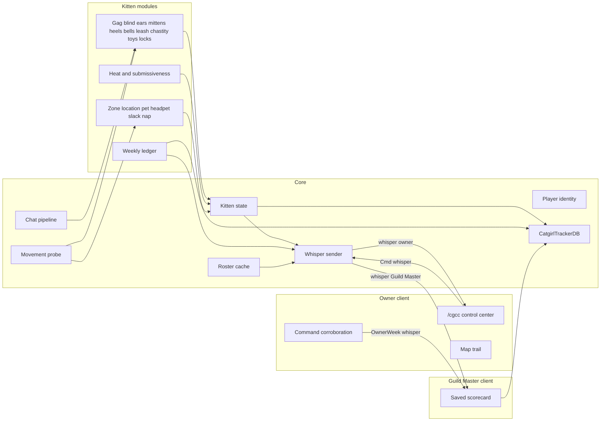
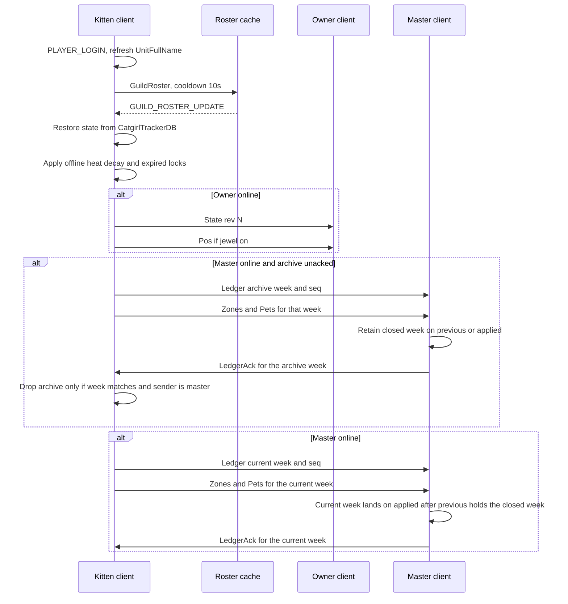
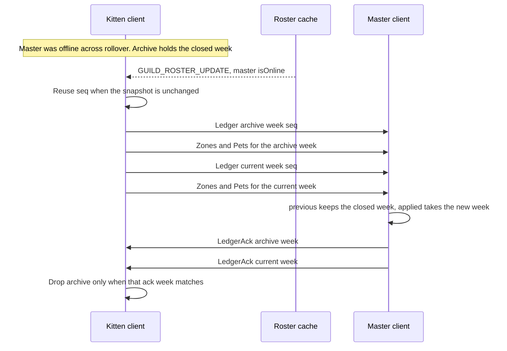
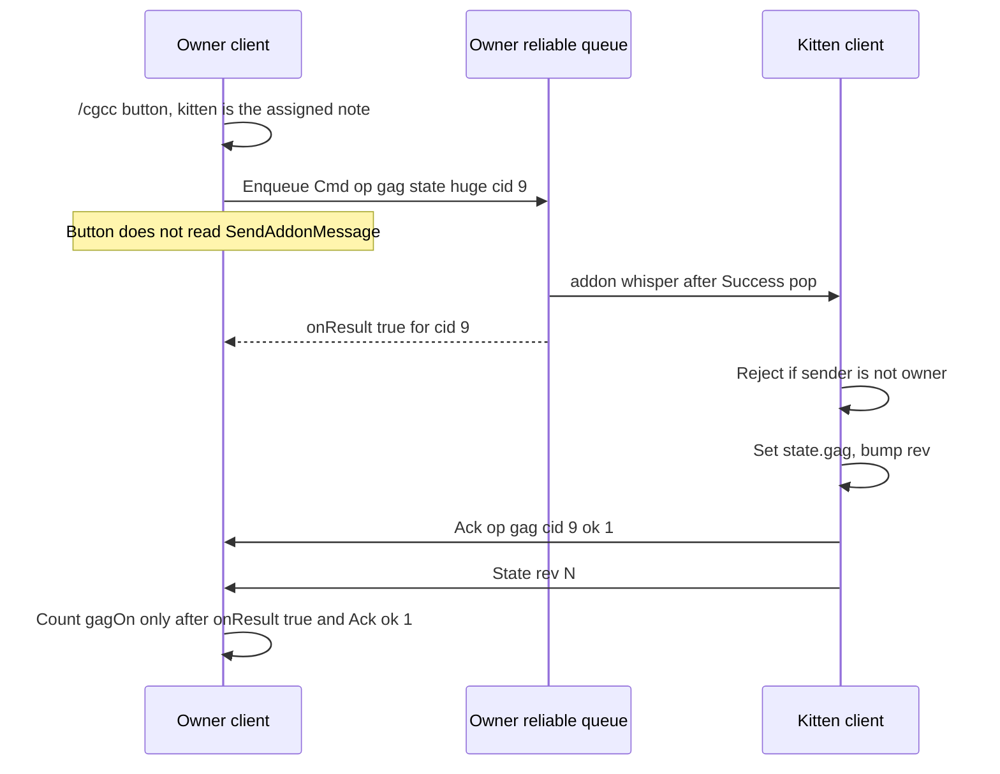

# CatgirlTracker Forever — Clean Rewrite Design

| Field | Value |
| --- | --- |
| Author | (placeholder) |
| Date | 2026-11-07 |
| Revised | 2026-11-08 |
| Status | Draft |
| Target client | WoW Forever (Camelot), Mainline UI family, Midnight 12.1.5 APIs |
| Interface | `16001` |
| New addon folder | `CatgirlTracker_Forever` |
| TOC | `CatgirlTracker_Forever/CatgirlTracker_Forever.toc` |
| SavedVariables | `CatgirlTrackerDB` (account-wide, one table) |
| Addon prefix | `CatgirlTracker` (14 characters; 16 is the cap) |
| Replaces | Nothing in place. Classic `CatgirlTracker/` stays untouched |

This is a clean reimplementation. No patch series against the 37 classic Lua files. Textures and sounds are copied, not shared at runtime, because the Interface path includes the addon folder name.

## Overview

CatgirlTracker is a guild roleplay addon. A kitten's client applies restraints, toys, heat, naps, and inn slacking, and an owner drives that kitten from `/cgcc`. A guild master collects a weekly scorecard so an out-of-game script can post Discord rewards. The classic addon stores every event forever and walks those logs every 1.2 seconds to whisper them. That design is what Forever must not repeat.

The rewrite keeps the gameplay and throws away the retention. One runtime owns the player name, the guild roster, outgoing chat, and addon whispers. Kitten state is a struct, not a backward scan of a log. The owner receives a live snapshot of the one kitten whose note names them. The Guild Master is one character. Every kitten sends that character the weekly counters, including headpets, inn slacking, and naps. The Guild Master client writes those counters into SavedVariables and does not draw them. There is no scorecard window and no copy box. A companion program, written later, reads the file while the game is closed, posts to Discord, and deletes a week only after Discord has accepted it. Week ids use each client's local machine clock. The Guild Master does not stay online: the guild logs that character in at reward time, before a closed week rolls off, and `settings.masterName` defaults to empty. An unacked closed week is sent before the new week and kept on a `previous` row. The first two-client slice ships picture popups, the binds strip, and the advertise window (advertise default off). `Cmd, op:group` leaves a current party with `LeaveParty` and then invites the owner. A `Cmd` is the only trigger. After it is accepted, the same visible roleplay whispers as today are still sent. There is no guild-chat transcript, no `GUILD` addon channel, no HTTP, and no Discord client inside the addon.

Classic clients and Forever clients do not share a realm. The wire format is a clean break. Old `BehaviorLog, ...` strings are not accepted and not emitted.

Forever character names are `First Surname`. `First-Surname` is the same character. The second return of `UnitName` and `UnitFullName` is the surname, not a realm. Do not strip at `-`, do not use `Ambiguate(..., "short")` to identify a player, and do not append `GetRealmName`. `owner=` keeps the first two words, so `owner=Anna Brightvale` and `owner=Anna-Brightvale` match, and `Anna` does not. Stored names use a space. Whispers, invites, and `/target` use `First-Surname`. Sentences below that say `Name-Realm` or `match("^[^%-]+")` are the original plan and do not apply.

## Background & Motivation

### What the classic addon actually does

`CatgirlTracker/CatgirlTracker.toc` declares `## Interface: 20505, 50502, 110207, 120000` and eight SavedVariables: `CatgirlGuildDB`, `CatgirlZoneDB`, `CatgirlPetDB`, `CatgirlEmoteDB`, `CatgirlBehaviorDB`, `CatgirlLocationDB`, `CatgirlSettingsDB`, `CatgirlHeatDB`. Forever's beta interface is **16001**. A TOC that does not list 16001 does not load. `_Classic.toc` does not load on Forever. The game type is Camelot (`WOW_PROJECT_CAMELOT` is 18 on current beta builds). Forever ships the retail binary and the Midnight secret-value rules.

Thirty-seven Lua files, 16,379 lines, each usually its own frame, its own `UnitName("player")`, and its own roster walk. `NyaChat.lua` exists on disk and is not in the TOC, so it never loads.

### Why that design fails

**No shared runtime, and four files crash before login.** `RequestGuildRoster` and `owner=` parsing are copied through the feature files (`gag.lua`, `ExactLocationTracker.lua`, `SendData.lua`, `kitenSubmissivnesTracker.lua`, `PawMittens.lua`, `LockingKittenHeels.lua`, `chastity.lua`, `toys.lua`, `Discipline.lua`, `MaidTaskSceduler.lua`, `MaidTaskReciver.lua`, `KittenPictureShow.lua`, `KittenHeat.lua`, `Leash.lua`, `CatGirlControlCenter.lua`, `ReciveData.lua`, and others). Four call sites use `:match` or `:lower` on a file-scope `UnitName("player")`:

- `Leash.lua` line 2: `UnitName("player"):match("^[^%-]+")`
- `CatGirlControlCenter.lua` line 3: the same
- `KittenMapShow.lua` line 1: the same
- `ReciveData.lua` line 14: `local myShortName = myName:match("^[^%-]+")` where `myName` is `UnitName("player")` from line 13, then line 42 calls `myShortName:lower()` at file scope

`UnitName("player")` is nil until the unit exists. Those files error on load, before `PLAYER_LOGIN`. `NyaChat.lua` lines 6–9 and `catgirladvertise.lua` lines 10–13 guard the name. They are not crash sites.

**The officer-note read is off by one, so the public-note fallback the comments describe does not run.** `GetGuildRosterInfo` returns `name, rank, rankIndex, level, class, zone, publicNote, officerNote, isOnline`. The common unpack is:

```lua
local name, _, _, _, _, _, _, note, officerNote = GetGuildRosterInfo(i)
```

That binds `note` to the officer note (return 8) and `officerNote` to `isOnline` (return 9). `gag.lua` lines 95–104 then prefer `officerNote` only when it is a non-empty string, which `isOnline` is not, and fall through to `note`. The public note (return 7) is never read. `CatGirlControlCenter.lua` `GetAssignedCatgirl` (lines 18–29) reads only return 8 and only the officer note, with a case-sensitive short-name compare. `BellCollar.lua` lines 25–32, `Blindfold.lua` lines 15–22, and `Leash.lua` lines 265–281 also read return 8 only. `KittenEars.lua` lines 88–99 apply earmuffs from any whisper, with no owner check at all.

**Chat speech is a global monkeypatch, stacked.** `gag.lua` lines 327–395 replace `SendChatMessage` and `C_ChatInfo.SendChatMessage`. `NyaChat.lua` wraps `SendChatMessage` again, but it is not in the TOC. Load order would decide which wrapper wins if it were listed. Full-block gag drops SAY / YELL / PARTY / RAID / INSTANCE_CHAT / GUILD / OFFICER. It does not drop WHISPER, which is how command replies stay readable.

**Logs are append-only, and the sender scans all of them.** `SendData.lua` line 3 hardcodes `masterName = "synckitten"`. Line 6 sets `RESYNC_PAUSE_SECONDS = 60`. The ticker at line 932 walks pet, zone, behavior, bind, emote, guild, and location logs every 1.2 seconds to find the next unsynced row. `RecordThrottle` (lines 166–170) pauses the whole queue for 60 seconds on `Enum.SendAddonMessageResult.AddonMessageThrottle` or `TooManyAddonMessages`. `CleanUp.lua` is a manual "delete the oldest N rows" window. `ReciveData.lua` appends every received row again on the master (`parseAndStoreSlaveData`, lines 465–618) and, if the local character is `synckitten`, broadcasts the literal addon payload `master` on the **GUILD** channel every 60 seconds (lines 423–437).

**Location volume.** `ExactLocationTracker.lua` lines 11–12: a point every 20 seconds, kept for `31 * 24 * 60 * 60` seconds. That is 4,320 points per day and about 134,000 points per 31 days per kitten. The master stores a second copy (`ReciveData.lua` lines 542–561). The owner map only needs the latest point. `KittenMapShow.lua` can also walk a full day of history (`GetSelectedDayRange`, up to 30 days back).

**State is recovered by scanning.** `CatGirlControlCenter.lua` `FindLastEvent` (lines 65–72) walks the behavior log backwards. `kitenSubmissivnesTracker.lua`, `chastity.lua`, `KittenHeat.lua`, `toys.lua`, and `KittenPictureShow.lua` do the same. `KittenPictureShow.lua` `ProcessLogUpdates` (lines 504–534) diffs the log length every second to decide which icon to pop.

**Jingles are already not synced, but they are still rows.** `SendData.lua` lines 1118–1120 mark `BellJingle` and `TailBellJingle` synced without sending. Nothing in the tree inserts a `BellJingle` behavior row today. The tail bell does not use the log: `BellTail.lua` `SendTailBellJingle` (lines 93–111) sends a `TailBellJingle` addon message on the **GUILD** channel. The collar bell only plays a local file (`BellCollar.lua` lines 36–41) on a 120–300 second timer (line 48). The tail bell timer is `math.random(5, 6)` seconds (line 129), which contradicts its own "2 to 5 minutes" product intent and the collar. Paw squeaks and creaks also go out on GUILD (`PawMittens.lua` lines 182–207).

**Heat and submissiveness sample themselves into the log.** `KittenHeatConfig.lua` lines 13–15: update every 0.25 seconds, sync interval 10 seconds, minimum delta 1. `KittenHeat.lua` `MaybeSyncHeat` (lines 387–404) appends a `KittenHeat` row when the interval has elapsed **or** the value has moved by at least 1. `kitenSubmissivnesTracker.lua` lines 386–400 append a `KittenSubmissiveness` row whenever the integer changes, on a 2-second ticker. The owner UI reads only the latest value (`CatGirlControlCenter.lua` lines 532–544).

**Guild chat is logged.** `GuildTracker.lua` `logMessage` (lines 9–11) returns early when the lowercased text matches the pattern `WorldBuff` or the pattern `questie`. The message is lowercased first, and Lua patterns are case-sensitive, so the `WorldBuff` pattern does not match a lowercased string. The `questie` pattern does. Lines 22–33 then append the remaining `CHAT_MSG_GUILD` lines, plus online/offline/join system lines, and `SendData.lua` whispers those rows. That pipe is out of this product. The early return is why "every guild line" is one filter short of the function as written.

**Forever API facts that classic code ignores.**

- `GetUnitSpeed` is documented `SecretWhenUnitStatsRestricted`. Comparing a secret to a number raises a Lua error. `LockingKittenHeels.lua` lines 658–668 do `speed > allowedSpeed` and `speed > 0`.
- `UnitPosition` is `#noinstance` (nil in dungeons, raids, battlegrounds, arenas) and is the kind of value Forever treats as restricted. `NapTracker.lua` lines 76–109 subtract coordinates every frame while a nap is active.
- `C_Map.GetPlayerMapPosition` is also `#noinstance`. It remains the right outdoor map API. It is not a yards-speed API.
- `C_ChatInfo.SendAddonMessage` takes a prefix of at most 16 characters and a payload of at most 255 bytes. The published result enum is `Success` (0), `InvalidPrefix` (1), `InvalidMessage` (2), `AddonMessageThrottle` (3), `InvalidChatType` (4), `NotInGroup` (5), `TargetRequired` (6), `InvalidChannel` (7), `ChannelThrottle` (8), `GeneralError` (9), `NotInGuild` (10), `AddOnMessageLockdown` (11), `TargetOffline` (12). There is no enumerator named `NotAllowed`. The result means the client enqueued the message, not that the server delivered it. Since patch 10.2.7 the C API wrapper can shift that enum to a later return, so read it with `select(-1, C_ChatInfo.SendAddonMessage(...))`. Patch 10.2.7 also exempts whispers outside instanced content from the per-prefix allowance (10 messages, regain 1 per second). A global disconnect throttle can still fire, and instanced content is not exempt. Patch 12.1.7 (PTR notes) says trial accounts, including Veteran, can no longer send addon messages. That is a prose restriction, not a named result. Some subscribed accounts have reported `Success` followed by a silent drop while `AreOutgoingAddonChatMessagesRestricted()` is true and `IsTrialAccount()` is false. Confirm that on a Forever client before the net PR sends. Inside a communication-restricted map, chat text and addon messaging are locked down (`SecretInChatMessagingLockdown`, `AddOnMessageLockdown`). The addon cannot open sockets or HTTP. `SendChatMessage` has been deprecated since 11.2.0; `C_ChatInfo.SendChatMessage` is the function to call. SAY, YELL, and CHANNEL still need a hardware event outdoors. A claim that Forever beta 4 added that same hardware-event rule for the EMOTE chat type outdoors was not verified against Blizzard's beta notes. Treat it as unverified. `DoEmote("DROOL")` stays best-effort either way.
- `require` was renamed to `import` on Forever beta 4. This addon does not need either. The TOC loads the files.
- There is still no supported clipboard write. Copy means an edit box plus Ctrl+C.

## Goals & Non-Goals

### Goals

- Load on Forever with `## Interface: 16001` from a new folder, beside the classic copy, without loading both.
- Keep every gameplay feature listed below. Cut retention, not features.
- One namespace, one roster cache, one chat pipeline, one addon-message sender.
- Owner live stream for the assigned kitten only, by addon whisper.
- Guild Master scorecard with absolute weekly counters, saved and not shown. Headpets, inn slacking, and naps are on that scorecard. They do not get a second sync system. The companion program deletes a posted week. The addon does not.
- Optional guild flavor lines, default **on**, local announcements only. They are not a data pipe.
- SavedVariables small enough to quote an upper bound. Empty on first Forever login. No migration.
- A message grammar of at most 255 bytes per part. The sender splits longer bodies. A retry of the same snapshot is safe.
- Week ids from each client's local machine clock. The master character is logged in at reward time, with an empty `settings.masterName` default and no hardcoded name.
- Picture popups, the binds strip, and the advertise window in the first two-client slice. Advertise stays default off.
- `Cmd, op:group` leaves an existing party with `C_PartyInfo.LeaveParty` and then invites the owner.

### Non-Goals

- Editing classic files, or reading classic SavedVariables. Forever uses a different WTF directory.
- Logging or forwarding `CHAT_MSG_GUILD`. The `GuildTracker.lua` transcript is not ported.
- Sending on the GUILD addon channel, including the `master` beacon in `ReciveData.lua`.
- A Guild Master window, a copy box, or any in-game view of the scorecard. The master client only receives and saves.
- Building the Discord companion. The saved table is the handoff. The program itself is later work.
- Byte compatibility with `BehaviorLog`, `ZoneLog`, `GuildLog`, `EmoteLog`, `LocationLog`, `PetLog`, `BindTimer`, `cctoy`, `ccdisc`, or `TailBellJingle`.
- An anti-cheat. Scores are the kitten's report, plus owner corroboration of commands whose send the queue accepted and whose kitten `Ack` came back `ok:1`.
- HTTP, sockets, or a Discord bot inside the addon.
- An ever-growing history, a cleanup window, or a 60-second freeze of a historical queue.
- Per-jingle ledger rows.
- Layer detection. Forever beta 5 obfuscates creature, pet, vehicle, and object GUID server and spawn ids so addons cannot compare them to find a layer. `KittyLayerGroup.lua` reads `_G.NWB_CurrentLayer`. That is classic tech.
- A confirm frame that asks the kitten to leave the party before a force-group. Classic showed that frame (`KittyLayerGroup.lua` lines 494–500). Forever calls `LeaveParty` and then invites the owner.
- A UTC week id, or a master character that stays online.

## Proposed Design

### Component architecture



Every file is a TOC entry under `CatgirlTracker_Forever/`. The first file creates the namespace. Later files only hang tables off it. Nothing at file scope calls `UnitName`, `GetGuildRosterInfo`, `C_GuildInfo.GuildRoster`, `SendChatMessage`, or `C_ChatInfo.SendAddonMessage`. The ledger edge on that diagram is two whispers when an archive is unacked: the closed week, then the current week. `previous` on the master is what keeps the closed week after the new week arrives.

```lua
local ADDON_NAME, CCT = ...
CCT.VERSION = "2.0.0"
CCT.PREFIX = "CatgirlTracker"
CCT.MEDIA = "Interface\\AddOns\\CatgirlTracker_Forever\\"
```

`CCT.MEDIA` is required. Classic paths are `Interface\\AddOns\\CatgirlTracker\\...`. A renamed folder does not see those paths. Copy `CatgirlTracker/Textures` and `CatgirlTracker/sounds` into `CatgirlTracker_Forever/Textures` and `CatgirlTracker_Forever/Sounds`. The code constant uses `Sounds` with that capitalisation. Classic code mixes `Sounds` (`ReciveData.lua` line 19) and `sounds` (the directory on disk). Windows hides that. A case-sensitive client does not.

`## SavedVariables: CatgirlTrackerDB` is account-wide so one master character's file holds every kitten the account has seen, and so an external script has one file to open: `WTF/Account/<Account>/SavedVariables/CatgirlTracker_Forever.lua`. It is flushed on logout and `/reload`, not continuously. Do not also declare `SavedVariablesPerCharacter`. Per-character data lives under `db.chars[shortName]`.

### Player identity

`CCT.Player.Refresh()` runs on `PLAYER_LOGIN`, and again on `PLAYER_ENTERING_WORLD` and `UNIT_NAME_UPDATE` when the unit is `"player"`.

- `name`, `realm` from `UnitFullName("player")` when that returns a name, otherwise `UnitName("player")`.
- `short` is the name with no realm suffix.
- `guid` from `UnitGUID("player")`, stored only as an identity key. Do not parse server or spawn ids out of any GUID. Forever beta 5 obfuscates those fields on creatures, pets, vehicles, and objects, and the player GUID is not a layer key either.

Until the first successful refresh, modules no-op. They do not cache a nil name into the database.

### Guild roster cache

`CCT.Roster` is the only caller of `C_GuildInfo.GuildRoster` (the current request API; `GuildRoster()` stays as a fallback only if `C_GuildInfo` is absent, which it is not on this client). Cooldown is 10 seconds, the same constant as `SendData.lua` `ROSTER_REQUEST_COOLDOWN`. `GUILD_ROSTER_UPDATE` rebuilds the cache from `GetNumGuildMembers` and `GetGuildRosterInfo`. Readers never request the roster themselves.

Unpack with the real indexes:

```lua
local name, _, _, _, _, _, publicNote, officerNote, isOnline = GetGuildRosterInfo(i)
```

The officer-note return is an empty string unless this character may view officer notes. Kittens usually cannot. Prefer the officer note only when `GetGuildRosterInfo` actually handed this client a non-empty string. Otherwise use the public note when that string is non-empty. Otherwise the owner is nil. The public-note fallback helps only when `owner=` is actually written on the public note. The kitten has to be able to see the note it obeys. If `owner=` lives only in the officer note and this character cannot view officer notes, `GetOwnerShort()` stays nil, commands are dropped, and no live stream is sent. Put `owner=` on the public note, or grant that kitten view-officer-notes.

Pattern `owner=([^,%s]+)`. Run the captured token through the same short-name split the sender path uses: `match("^[^%-]+")`, which is what `CatGirlControlCenter.lua` line 24 already does. Then compare short names case-insensitively. A note of `owner=Name-Realm` matches `Player.short`. Trim does not remove a realm suffix; the split does. The first `owner=` token wins. A comma ends the token, which matches every current call site.

The master's `OwnerWeek` check uses this same parse against the current roster. The master character needs view-officer-notes when corroboration is checked against the officer note. If the roster row has no visible note, store the ledger and omit owner corroboration.

Public API:

| Function | Returns |
| --- | --- |
| `CCT.Roster.GetSelf()` | `{ fullName, short, online, publicNote, officerNote, ownerShort }` for the player |
| `CCT.Roster.GetMember(short)` | the same shape, or nil |
| `CCT.Roster.GetOwnerShort()` | owner of this character, or nil |
| `CCT.Roster.GetAssignedKitten()` | the one guild member whose parsed owner short-name equals the local player. If several match, the first roster index wins and a debug line names the collision |
| `CCT.Roster.IsMasterOnline()` | true when `settings.masterName` matches a roster member with `isOnline == true` |

`IsInGuild()` false clears the cache. A stale cache is kept for the 10 second cooldown but `online` is not invented: unknown online stays nil, and the sender treats nil as offline.

### Kitten state

One table, `CCT.State`, mirrored into `db.chars[short].state`. Modules mutate it through setters. Setters update `state.rev` (monotonic integer), stamp `state.updatedAt` with `time()`, notify the owner sender, and notify the ledger if a weekly counter changed. Nobody calls `FindLastEvent`.

#### State schema

| Field | Type | Values | Worn-minute / bind rule |
| --- | --- | --- | --- |
| `gag` | string | `none`, `small`, `huge`, `full`, `nyamask`, `inflatable` | Any value except `none` counts as one bind. `gagMin` accrues on the minute clock below |
| `gagStage` | int 0–5 | 0 unless `gag == inflatable`, then 1–5 | Not an extra bind |
| `blind` | string | `none`, `light`, `mask`, `full` | `light`, `mask`, `full` count. Classic logged `remove`; the new schema uses `none` |
| `ears` | string | `none`, `kitten`, `heavy` | `kitten` and `heavy` count. Classic strings were `KittenEarmuffs` and `HeavyEarmuffs` |
| `mittens` | string | `none`, `locked`, `heavy`, `squeaking` | All three worn values count, including the classic typo acceptance: a restored classic `squeking` is read as `squeaking` once, if it ever appears. New writes never use `squeking` |
| `heels` | string | `none`, `maid`, `high`, `ballet` | Those three count. `heelsMin` accrues on the minute clock below, independent of which style is worn |
| `heelLevel` | `{maid, high, ballet}` | int 1–20, default 1 | Used by speed cap and by submissiveness. Not reset weekly |
| `bell` | bool | collar | true counts |
| `tail` | bool | tail bell | true counts |
| `jewel` | bool | tracking jewel | true counts. While true, position samples run |
| `belt` | bool | chastity belt | true counts |
| `beltMode` | string | `allow`, `deny` | Forced back to `allow` when `belt` becomes false |
| `bra` | bool | chastity bra | true counts |
| `leash` | bool | | true counts |
| `leashOwner` | string or nil | short name | |
| `toys[id]` | `{applied, vibe, inflate}` | vibe 0–5, inflate 0–5 | `applied == true` counts as one bind per toy id. Stage is not an extra bind |
| `locks[bind]` | `{unlockAt, minutes}` or nil | see bind keys | |
| `heat` | number 0–100 | | Owner sees the current number. Master stores the week's peak only |
| `sub` | int 0–100 | formula below | Latest value, not a weekly sum |
| `zone` | string | `GetRealZoneText` or `GetZoneText` | |
| `instanceType` | string | second return of `IsInInstance`, or `none` | |
| `pos` | `{mapID, x, y, instanceID, t}` or nil | map fractions, 4 decimal places | Latest only in the snapshot. Trail is separate |
| `petSummoned` | bool | true while one of the seven cat-carrier companions is summoned | Not a scorecard field. A hunter pet does not set it |
| `week` | string | `YYYY-Www` | |
| `counters` | table | weekly absolutes | Reset on week change |
| `rev` | int | | Bumped on every mutation |
| `lastUnixUpdate` | int | unix time | Persisted. Heat's offline decay reads it. Not optional |

Toy ids, copied from `toys.lua` lines 5–106, and the butplug group rule from `SetToyApplied` (lines 322–327): applying one of `inflatable_butplug`, `small_butplug`, `large_butplug`, `taill_butplug` clears the other three. `restrict = belt` toys refuse apply and remove while the belt is on. `restrict = bra` toys refuse apply and remove while the bra is on. The restricted set is the same list: belt blocks `dildo`, `inflatable_butplug`, `inflatable_dildo`, `small_butplug`, `large_butplug`, `taill_butplug`, `vibes_pussy`, `pussy_lipps_piercings`; bra blocks `vibes_nipples` and `nipple_piercings`. `vibes_ears` and `ear_piercings` have no restrict flag.

Bind keys, the same set `KittenLockTracker.lua` and `SendData.lua` `BIND_KEYS` already use, plus none others: `gag`, `earmuffs`, `blindfold`, `mittens`, `heels`, `bell`, `tailbell`, `chastitybelt`, `chastitybra`. Each key clears one state field:

| Lock key | Setter on expiry |
| --- | --- |
| `gag` | `gag = none`, `gagStage = 0` |
| `earmuffs` | `ears = none` |
| `blindfold` | `blind = none` |
| `mittens` | `mittens = none` |
| `heels` | `heels = none` |
| `bell` | `bell = false` |
| `tailbell` | `tail = false` |
| `chastitybelt` | `belt = false`, `beltMode = allow` |
| `chastitybra` | `bra = false` |

A lock is `{ unlockAt = time() + minutes * 60, minutes = minutes }`. A 1-second ticker fires the same removals `KittenLockTracker.lua` `bindUnlockedMessage` fires today. On expiry the setter clears the lock and the worn state together. Offline expiry: on login, if `unlockAt <= time()`, fire the removal once. That login pass does not add worn minutes for the gap while the client was logged out.

#### Minute clock

`playMin`, `gagMin`, `heelsMin`, and zone minutes share one stamp, `minuteStamp`. One function is the only writer. The 60-second ticker and the zone-change path both call it. Neither adds 1 on its own.

```text
whole = floor((now - minuteStamp) / 60)
add whole to playMin
add whole to gagMin when gag ~= none
add whole to heelsMin when heels ~= none
add whole to the zone argument (the current zone for the ticker, the zone being left for a zone change)
minuteStamp = now
```

A partial minute stays truncated, because `whole` is a floor. A ticker that fires late, 180 seconds after the stamp, adds 3, not 1. A zone change at 100 seconds after a login stamp of 0 adds 1 and sets the stamp to 100. The ticker's original period then fires at 120 seconds and computes `floor(20 / 60) = 0`, so it does not book a second minute. Login and `/reload` set `minuteStamp = time()` and add nothing. The offline gap is not worn time and not play time.

`playMin` is whole minutes this client spent in the world during the week. The classic addon has no such counter. It exists because the locked payload includes it. `gagMin` is whole minutes of that same clock with any non-`none` gag. `heelsMin` is whole minutes of that same clock with any heel style worn.

#### What a reload clears

Nap window, in-progress nap, slack session (`restingStart`, the counting latch, the sleep-suppression latch), and partial heel progress (`skillProgress`, the 30-boolean window, the walk accumulator) reset on reload. Classic `LockingKittenHeels.lua` already zeros in-memory `skillProgress` on load (around line 130) and keeps levels. Heel levels stay in `state.heelLevel`. Heat, worn restraints, locks, weekly counters, and `lastUnixUpdate` stay.

#### Submissiveness, preserved

`kitenSubmissivnesTracker.lua` `CalculateSubmissiveness` (lines 269–287) and `GetAppliedBindCount` (lines 146–227). The product of three integers is an integer, so `math.floor(value + 0.5)` and a floor are the same result. Keep the expression anyway.

```text
levelSum = heelLevel.maid + heelLevel.high + heelLevel.ballet
           -- each defaults to 1, each is at least 1
deniedToday = denials since local midnight
              -- NOT the lifetime deny count
              -- NOT the weekly scorecard deny counter
orgasmsToday = orgasms since local midnight (date("*t") with hour, min, sec = 0)
diff     = deniedToday - orgasmsToday
diff     = 1 if diff <= 0
binds    = applied bind count
binds    = 1 if binds < 1
sub      = math.floor(clamp(levelSum * diff * binds, 0, 100) + 0.5)
```

Bind count is 1 for each of: gag worn, blind worn, ears worn, mittens worn, heels worn, collar bell, tail bell, jewel, belt, bra, each applied toy, leash. There are 12 toy ids. The four butplug ids are mutually exclusive, so at most one of them is applied. The reachable maximum is 20: 10 worn slots + 9 toys (12 minus the 3 butplugs the exclusion keeps off) + leash. 23 is the sum if all 12 toys could be worn together. That sum is unreachable. The formula clamps at 100, so once `sub` saturates the scorecard tie-break is the kitten's name. The bar is the existing 240×18 status bar, draggable, position stored on the character. It is shown only when this character has an owner. Recompute on state change and on a 2-second ticker, but write the value into `state.sub` only. Do not append a log row. Push to the owner when the integer changes.

Lifetime deny, today's denial timestamps, and today's orgasm timestamps live in `db.chars[short].life`, not in the weekly counters. Weekly `orgasm` and `deny` are a second pair used only on the scorecard. Both pairs increment together when the event happens. The weekly pair resets with the week. The lifetime deny count does not. Denials today and orgasms today are counts of stamps since local midnight, each list capped at 50. The kitten's submissiveness bar shows both today counts and the local time they reset. The owner stats show Denied Today and that same reset time. A new local day sends one state snapshot so the owner counts clear.

#### Heat, preserved

Port `KittenHeat.lua` `RebuildDecayConstants` and `ApplyDecayExact` (lines 204–236) and the config defaults in `KittenHeatConfig.lua` lines 5–15 and 38–191.

- `ratio100to10 = 5`, `totalSeconds = 1200` (20 minutes), `updateInterval = 0.25`.
- `exponent = ln(ratio) / ln(10)`, clamped to `< 0.999`. If ratio `<= 1.01`, use `1.01`.
- `decayK = 100 / (totalSeconds * (1 - exponent))`.
- `totalSeconds` is clamped to at least 60.
- The closed form is the one in `ApplyDecayExact`: for `u = heat/100`, subtract `(decayK/100) * (1-exponent) * dt` from `u^(1-exponent)`, then raise back. Zero if the power term goes non-positive.
- On login, apply decay for the offline gap using `state.lastUnixUpdate`, then set `state.lastUnixUpdate` to now. That matches `KittenHeat.lua` `RefreshHeatFromStorage` (lines 627–635). If the field is nil, skip the gap and set it to now. The 0.25-second ticker writes `state.lastUnixUpdate` in memory on each decay step so logout flushes a fresh stamp. That is the one place offline time changes heat. It does not add worn minutes.

Control heat while a restraint or toy is active uses `KittenHeatConfig.lua` `cfg.controls` (lines 252–268) plus `AddToyControls`. Intervals and amounts stay as written: maid heels +2 / 60s, high +3 / 60s, ballet +4 / 60s, mittens +1 / 90s, gag +1 / 90s, blindfold +1 / 90s, kitten earmuffs +1 / 120s, heavy earmuffs +2 / 120s, each bell +1 / 180s, leash +2 / 60s, and the per-toy base / vibe / inflate rows. The ticker adds `dt` to an elapsed accumulator per active control. It does not scan a log to discover whether a control is active. It reads `CCT.State`.

Submissiveness heat flip (`KittenHeatConfig.lua` lines 38–50): a negative delta whose magnitude is within the highest matching threshold is applied as a positive delta of the same magnitude. Thresholds: 10→1, 20→2, 30→3, 40→5, 50→7, 60→10, 70→11, 80→13, 90→15, 100→20. A delta more negative than the limit stays negative. This is `AddHeatDelta` in `KittenHeat.lua` lines 356–377.

Orgasm, `KittenHeat.lua` `AddHeat` (lines 326–347) and `chastity.lua` `CCT_HandleOrgasmAttempt` (lines 206–219):

- Heat is clamped 0–100.
- Reaching 100 calls the chastity check.
- If `belt` and `beltMode == deny`: full-screen shock overlay for 5 seconds, lifetime deny += 1, weekly `deny` += 1, heat becomes 70, whisper the owner the existing `CHASTITY_DENY_SHOCK` text. Return. Do not play the orgasm flash.
- Otherwise: flash for 0.6 seconds at alpha 0.9, weekly `orgasm` += 1, today's orgasm count += 1, heat becomes 0.
- The configured texture is `Textures/orgasm.toc` (`KittenHeatConfig.lua` line 30). `chastity.lua` line 135 references `Textures/BeltShockDeny.tga`. Neither file is in `CatgirlTracker/Textures` today. The overlay must hide when the texture fails to load. Do not invent art.

Owner heat push: when the displayed integer (`math.floor(heat + 0.5)`) changes by at least 1, and not more often than once per 10 seconds, send the current number. Do not send a sample every tick. The 0.25 second ticker stays local. Master `heatPeak` is the max integer seen this week.

The heat bar matches the current widget: 240×18, color lerp blue → pink → red at the midpoint, draggable unless `bar.locked`.

### Feature behavior to reimplement

Commands arrive as addon whispers. The grammar is below. The kitten applies a command only when the sender's short name equals `CCT.Roster.GetOwnerShort()`. If the roster cache is empty, hold the command for up to 10 seconds and drop it if the owner is still unknown. Ignore everyone else, including the Guild Master. A command is not a scorecard update. A normal chat whisper is never the trigger. Typing the old sentence by hand does nothing.

After `Ack` with `ok:1`, both clients still show the classic roleplay lines. The owner client whispers the button sentence, such as "Your owner has secured a heavy gag in place. You can no longer speak." The kitten whispers the matching `CCT_Messages` reply, such as `GAG_HEAVY`. Both use `CCT.Chat.Send(..., { raw = true })` so gag and Nya do not mangle them. The kitten also keeps the local print and the raid notice from the classic handler. Those lines inform. They are not parsed. Guild flavor lines and other addon sends pass raw as well. A worn gag rewrites only chat the player types.

#### Gag

States: `none`, `small` (classic `LightGag`), `huge` (classic `Gag`), `full` (classic `FullBlock`), `nyamask` (classic `NyaMask`), `inflatable` with stage 1–5 (classic `Inflatable:N`).

Speech types, from `gag.lua` `IsSpeechChatType` (lines 331–342): SAY, YELL, PARTY, PARTY_LEADER, RAID, RAID_LEADER, INSTANCE_CHAT, INSTANCE_CHAT_LEADER, GUILD, OFFICER. Not WHISPER, not CHANNEL, not EMOTE.

Transforms, same functions:

- `full`: drop the message. Local error text only.
- `huge`: pick one token from `mmf~`, `mrrgghh~`, `nnyaa-mmm!`, `mmph!`, `grrrgh~`, `hnnnng~`, and repeat it `math.random(1, 3)` times. `gag.lua` lines 351–353 are `string.rep(token .. " ", math.random(1, 3))`. One token, not a mix of different tokens.
- `small`: `s→sh`, `r→h`, `l→w`, `b→bh`, `t→th`, `c→k`, preserve case, append ` nya~`.
- `nyamask`: sprinkle `~Nya~` on about 30% of words and append a random cute emote after punctuation (`gag.lua` lines 22–40).
- `inflatable`: stage 1 appends ` mmf~` 30% of the time; stage 2 is the small-gag transform; stage 3 replaces about 40% of words with `mmf~` then applies the small-gag transform; stage 4 is the heavy `mff~` garble; stage 5 is three to six `mmmm~ `.

Drool: while inflatable stage `>= 1`, `DoEmote("DROOL")` on a timer of `max(2, 7 - stage)` minutes (`gag.lua` lines 127–133). Outdoors this can fail the hardware-event rule. Ignore the failure. Do not send an EMOTE chat line as a fallback.

Stage changes play `CCT.Sounds.PlayToyInflateDeflate("inflatable_gag", "inflate"|"deflate")` only when the stage actually moves, matching `gag.lua` lines 260–281 and 286–298.

#### Blindfold

`light`: fullscreen frame, black backdrop alpha 0.4, mouse not captured. `mask`: play `Textures/masks/KittenMaskZ1`–`Z7` at 0.3 seconds per frame, or `KittenMaskuwZ1`–`Z9` when `UIParent` width/height `> 2.3` (`Blindfold.lua` lines 50–115). `full`: black backdrop alpha 1 and `EnableMouse(true)`. `none`: hide the frame; if the previous state was `mask`, play the mask frames backward. Removing a mask does not leave the mouse captured.

#### Earmuffs

Incoming filter on SAY, YELL, PARTY, PARTY_LEADER, RAID, RAID_LEADER, GUILD, via `ChatFrame_AddMessageEventFilter`. `kitten` inserts `nya~` / `nyan~` / `*nya*` / `<3 nya` after about half the words. `heavy` replaces every character with `*` or `~`. If `issecretvalue(msg)` is true, return the message untouched. A secret cannot be gsub'd, and instance chat is secret on this client. The filter must not error.

Owner check is new. Classic `KittenEars.lua` does not have one. The rewrite requires it.

#### Paw mittens

`locked` and `heavy` both sabotage action slots 1–12 continuously: every 5 seconds, out of combat, swap one occupied slot for a character macro whose body is `/say` plus `PAW_MITTENS_SAY`, then restore the previous slot on the next tick. `squeaking` does that for a 5-second window every 30 seconds (`SQUEAK_WINDOW_SECONDS`, `SQUEAK_CYCLE_SECONDS`). Both honor `InCombatLockdown` and finish on `PLAYER_REGEN_ENABLED`, as `PawMittens.lua` already does.

Cursor: a 72×72 texture, `Textures/pawmittens.tga` for `locked`, `Textures/heavypawmittens.tga` for `heavy` and for `squeaking` (the current code already uses the heavy texture for the squeaking cursor). Show it only while mittens are worn. Position it from `GetCursorPosition()` / `UIParent:GetEffectiveScale()` on a 0.05 second ticker, not a permanent `OnUpdate`. Classic installs `OnUpdate` for the life of the frame (`PawMittens.lua` lines 276–281) and returns immediately when mittens are off. The rewrite clears the handler when the overlay hides.

`UNIT_SPELLCAST_SUCCEEDED` for `player`: `squeaking` plays a random `Sounds/pawsqueakN.ogg` (2 second cooldown) and sends a proximity whisper. `locked` and `heavy` play a random `Sounds/creak-N.ogg` (2 second cooldown) and sends a proximity whisper. No ledger row. `PlaySoundFile` on this client plays addon Vorbis ogg and does not play a custom wav, so those clips are ogg. While the kitten is leashed, the slot swap pauses: the covered spell is put back before the leash snapshot, and the swap starts again after unleash. Mittens stay allowed during a leash. A failed spell restore does not cover a second slot. Restoring a spell uses the spellbook when the saved action id does not fill the cursor.

#### Locking heels

Types and numbers from `LockingKittenHeels.lua` lines 4–50 and 398–412:

| Type | Base yards/sec | Sound | Failure texture | Heat |
| --- | --- | --- | --- | --- |
| maid | 3.5 | `Sounds/HighHeels3.ogg` every 7.0s while moving | `Textures/heels/maid-heels.tga` | +2 / 60s |
| high | 2.0 | `Sounds/HighHeels8.ogg` every 7.0s while moving | `Textures/heels/high-heels.tga` | +3 / 60s |
| ballet | 1.4 | `Sounds/HighHeels12.ogg` every 7.0s while moving | `Textures/heels/ballet-boots.tga` | +4 / 60s |

`HEELS_SOUND_INTERVALS` is 7.0 for maid, high, and ballet (`LockingKittenHeels.lua` lines 22–26, and `ReciveData.lua` lines 37–41). The interval is not maid-only.

`allowed = base + (level - 1) * 0.05`, level 1–20. The warning ticker stays at 0.1 seconds (`HEELS_WARNING_CHECK`), and only while heels are worn.

Progress is `UpdateSkillProgress` (lines 552–611), not a 30-sample speed window:

- `HEELS_SAMPLE_COUNT` is 12. That ring is the speed average.
- `HEELS_PROGRESS_WINDOW` is 30 booleans, one per 0.1-second tick. A boolean is true only when that tick's average is `>= 0.45 * allowed` (`HEELS_PROGRESS_MIN_RATIO`).
- Moving time accumulates by 0.1 seconds when the current sample says the player is moving. A 5-second chunk (`HEELS_PROGRESS_CHUNK_SECONDS`) counts only when all 30 booleans are true.
- Reset is `avgSpeed > allowed` (`HEELS_PROGRESS_RESET_RATIO` is 1). A single sample crossing is not the reset. Reset clears `skillProgress` and the boolean window.
- `ShowFailureOverlay` sets `expireAt = now + 5` (line 436). `HeelsWarningTick` calls it on every 0.1-second tick while the average is over `allowed` (lines 668–682), so the overlay lasts the whole overspeed stretch plus 5 seconds after the average drops. It is not 5 seconds measured from the first crossing.
- While the average is over, one guild/group fail line fires if flavor is on (`heelsFailActive` latches until the average drops).
- Level time required is `180 + level * 60` seconds of counted chunks (`GetLevelRequirement`). At level-up, one guild flavor line (`HEELS_PROGRESS`).

Partial progress resets on reload. Levels do not. See "What a reload clears".

Forever-safe movement, used by heels, bells, and naps. `issecretvalue` is the first use of each raw return. A secret must not be compared, boolean-tested, or passed through `or`.

```lua
function CCT.Move.Sample()
    if GetUnitSpeed then
        local speed = GetUnitSpeed("player")
        if issecretvalue(speed) then
            return { kind = "hidden" }
        end
        if type(speed) == "number" then
            return { kind = "speed", yards = speed, moving = speed > 0 }
        end
    end
    if IsPlayerMoving then
        local moving = IsPlayerMoving()
        if issecretvalue(moving) then
            return { kind = "hidden" }
        end
        if type(moving) == "boolean" then
            return { kind = "bool", moving = moving }
        end
    end
    return { kind = "hidden" }
end
```

`GetUnitSpeed` is `SecretWhenUnitStatsRestricted`. The current speed is the first return, in yards per second. Classic `LockingKittenHeels.lua` lines 658–668 do `GetUnitSpeed("player") or 0` and then compare. Do not port that.

Rules:

- `hidden`: do not compare to `allowed`, do not fail, do not advance skill, do not Lua-error. A hidden sample does not start or stop the heel sound by itself.
- `bool`: do not compare to `allowed`, do not fail, do not advance skill. It does start and stop the heel sound loop and the proximity ping from `moving`.
- `speed`: keep the fail and progress behavior above. The average and the moving-time accumulator both use this number. Do not write `speed or 0` before the secret check.
- Do not call `UnitPosition`. It is `#noinstance`. Map position is not a yards speed. Do not invent a zone-width conversion to fake one.

The PR1 self-check passes a value that errors if it is compared or boolean-tested. The first operation on that value is `issecretvalue`, and the result is `{ kind = "hidden" }`. A helper that evaluates `speed ~= nil` before `issecretvalue` fails the self-check.

Heel loop proximity (`HeelsLoop Start|Stop|Ping` today) becomes a `Prox` whisper to the owner, at most once per second while moving, plus start and stop. The kitten plays the step sound only while walking, and stops it when walking stops. The owner plays the same loop only when the map distance is `<= 0.005` (`HEELS_STEP_CLOSE_RANGE` in `ReciveData.lua`), at full volume. There is no distance fade. `PlaySoundFile` has no volume argument, and this design does not add quieter file copies. Past `0.005` the owner hears nothing. Unlike discipline, the classic heel check does **not** treat "same instance, no coordinates" as close (`IsHeelsLoopClose`, lines 333–341). Keep that stricter check. Range is in map fractions, not yards. A `Prox` stop stops the owner and every party member who is playing the loop.

`UpdateWalkModeForHeels` in the classic file is empty. Do not add a forced walk toggle.

#### Bells

Both bells use the same walk rule as the heels. Collar uses `Sounds/Bell.ogg`. Tail uses `Sounds/sbell4seconds.ogg`. A jingle may start only when `CCT.Move.Sample()` says the kitten is walking. The collar waits `math.random(120, 300)` seconds. The tail waits `math.random(5, 6)` seconds, which is the interval that makes the tail audible while walking. A non-secret sample with `moving == false` does not start a jingle, stops a jingle that is already playing on the kitten, and sends `Prox` stop so the owner and party members stop too. A `hidden` sample does not start a jingle and does not stop one. Do not call `IsPlayerMoving` and then compare it before `issecretvalue`. Classic `BellCollar.lua` lines 36–41 played only on the kitten, even while standing still. Forever sends the collar jingle to the owner as well.

Both jingles are a proximity effect for the owner and a sound token for party members. They are not a GUILD broadcast and not a ledger row. The owner whisper carries `map`, `x`, `y`, and `inst`. The owner plays either bell at full volume when map distance `<= 0.02`, or, if coordinates are missing, when instance ids match and are non-nil (`ReciveData.lua` `IsTailBellClose`, threshold `TAIL_BELL_CLOSE_RANGE = 0.02`). There is no distance fade. Past that range the owner hears nothing. A reminder line at the top of the screen stays while the bell is worn.

Nearby clients who are not the owner do not receive coordinates. A GUILD addon message is forbidden, and whispering every guild member blows the throttle budget. If the kitten is in a party, one additional `PARTY` addon message carries a sound token only: `kind` and `snd`, no `map`, no `x`, no `y`, no `inst`. A party member who has the addon plays that token at full volume. A player without the addon hears nothing, because this is not a world sound. Party members are not distance-checked. `RAID` is not used. `INSTANCE_CHAT` is not used. One token per jingle, not one whisper per member. The same split applies to mitten and heel `Prox` messages: the owner whisper keeps coordinates, the party message is a sound token, a raid gets neither the token nor the coordinates. The owner still receives the whisper while raiding. A stop token stops the party playback as well.

#### Leash

`leash` from the owner, while not already leashed: save action slots, write a character macro `/target <owner>\n/follow`, show a fullscreen `SecureActionButtonTemplate` that clicks that macro. `unleash` only from the character who applied it: secure button runs `/stopfollow`, then restore slots. `InCombatLockdown` defers attribute changes to `PLAYER_REGEN_ENABLED` (`Leash.lua` lines 194–199). The button text stays "Press 1 follow your Master nya~" on apply and "Click to stop following nya~" on remove. Log the transition in state, not a growing event list. The whisper replies stay `LEASH_APPLY` / `LEASH_REMOVE`.

Secure templates and macro edits stay out of combat. The rewrite does not click through protected frames from insecure code.

#### Chastity

Belt and bra booleans, belt mode `allow` or `deny`. Mode commands are ignored when the belt is off. Removing the belt forces `allow`. Session start does not append a log row. The deny path is the heat path above. Text keys stay in the messages table: `CHASTITY_BELT_APPLY`, `CHASTITY_BELT_REMOVE`, `CHASTITY_BELT_DENY`, `CHASTITY_BELT_ALLOW`, `CHASTITY_BRA_APPLY`, `CHASTITY_BRA_REMOVE`, `CHASTITY_DENY_SHOCK`.

#### Toys and discipline

Owner sends `Cmd, op:toy` and `Cmd, op:disc`. The kitten checks the owner, then the belt/bra restrict flags, then mutates state. Vibe and inflate are stages on an applied toy. Shock is instant heat from `cfg.toys[id].shock` (`KittenHeatConfig.lua`: `-5, -10, -15` at strengths 1–3) via `CCT.AddHeatDelta`, plus the sound engine. Removing a toy zeroes vibe and inflate.

Discipline actions, parts, max strength, and restrict flags are the tables in `Discipline.lua` lines 6–108. Heat per strength is `cfg.discipline` (lines 180–191 of `KittenHeatConfig.lua`). The owner UI still refuses to send when the latest kitten position is farther than `0.02` map-fraction (`DISCIPLINE_CLOSE_RANGE` in `CatGirlControlCenter.lua` line 1084) unless the instance ids match and coordinates are missing, which is `IsOwnerNearKitten` (lines 1136–1158).

`disc` carries `map`, `x`, `y`, and `inst` from the owner's own client at send time: `C_Map.GetBestMapForUnit("player")` and `C_Map.GetPlayerMapPosition("player")`, plus `instanceID`. Those are not the kitten's last `Pos`. The kitten repeats the 0.02 check against that owner position. If the kitten is too far, the reply is one `Ack` with `op:disc`, `ok:0`, `reason:toofar`. It is not also a `Prox`. The owner shows `DISCIPLINE_TOO_FAR` from that ack. A warn is not a ledger row. An `ok:0` ack does not increment the owner's `disc` count.

Sounds stay in the port of `soundengine-Toys-Discipline.lua`: local `PlaySoundFile`, and a whisper to the owner for discipline hits and for vibe loop start, stop, and ping. Vibe ping carries map coordinates and uses the same 0.02 owner-distance check as paws. Ping interval stays the constant already in that file (`VIBE_PING_INTERVAL`). Do not put shocks, spanks, or vibe pings on the master ledger. The weekly headpet counters are separate and come only from emote text.

#### Maid tasks

Port the protocol in `MaidTaskSceduler.lua` `SendMaidTasks` (lines 195–251) onto the reliable queue. The owner edits the list in `/cgcc`. Every 60 seconds, and on demand, if the assigned kitten is online, the owner whispers:

- one header with update id, owner short name, item count
- one instruction header with instruction count
- one whisper per item (`itemID`, encoded name, `GetItemCount`)
- one whisper per instruction

`ShouldThrottle` (lines 179–186) still refuses a non-forced send when the last send was under 5 seconds ago. The 60-second ticker is the periodic path. `NextUpdateId` (lines 188–193) is `(time() % 2000000) * 1000 + seq` and changes on every call. Call it only when the list contents change. An unchanged 60-second refresh reuses the last update id.

Contents are the item ids, counts, encoded names, and instruction strings. Compare those to the last list that was built. Same contents: reuse the id, send the refresh, do not arm a `tasks` increment. Different contents: new id, send every fragment, arm one increment.

There is no `tasks` counter in the classic addon. The weekly counter is new, and it counts task lists whose contents changed, not minutes the owner was online.

- Kitten: apply a maid update only from the owner, replacing the shown list in place. Increment weekly `tasks` by 1 only when the applied update id differs from the last applied id and the contents differ from the last applied contents. The same id refreshed 60 seconds later does not increment. An incomplete fragment set does not increment and does not replace the shown list.
- Owner: increment corroboration `tasks` by 1 only when this push was a content change, every logical fragment has had all of its on-wire parts pop with `Success`, and one `Ack` with `op:maid`, `ok:1`, and that update id has arrived. One queue slot is one on-wire part. One logical fragment is the header, one item, or one instruction, even when the sender split it. The increment is once per content change, not once per part and not once per fragment. `ok:0` does not increment. The button and the ticker do not read `SendAddonMessage`. They enqueue and wait for the callback plus the ack. See Owner control center.
- The ledger flush is not a writer of `tasks`. PR7 stores the field. PR8 is the only increment. Rewards prefer `OwnerWeek.tasks` when the master has it, and suffix the kitten number when the two differ.

`Encode` (lines 140–149) escapes `%` as `%25`, comma as `%2C`, semicolon as `%3B`, and newline as `%0A`, and it strips CR. It does not escape colon. Maid text and item names do escape colon as `%3A`, because they are user data. That escape is not applied to structural colons in `z:`, `p:`, `lk:`, `ty:`, or `h:`. See Wire grammar. `ClampInstruction` (lines 152–161) caps one raw instruction at 140 characters. That cap stays. A cap of 20 items and 20 instructions is new. It is not in `MaidTaskSceduler.lua`.

One queue slot is one on-wire part. Encoding can expand one character to three bytes, so a 140-character instruction is at most 420 bytes of text. The `maidtext` header (`op`, `cid`, `id`, `idx`, `part`) is budgeted at 80 bytes, so header plus text is at most 500 bytes, which is two parts of 255. If a particular header would push a third part, truncate the escaped text so that instruction is exactly two parts. A legal instruction therefore never exceeds two on-wire parts. An item name has no classic length cap. Truncate the escaped name so each item message is one part of at most 255 bytes. That item-name cap is new. Headers are one part each.

A legal full list is 2 headers + 20 items + 20 instructions × 2 parts = 62 on-wire parts. The reliable cap is 72, so that list fits on an empty queue and 10 slots remain for `Cmd`, `Ack`, and `LedgerAck`. Callers do not pre-split.

If this push's part count is greater than 72, it can never fit. Reject it once. Do not enqueue it. The owner records `ok:0` `reason:toobig` locally, the same failure an `Ack` `ok:0` is, and does not wait for a kitten `Ack`, because nothing was sent. `tasks` does not increment. The 60-second ticker does not retry that oversized set. A list inside the 20-item, 20-instruction, and 140-character caps cannot take this path. If the part count is at most 72 but the free slots cannot hold it, enqueue none of this push, leave what is already queued, and retry on the next tick. That retry is a busy queue, not an oversized list. Do not drop a fragment to make room, and do not drop a snapshot from the other queue.

Item names go through `C_Item` (`C_Item.GetItemInfo`, `C_Item.GetItemCount`). Classic `GetItemInfo` is gone on this client. Do not call it.

#### Pet and zone

`CreateLocalMacro.lua` still writes one general macro named `CatNya` whose body is only `/use` lines for the seven cat carriers. Those items no longer summon on this client. The summon control is a small draggable window. Its button calls `C_PetJournal.SummonPetByGUID` for the first collected cat-carrier species, or `CallCompanion("CRITTER", slot)` when only the classic critter list is present. A second click dismisses that cat. The click does not decide `petSummoned`. The window shows the minutes and seconds left until the next check. While the player is dead the button reads "Summon your cat Nya !". On revive it reads the journal again.

Forever can read the summoned cosmetic companion. `C_PetJournal.GetSummonedPetGUID` and the species id are the check. The seven cat-carrier species are Bombay Cat 40, Cornish Rex Cat 41, Black Tabby Cat 42, Orange Tabby Cat 43, Siamese Cat 44, Silver Tabby Cat 45, and White Kitten 46. A renamed pet still counts. Any other companion does not, including other cats. A hunter pet does not, and the check does not ask whether a hunter pet is dead. The player's own death clears the button until they are alive again. If the classic critter list is present, a summoned critter named Bombay, Cornish Rex, Black Tabby, Orange Tabby, Siamese, Silver Tabby, or White Kitten counts the same way. Those are the short names on the Forever companion list.

Every 10 minutes, while the module is on and the player is alive, look again. The first time none of those cats is out, print a local warning. On the next check, if that cat is still not out, send `PET_SUMMON_BAD` once. Summoning one of those cats clears the warning. The line is not a ledger row. Classic could not see the carrier cat, so `PetTracker.lua` lines 157–166 toggled a boolean on click. Do not keep that toggle.

Zone: on `PLAYER_ENTERING_WORLD` and `ZONE_CHANGED_NEW_AREA`, wait 1 second, then if `GetRealZoneText()` or `GetZoneText()` changed, call the minute clock with `now = time()` and the zone being left, then set `state.zone`. That call uses `whole = floor((now - minuteStamp) / 60)` and then sets `minuteStamp = now`, the same formula as the 60-second ticker. It does not add 1, and the ticker does not add 1 either. A reload does not add the offline gap. The owner snapshot includes the current zone name. The master receives the zone-minute map as a `Zones` message in the same snapshot version as the ledger. A same-seq `Zones` part replaces the zone map, and a same-seq `Ledger` that arrives after it still writes the counters. The raw zone log is not stored.

#### Location jewel

While `jewel` is true, every 20 seconds read `C_Map.GetBestMapForUnit("player")` and `C_Map.GetPlayerMapPosition`. If either returns nil, skip the sample. Round x and y to 4 decimal places. Keep that point as `state.pos`. That 20-second sample is the live pin only. It is not a history point. About once a minute, and also when the map id changes, append one history point `{mapID, x, y, t}` to `char.trail`. `t` is `time()`, never `GetTime()` or `CCT.Net.Clock`. A session clock formats as 1970 and never matches a calendar day. Keep the last 30 days, capped at 45000 points. The master does not get the trail and does not get `Pos`.

Each `Pos` whisper carries the live `map`, `x`, `y`, `inst`, and `t`, plus the oldest unacked history points as repeated `h` fields. One whisper stays one part of at most 255 bytes. `char.trailSent` advances to the newest `t` in that batch only after the whisper succeeds, and the next batch is queued then. Do not replace a queued batch on every pump tick. An offline owner holds that one snapshot. The rest catches up when they return. The owner appends each `h` and does not append the live sample. The same `t` updates in place.

`KittenMapShow` stays default **off**. The owner map draws the assigned kitten on the open world-map canvas, not in a 100 pixel box. The marker is `Textures/catgirltga32.tga` at 16 px. The live pin is brighter. History pins are dimmer. Several samples at the same spot are one pin, and hovering it shows the time, or a time span. The settings slider still picks a calendar day from today back 30 days. Today shows the live pin and that day's walk. Another day shows only that day's walk. The kitten does not see their own trail.

#### Picture log

`KittenPictureShow.lua` is not a screenshot archive. It pops a 232 px icon for 5 seconds when a restraint or toy changes, shows a 64 px discipline icon for 5 seconds, and keeps a draggable binds strip of the currently worn icons. Keep that. Drive it from state setters, not from log length. Store at most 30 recent popup records `{t, icon}` on the character so a reload can show the last one again. The binds strip is derived from state and is not a list that grows. Icons are 40 px with an 8 px gap. A timed lock shows a countdown under its icon, from `unlockAt`, as hours and minutes, then minutes, then seconds in the last minute. Jewel, toys, and the leash have no number. Icons stay the files under `Textures/cgcc/` and the toy TGAs. `CCT_ShowDisciplineIcon` remains the function discipline calls. Picture popups and the binds strip ship in PR 6, the first two-client slice, in `Kitten/Pictures.lua`.

#### Advertise window

`catgirladvertise.lua` is a local window with five chat lines, a timer, and a send button. Module default off (`Debug.lua` line 12, `ChatAdvertise = false`). It sends whatever the player typed, through the normal chat API. It is not scorecard data and not a data pipe. The window ships in PR 6, the same first two-client slice as the picture popups and the binds strip, in `Owner/Advertise.lua`. The default stays off. The lines persist in `db.chars[short].advertise`.

#### Headpets

`HeadPetTracker.lua` lines 31–40. On `CHAT_MSG_TEXT_EMOTE` and `CHAT_MSG_EMOTE`, call `issecretvalue(msg)` first. A secret is ignored and is not lowered. Otherwise, if the lowered message contains:

| Substring | Counter | Flavor key |
| --- | --- | --- |
| `pets you` | `pets` | `HEADPET_GOOD` |
| `hugs you` | `hugs` | `HEADPET_GOOD` |
| `blows you a kiss` | `kisses` | `HEADPET_GOOD` |
| `spanks you` | `spanks` | `HEADPET_SPANKED` |
| `pinches your ear` | `earPinch` | `HEADPET_EARPINCH` |

Classic `HeadPetTracker.lua` lines 31–80 log every match. They have no cooldown and no cap. Two limits here are new, for the scorecard, and are not in those lines: one count per sender short-name per action per 60 seconds, and a week list of the 20 most recent unique `action:sender` pairs. Flavor lines, if enabled, go to GUILD and, if in a group, RAID or PARTY, exactly as lines 70–78 do today. They are not ledger input. The counters are. The pair list on the wire uses `action:sender` (`pets`, `hugs`, `kisses`, `spanks`, `earPinch`). It does not also use a `Headpet:A|B` form.

#### Inn slacking

Cities, from `InnSlackerTracker.lua` lines 16–26: Orgrimmar, Stormwind City, Ironforge, Darnassus, Undercity, Thunder Bluff, Shattrath City, Silvermoon City, The Exodar. Match `GetRealZoneText()` or `GetZoneText()` exactly.

The classic ticker (lines 59–91) only sets a flag at 10 minutes and never counts minutes after that, and it never closes the session on leaving rest. Lines 71–82 set `hasPosted = true` even when sleep suppresses the post, so that rest session cannot count later. The rewrite keeps the latch and replaces the one-shot with an end-of-session total. `slackMin` has one writer.

- Out of rest, or in a city: if this session was marked counting, add the minutes after the 10-minute mark to `slackMin` once, clear the session, and flush the ledger once. If the session was latched as suppressed, add nothing and clear it.
- Resting outside a city: start `restingStart` if unset. This is a new session when they sit back down after the previous one cleared.
- At 10 minutes (`600` seconds), if `time() - lastSleepTime >= 1200` and this session is not already latched, mark it counting and add 1 to `slack`. Do not add `slackMin` here.
- If they did `/sleep` in the previous 20 minutes when the 600-second mark is reached, latch this rest session as suppressed. It does not count and does not accrue, including if they stay in rest past 10 minutes. That latch is the `hasPosted` analogue. It lasts until the session ends.
- `/sleep` is `CHAT_MSG_TEXT_EMOTE`, sender short-name equals the player, and the text contains `fall asleep`. Call `issecretvalue(msg)` before `:lower()` or `find`. A secret message does not update `lastSleepTime` and does not latch the session.
- Poll every 10 seconds, the current period. The end-of-session minute count comes from `time() - restingStart`, not from how many polls ran.

A city is not slacking, including a hearth to a city mid-session: arriving in a city ends the session the same way leaving rest does. A reload clears the in-progress session and does not add the gap. The test that a 10-minute rest outside the city list counts requires `slack == 1` and `slackMin` equal to the minutes after the mark, once. A second add fails that test.

#### Naps

From `NapTracker.lua`, with the typos removed:

- `onlineTime` counts seconds the addon is in the world. It resets when a nap resolves. The next trigger is `math.random(7200, 18000)` (2–5 hours). Do not port the commented 7–18 second debug range.
- When `onlineTime` reaches the trigger, open a 30-minute window (`1800` seconds) and raid-notice "Good Kittens need to Nap Nya! Find a Inn to nap for 10 to 20 Minutes".
- The nap starts only inside the window, while `IsResting()` is true, on a self emote whose text contains `you fall asleep`. Classic `NapTracker.lua` line 168 is `msg:lower():find("you fall asleep")` with no secret check. Call `issecretvalue(msg)` before `:lower()` or `find`. A secret does not start the nap. This is the same guard as the slack `/sleep` path, because both listen for a sleep emote.
- Score when movement ends it, when duration exceeds 1200 seconds, or when the window expires with no sleep.

| Condition | Counter |
| --- | --- |
| Slept, ended by movement or by leaving rest, duration 600–1200 inclusive | `napOk` |
| Same, duration `< 600` | `napEarly` |
| Duration `> 1200`, whether or not movement is visible | `napOver` |
| Window expires and sleep never started | `napMiss` |

Movement uses `CCT.Move.Sample`, not `UnitPosition`. A `speed` sample with `moving == true` ends the nap. A non-secret `bool` sample with `moving == true` ends the nap. A `hidden` sample, including a secret return, does not. A `bool` or `speed` sample with `moving == false` does not. Leaving rest (`IsResting()` becomes false) ends it, and so does a zone change. If movement stays hidden for the whole nap, duration and rest state still score it: leaving rest before 600 is `napEarly`, staying past 1200 is `napOver`, leaving between 600 and 1200 is `napOk`. That is the Forever-safe substitute for the frame-by-frame coordinate subtract in `NapTracker.lua` lines 93–110. The in-progress window resets on reload.

On a result, add 1 to that counter, guild-flavor the existing line if enabled (`NAP_WOKE_EARLY`, `NAP_OVERSLEPT`, `NAP_SLEPT_AS_TOLD`, `NAP_DID_NOT_SLEEP`), roll the next trigger, and flush the ledger immediately. Result strings on the wire are only `napOk`, `napEarly`, `napOver`, `napMiss`. Never `SleeptAsTold`, `Oversleept`, `WokeUpToEarly`, or `DidNotSleep`.

#### Flavor announcements

One setting, `settings.flavorAnnouncements`, default **true**. When true, the kitten sends the existing `CCT_Messages` lines for headpet, slack, nap, pet reminder, heel progress, and heel failure. When false, none of those `SendChatMessage` calls run. Either way they are not parsed back in. There is no `CHAT_MSG_GUILD` logger.

### Chat pipeline

One function, installed once from Core on `ADDON_LOADED`, after the namespace exists. Load order of feature files does not matter because they call `CCT.Chat.Send` and do not replace the global themselves.

```text
CCT.Chat.Send(msg, chatType, language, target, opts)
  1. If opts.raw, skip to step 4.
  2. Gag. full on a speech type returns without sending.
     Other worn gags replace msg.
  3. If settings.nya.enabled, and the chat type is in the Nya set, apply Nya.
  4. C_ChatInfo.SendChatMessage(msg, chatType, language, target)
     if that function exists, else SendChatMessage.
```

Also hook the two globals once, with a reentrancy flag, so typed chat and other addons pass through gag and Nya. The hook calls the same function. `NyaChat.lua` today is the specification for the optional stage even though it is not loaded: default **off** (`DEFAULTS.enabled = false`, line 91), chat types SAY, YELL, EMOTE, PARTY, RAID, INSTANCE_CHAT, GUILD, OFFICER, WHISPER, CHANNEL, and the kawaii transforms in that file. `LooksLikeAddonCommand` (lines 259–277) skips text that starts with `cctoy` or `ccdisc`, text that is exactly `leash` or `unleash`, and text that starts with `Your owner`, `Owner Forces`, `You hear a soft`, or `With a gentle touch`. Line 271 is only the owner-prefix pair. The rewrite does not need that skip for commands, because commands are addon messages, but flavor replies that quote those prefixes still skip Nya. `CCT_NyaChat_RunUnfiltered` becomes `opts.raw`.

Nya options (append nya, tildes, ascii, sprinkle, uwu, kitty words, stutter, sparkle, action emotes, lowercase, trailing face, chance 10–100 default 50) stay on `db.chars[short].nya`. A small checkbox block on the control-center settings tab edits them. No second global wrapper.

Gag and Nya both no-op on secret strings. If the outgoing message is somehow secret, send it unchanged or drop it. Do not concatenate.

### Addon-message sender

`C_ChatInfo.RegisterAddonMessagePrefix("CatgirlTracker")` once, from Core, on `PLAYER_LOGIN`.

`CCT.Net` owns three queues. Callers pass a logical body. They do not split, and they do not read `SendAddonMessage`. The sender splits. `CCT.Net.Whisper(targetShort, kind, body, onResult)` and `CCT.Net.Send(chatType, kind, body, onResult)` are the only send paths. `onResult(true)` runs when that queued message is popped. `onResult(false, result)` runs on a terminal failure. The control center registers `onResult`. A button handler only enqueues.

Read the result with `select(-1, C_ChatInfo.SendAddonMessage(...))`. Pop only when that value equals `Enum.SendAddonMessageResult.Success` (0). Nil is not success. `SendData.lua` `IsSendSuccess` (lines 153–164) treats nil as success because older clients returned nothing. This addon does not load on those clients. On Forever a nil result means the message was not accepted. Leaving it queued is the safe behavior. `Success` means the client enqueued the payload. It does not mean the server delivered it. Confirm delivery behavior on a Forever client before PR6's sends are treated as done.

#### Snapshot queue

One queue per whisper target. Coalesce key is `(target, kind)` for `state` and `pos`, and `(target, kind, week)` for `ledger`, `zones`, `pets`, and `ownerWeek`. A newer body replaces the queued body of the same key. An archive week and the current week are different keys, so the current ledger cannot replace the unacked archive.

Cap is one queued body per key. That is at most two ledgers, two zone maps, and two pet lists (archive week and current week), plus one state and one pos, on the kitten's master and owner targets. Never drop the only queued body of a key to make room for anything else. There is no fourth-slot eviction.

Send order to the master, when both weeks are queued: archive `Ledger`, then archive `Zones` and `Pets` if those keys are queued, then the current week's `Ledger`, `Zones`, and `Pets`.

#### Reliable queue

`Cmd`, `Ack`, `LedgerAck`, and maid fragments (`maid`, `maiditem`, `maidtext`). Cap 72. One slot is one on-wire part. These do not coalesce. A legal maid push is 2 headers, 20 one-part items, and 20 instructions of at most 2 parts each, which is 62 parts. That set fits in 72, and 10 slots remain for other reliable messages. If this push's part count is greater than 72, reject it once. Do not enqueue it. The owner records `ok:0` `reason:toobig` locally and does not wait for a kitten `Ack`. Do not retry it. A list inside the published caps cannot do that. If the part count fits in 72 but not in the free slots, enqueue none of the set, leave what is already queued, and let the maid ticker retry. Do not drop a fragment. Do not drop a snapshot to make room for a fragment. A `Cmd` from a button that finds the queue full fails its `onResult` immediately and does not count. The owner's `tasks` callback runs once per content-changing update, after every logical fragment's parts have popped, not once per part.

#### Channel queue

Outgoing `PARTY` proximity only. Cap 2. Drop the oldest party token. No coordinates on this queue. `RAID` is not a destination. A party token is not a whisper and has no target short-name, which is why it is not on the snapshot queue.

#### Results

- `Success`: pop, run `onResult(true)`.
- `AddonMessageThrottle` (3) or `ChannelThrottle` (8): leave it queued. Retry that message after 1.5 seconds plus up to 0.5 seconds of jitter. Do not pause other targets. Do not pause for 60 seconds. Classic `TooManyAddonMessages` is not a result this client documents. Do not test for it.
- `AddOnMessageLockdown` (11), or `IsInInstance()` with type `party`, `raid`, `pvp`, or `arena`: do not call `SendAddonMessage` for any whisper. Hold coalesced snapshots. Leave reliable whispers queued. That is `Cmd`, `Ack`, `LedgerAck`, and maid fragments (`maid`, `maiditem`, `maidtext`). Do not run `onResult(false)` for them. Resume those whispers on the same outdoor `PLAYER_ENTERING_WORLD` (instance type `none` or nil) that flushes the snapshots, in the order they were queued. Drop proximity. Do not queue a new proximity token.
- `TargetOffline` (12): keep that target's snapshots queued. Keep that target's reliable whispers queued too: `Cmd`, `Ack`, `LedgerAck`, and maid fragments. Do not run `onResult(false)`. Send them on the next roster edge that shows the target online. The command is not treated as failed, and it is not applied until that send pops `Success` and, for a `Cmd`, the kitten acks `ok:1`.
- Any other non-success result, which does not include lockdown, an instanced hold, or `TargetOffline`: one retry 5 seconds later, then drop a party token or keep a snapshot queued for the next online edge. Run `onResult(false, result)` only when a reliable message is actually dropped by this path. Lockdown and `TargetOffline` are not this path.

Whispers outside instances are exempt from the per-prefix allowance on current Mainline (patch 10.2.7). The retry stays anyway. Instanced content is not exempt, and a global disconnect throttle can still fire.

Trial and veteran accounts: do not invent a result name. The published enum has no `NotAllowed`. On `PLAYER_LOGIN`, if `IsTrialAccount`, `IsVeteranTrialAccount`, or `AreOutgoingAddonChatMessagesRestricted` exists and returns true, print one debug line and do not send for the rest of the session. Counters stay in SavedVariables. A `Success` that is then silently dropped is the case to confirm on a Forever client before the net PR. Until that confirmation, a popped message is "the client accepted it," and the kitten's archive still waits for `LedgerAck`.

#### Login flush

On `PLAYER_LOGIN`, after the roster has had one `GUILD_ROSTER_UPDATE` or 5 seconds, whichever is first:

- If this character has an owner and that owner is online, whisper one full `State` and one `Pos` if the jewel is on.
- If `settings.masterName` is set and that character is online, and an archive is unacked, whisper that archive's `Ledger` (its own `week` and `seq`) and its `Zones` and `Pets` when those tables are non-empty, then the current week.
- If the master is offline, hold both weeks until a later roster update shows them online, then send archive first.

There is no guild beacon. The master does not announce itself.

### Wire grammar

Comma-separated tokens. The first token is the type and has no colon. Every later token splits on its first colon only, into a key and a remainder. `part:N/M`, `dropped:YYYY-Www`, and ordinary fields such as `heelsMin:47` are finished at that split.

`lk`, `ty`, `z`, `p`, and `h` then split the remainder on structural colons. Those structural colons are not percent-encoded.

- `lk` remainder is `<bindKey>:<unlockAt>`. Bind keys contain no colon. `unlockAt` is an integer.
- `ty` remainder is `<id>:<applied>:<vibe>:<inflate>`. The id is a fixed toy id and contains no colon. The last three fields are integers. Split the remainder on every colon into those four fields.
- `z` remainder is `<encoded name>:<minutes>`. Split the remainder on its first colon. `minutes` is an integer. Percent-decode the name.
- `p` remainder is `<action>:<encoded sender>`. The action is `pets`, `hugs`, `kisses`, `spanks`, or `earPinch`. Split the remainder on its first colon. Percent-decode the sender.
- `h` remainder is `<mapID>:<x>:<y>:<t>`. All four fields are required. `x` and `y` are four decimal digits. `t` is `time()`. There is no instance id on a history point. A `Pos` repeats `h` for one unacked batch and stays a single part.

Percent-encode only user-data fields: zone name, pet sender, maid text, item name, and leash owner. The list is `%` → `%25`, comma → `%2C`, colon → `%3A`, semicolon → `%3B`, newline → `%0A`. Strip CR. Spaces are allowed inside a value. No raw newlines, no NUL. Classic `Encode` does not escape colon. User-data fields do. Structural colons do not. Names that are not free text are short names. Booleans are `0` or `1`. Integers are decimal. Map coordinates are four decimal digits.

A zone named `Elwynn:Forest` with 12 minutes is the token `z:Elwynn%3AForest:12`. The token's first colon yields key `z` and remainder `Elwynn%3AForest:12`. The remainder's first colon yields the encoded name and `12`. Decoding the name yields `Elwynn:Forest`. Escaping that structural colon would turn the token into one opaque string and drop the minute field. Do not.

The sender is the only splitter. A logical body over 255 bytes goes out as `part:N/M` on every piece, with the reassembly key repeated on every piece. Callers do not pre-split. Duplicate part N: last copy wins. An incomplete set is discarded after 60 seconds and is not applied. Unknown types are ignored. Classic `BehaviorLog`, `GuildLog`, `ZoneLog`, `PetLog`, `LocationLog`, `EmoteLog`, `BindTimer`, `cctoy`, `ccdisc`, `TailBellJingle`, `PawSqueak`, `PawCreak`, `HeelsLoop`, `MaidTasksHeader`, and `master` are ignored.

Reassembly keys:

| Type | Key | Apply when |
| --- | --- | --- |
| `State` | type + sender short + `rev` | Every part of that `rev` is present. A newer `rev` discards an incomplete older buffer. `State` has no week in the key. |
| `Pos` | type + sender short + `t` | Every part, if a sample ever splits. A normal `Pos` is one part. |
| `Ledger`, `Zones`, `Pets` | type + sender short + `week` + `seq` | Every part of that one type. The three types share a version but do not wait for each other. |
| `OwnerWeek` | type + sender short + `kitten` + `week` + `seq` | Every part of that version. |
| `Cmd` maid fragment | type + sender short + update `id` + `idx` | Every part of that one item or instruction. The shown list updates only when every `idx` of that `id` has arrived. |
| `Prox`, `Ack`, `LedgerAck` | not reassembled | One part. A body that cannot fit in 255 bytes is rejected at enqueue. |

`Ledger`, `Zones`, and `Pets` are one snapshot version identified by `(week, seq)`. They do not wait for each other. A `Zones` or `Pets` message replaces that map. A `Ledger` replaces the counters with the payload. Neither adds. A `Ledger` of seq 13 still writes its counters when a one-part `Zones` of seq 13 was applied first and moved the row seq to 13. The equal-seq path is a replace, not a skip.

Minute counters on the wire (`heelsMin`, `gagMin`, `playMin`, `slackMin`, each zone's minutes) clamp to `0..10080`, one ISO week of minutes. The minute clock cannot honestly exceed that, because offline gaps are not counted. Event counters (`tasks`, `orgasm`, `deny`, `pets`, `hugs`, `kisses`, `spanks`, `earPinch`, `slack`, `napOk`, `napEarly`, `napOver`, `napMiss`) clamp to `0..9999`. `heatPeak` and `sub` clamp to `0..100`. With those clamps, a 6-digit `seq`, and an optional `dropped:YYYY-Www`, the ledger line is 301 bytes. Without `dropped` it is 283. Both exceed 255, so that ledger is two parts. A longer `seq` still splits. The sample below is 227 bytes and fits in one part. It is not evidence that zone names were the overflow. Zone names are on `Zones` because the map is a separate type, and a long name still goes through the same splitter.

| Type | Direction | Body | Receiver rule |
| --- | --- | --- | --- |
| `Cmd` | owner → kitten | `op`, `cid`, plus the fields in the command table | Apply only if sender short-name is the owner |
| `Ack` | kitten → owner | `op`, `cid`, `ok`, optional `reason`, optional maid `id` | Count the command only when this `cid`'s queue callback already reported `Success` and `ok` is `1` |
| `State` | kitten → owner | `rev`, `part`, and the state tokens below | When the `rev` set is complete, replace the stored snapshot if `rev` is newer |
| `Pos` | kitten → owner | `map`, `x`, `y`, `inst`, `t`, repeated `h` | Replace the live pin from `map`/`x`/`y`/`t`. Append each `h` to the 30-day trail. Do not append the live sample |
| `Prox` | kitten → owner whisper | `kind`, `map`, `x`, `y`, `inst`, optional `heel` or `level` or `action` | Owner plays the sound only after the distance check. Never store |
| `Prox` | kitten → `PARTY` | `kind`, `snd`, optional `heel` | Party members play the sound on receive. No coordinates, no distance check, no `RAID` |
| `Ledger` | kitten → master | the scorecard fields below | Version rule in Week id. A same-seq ledger replaces counters with the payload, including when `Zones` or `Pets` of that seq already advanced the row seq. It does not add |
| `Zones` | kitten → master | `week`, `seq`, `part`, repeated `z:` tokens | Same version. A same-seq message replaces the zone map. The `z:` token is parsed as in the grammar above |
| `Pets` | kitten → master | `week`, `seq`, `part`, repeated `p:` tokens | Same version. Replaces the sender list. Cap 20 pairs. The `p:` token is parsed as in the grammar above |
| `LedgerAck` | master → kitten | `week`, `seq` | Ignore unless the sender short-name equals `settings.masterName`. Drop the archive only when ack week equals the archived week and ack seq `>=` archived seq |
| `OwnerWeek` | owner → master | `week`, `seq`, `kitten`, `part`, every counter named below | Version rule for that owner+kitten. Same seq refreshes `at` and replaces fields present in the completed part set. It does not add |

`State` token order, omitted only when the default applies and the field is not required:

| Token | Always sent | Omitted means, once the full `rev` is applied |
| --- | --- | --- |
| `rev` | yes | |
| `week` | yes | current kitten week id |
| `gag` | yes | |
| `gagStage` | when `gag` is `inflatable` | `0` |
| `blind`, `ears`, `mittens`, `heels` | when not `none` | `none` |
| `hMaid`, `hHigh`, `hBallet` | yes | heel levels, each 1–20 |
| `bell`, `tail`, `jewel`, `belt`, `bra`, `leash` | when `1` | `0` |
| `beltMode` | when not `allow` | `allow` |
| `leashOwner` | when leashed | nil |
| `zone`, `inst` | yes | empty string if the client has no text yet |
| `heat`, `sub` | yes | integers |
| `lk` then `<bindKey>:<unlockAt>` | one per active lock | no lock on that bind key. Bind keys are the lock-key table, not the state field names. The two colons after `lk` are structural |
| `ty` then `<id>:<applied>:<vibe>:<inflate>` | one per toy that is applied or has a non-zero stage | not applied, vibe 0, inflate 0. The colons after `ty` are structural |

A worn subset from `gag` through `zone`, with no toys and no locks, already exceeds 255 bytes. `State` splits in the usual case. The owner does not apply a partial `rev`.

`OwnerWeek` names every counter, zeros included, so a completed part set can replace a field with zero. Restraints, each with `On` and `Off`: `gag`, `blind`, `ears`, `mittens`, `heels`, `bell`, `tail`, `jewel`, `belt`, `bra`, `leash`. Toys, each with `On` and `Off`, using the classic ids including the `taill_butplug` spelling: `dildo`, `inflatable_butplug`, `inflatable_dildo`, `small_butplug`, `large_butplug`, `taill_butplug`, `vibes_pussy`, `vibes_nipples`, `vibes_ears`, `nipple_piercings`, `ear_piercings`, `pussy_lipps_piercings`. Plus `tasks` and `disc`. That list does not fit in one whisper. The sender splits it. Vibe, shock, and inflate are not pairs.

Example ledger, the locked shape. 227 bytes, one part:

```text
Ledger, week:2026-W45, seq:12, heelsMin:47, gagMin:12, tasks:3, heatPeak:80, orgasm:1, deny:4, playMin:180, sub:64, pets:6, hugs:2, kisses:0, spanks:1, earPinch:0, slack:1, slackMin:47, napOk:2, napEarly:0, napOver:0, napMiss:1
```

Ledger field order when the line splits: `week`, `seq`, `part`, `heelsMin`, `gagMin`, `tasks`, `heatPeak`, `orgasm`, `deny`, `playMin`, `sub`, `pets`, `hugs`, `kisses`, `spanks`, `earPinch`, `slack`, `slackMin`, `napOk`, `napEarly`, `napOver`, `napMiss`, and `dropped` only when the kitten discarded an unacked week. `dropped` is that week id. It is not a counter.

Command `op` values:

| `op` | Fields |
| --- | --- |
| `gag` | `cid`, `state:none\|small\|huge\|full\|nyamask\|inflatable`, `stage` if inflatable |
| `gagstep` | `cid`, `dir:up\|down` |
| `blind` | `cid`, `state:none\|light\|mask\|full` |
| `ears` | `cid`, `state:none\|kitten\|heavy` |
| `mittens` | `cid`, `state:none\|locked\|heavy\|squeaking` |
| `heels` | `cid`, `state:none\|maid\|high\|ballet` |
| `bell` | `cid`, `which:collar\|tail`, `on:0\|1` |
| `jewel` | `cid`, `on:0\|1` |
| `leash` | `cid`, `on:0\|1` |
| `belt` | `cid`, `on:0\|1` |
| `bra` | `cid`, `on:0\|1` |
| `beltmode` | `cid`, `mode:allow\|deny` |
| `toy` | `cid`, `id`, `action:apply\|remove\|vibe\|shock\|inflate\|deflate`, optional `level` |
| `disc` | `cid`, `id`, `part`, `str`, `map`, `x`, `y`, `inst`. `map`, `x`, `y`, and `inst` are the owner's position at send time |
| `lock` | `cid`, `bind`, `minutes` (positive integer, cap 10080) |
| `group` | `cid`. If the kitten is not in a group, invite the owner with `C_PartyInfo.InviteUnit`. If the kitten is already in a group, call `C_PartyInfo.LeaveParty`, then `C_PartyInfo.InviteUnit` the owner once the player is ungrouped. Classic `HandleWhisper` (`KittyLayerGroup.lua` lines 494–500) showed a frame and waited for a click. The frame button (lines 284–296) already called `SafeLeaveParty` and then `SafeInvite`. Forever runs that leave-then-invite without the frame |
| `maid` | `cid`, `id`, item count or instruction count. Items and instructions are `Cmd, op:maiditem` / `Cmd, op:maidtext` with the same `id`, an `idx`, and `part` when the sender splits one fragment |

`lock` minutes come from the control-center hour box: the box is in hours (`AddDelayRow` defaults the text to `1.5`), and `minutes = floor(hours * 60 + 0.5)`. The whisper template text is not parsed. The number is a field.

#### Week id

Local machine time, which is what `date("*t")` and `time()` already use in the classic addon. Each client uses its own clock. There is no realm-timezone API, and the week id is not UTC. Two computers in different timezones can file the same evening under different `YYYY-Www` ids. That is the decided clock. A retry cannot merge those weeks, because the week id is part of the key.

```lua
local function ShiftDays(year, month, day, delta)
    return date("*t", time({
        year = year, month = month, day = day + delta, hour = 12,
    }))
end

local function IsoWeekId(now)
    local t = date("*t", now or time())
    local isoDow = (t.wday == 1) and 7 or (t.wday - 1) -- Mon=1 .. Sun=7
    local th = ShiftDays(t.year, t.month, t.day, 4 - isoDow)
    local jan4 = date("*t", time({ year = th.year, month = 1, day = 4, hour = 12 }))
    local jan4Dow = (jan4.wday == 1) and 7 or (jan4.wday - 1)
    local week1 = ShiftDays(jan4.year, jan4.month, jan4.day, 1 - jan4Dow)
    local thNoon = time({ year = th.year, month = th.month, day = th.day, hour = 12 })
    local week1Noon = time({ year = week1.year, month = week1.month, day = week1.day, hour = 12 })
    local week = math.floor((thNoon - week1Noon) / 604800) + 1
    return string.format("%04d-W%02d", th.year, week)
end
```

Noon anchors avoid the DST fold at midnight. Week 1 is the week that contains 4 January. The year is the ISO year of that week's Thursday, so late December can be `YYYY-W01` of the next year.

Week order is ISO year, then week number. `2026-W01` is newer than `2025-W52`. Comparing the week number alone is wrong. String order of the `YYYY-Www` id happens to match this order. The compare function is still year then week, so a hand-built id cannot be ordered by the `W` field.

```lua
local function WeekParts(id)
    if type(id) ~= "string" then
        return nil, nil
    end
    local y, w = id:match("^(%d%d%d%d)%-W(%d%d)$")
    return tonumber(y), tonumber(w)
end

-- -1 if a is older, 0 if equal, 1 if a is newer. A missing id is older than a real id.
local function CmpWeek(a, b)
    local ay, aw = WeekParts(a)
    local by, bw = WeekParts(b)
    if ay == nil and by == nil then return 0 end
    if ay == nil then return -1 end
    if by == nil then return 1 end
    if ay ~= by then
        return ay < by and -1 or 1
    end
    if aw ~= bw then
        return aw < bw and -1 or 1
    end
    return 0
end
```

On each `Ledger` build, if `IsoWeekId()` differs from `counters.week`:

1. If an archive is already stored, drop that older week. One unacked archive is the cap. Remember its id as the kitten's `droppedWeek` and put `dropped:<that id>` on later ledger sends until the current week is acked. Print one line that is not behind `/cctdebug`. When the master applies that token, it sets its own `droppedWeek` only when the id is absent from `storedWeeks`. A hit in `storedWeeks` leaves `droppedWeek` unchanged, even after that id has left `applied` and `previous` and remains only on `rotatedWeek`. This kitten step does not choose the master's notice from the current rows.
2. Move the current counters, zone minutes, and sender list into `archive`, keeping that week's id and seq.
3. Start a new counters table at zero with the new week id and `seq = 1`.
4. Do not reset heel levels, lifetime denies, heat, worn state, or `lastUnixUpdate`.

`seq` starts at 1 for a week and increments only when the newly built snapshot's counters, zone map, or sender list differ from the last sent snapshot. A retry resends the same bytes and the same seq. An unchanged timer heartbeat reuses the same seq.

The master stores two rows per kitten short-name:

```lua
applied = {
    week = "2026-W46", seq = 1, at = time(),
    fields = { ... }, zones = { ... }, senders = { ... },
    owner = nil,
}
previous = {
    week = "2026-W45", seq = 12, at = time(),
    fields = { ... }, zones = { ... }, senders = { ... },
    owner = nil,
}
-- siblings of the two rows, on the kitten record, not inside a row that was deleted:
droppedWeek = nil  -- a dropped: id absent from storedWeeks, including after it has left both rows
rotatedWeek = nil  -- a week that was stored, then left the one-slot previous row
storedWeeks = { }  -- week ids written to applied or previous, newest last, cap 16
```

`previous` is the closed week. `applied` is the newest week retained. A new week does not replace `applied` until the closed week sits on `previous`. `droppedWeek`, `rotatedWeek`, and `storedWeeks` live beside those two rows. Deleting `previous` does not delete the notice, because the notice is not a field of the deleted row. `storedWeeks` still contains the id.

Pick the row, then apply the part. This order is what puts a late archive on `previous` when the current week arrived first, and what keeps a closed week when the new week arrives first:

1. If `applied` is nil, create it for the incoming week, append that id to `storedWeeks`, and choose it.
2. If `CmpWeek(incoming, applied.week) > 0`, the incoming week is newer. When `previous` exists, that row was retained and is leaving the one-slot cap: set `rotatedWeek` to `previous.week` and show "Closed week <id> rotated off the previous row. It had been retained." Do not set `droppedWeek` for that id. When `previous` is nil, this is the first closed week: do not set `rotatedWeek`. Either way, copy `applied` onto `previous`, create a fresh `applied` for the incoming week, append that new id to `storedWeeks` if it is new, and choose `applied`. The copy runs when `previous` is nil and when `previous` already holds a week.
3. If `applied.week` equals the incoming week, choose `applied`.
4. If `previous` exists and `previous.week` equals the incoming week, choose `previous`.
5. If the incoming week is older than `applied` and (`previous` is nil or the incoming week is newer than `previous`), store it on `previous`, append that id to `storedWeeks` if it is new, and choose `previous`. If that replaces a different `previous` week, that replaced week had been retained: set `rotatedWeek` to the replaced id and show the same retained-rotation line. Do not set `droppedWeek`. This is the closed week arriving after the new week.
6. Otherwise the incoming week is older than both rows. Ignore the week. Do not set `droppedWeek` because a week is older than both rows. Steps 2 and 5 are the only rotation. A `dropped:` id becomes the master's `droppedWeek` only when it is absent from `storedWeeks`, in the paragraph below.

On the chosen row, for that part type:

- Incoming seq greater than the row seq: replace only the fields that part carries. `Ledger` replaces counters. `Zones` replaces the zone map. `Pets` replaces the sender list. Set the row seq. Set `at = time()`.
- Incoming seq equal to the row seq: set `at = time()` and replace the fields that part carries. A same-seq `Ledger` replaces counters from the payload and does not add, including when `Zones` or `Pets` of that seq was applied first and the row seq is already equal. Advancing the row seq from `Zones` or `Pets` does not make that ledger a no-op. A same-seq `Zones` or `Pets` part replaces that map. Replacing is not adding.
- Incoming seq lower than the row seq: ignore the part. Do not move `at` backward.

Absolute fields are replaced, never added. There is no rule that "a retry of seq 12 does nothing," and there is no rule that an equal seq skips counters. The retry refreshes `at` and replaces counters with the numbers in the payload. Those numbers match the last send, so the counters stay the same. A `Ledger` whose counters differ from the row, and whose seq equals the row because `Zones` or `Pets` arrived first, still writes the payload.

`storedWeeks` keeps the week ids this master has written to `applied` or `previous`, newest last, capped at 16. Drop the oldest id when a 17th would be appended. Rotation does not remove an id. On load, if `storedWeeks` is nil or empty, seed it from `applied.week` and `previous.week` when those rows exist, previous first. After a `Ledger` is applied, if it carries `dropped:YYYY-Www` and that id is absent from `storedWeeks`, set `droppedWeek` to that id. That is a week this master never stored. Show "Unacked <week> was dropped before it was retained." If the id is in `storedWeeks`, including a week that has since moved to `rotatedWeek` and is on neither `applied` nor `previous`, the week was retained: leave `droppedWeek` unchanged. A normal W45-on-`previous`, W46-on-`applied`, W47-arrives rotation sets `rotatedWeek` to W45 and does not set `droppedWeek`. A later `dropped:W45`, once W45 is only in `storedWeeks` and `rotatedWeek`, also leaves `droppedWeek` unchanged. The copy text does not call W45 unacked.

After the row retains the week, whisper `LedgerAck` for that week and seq. Ack the archive week when `previous` or `applied` holds it, and ack the current week when `applied` holds it. The kitten drops `archive` only for an ack whose week equals `archive.week` and whose seq is at least `archive.seq`, and only when the sender is the configured master. An ack for the other week does not drop it.

Flush policy. While an archive is unacked, every flush sends that week's `Ledger`, `Zones`, and `Pets` before the current week's, including when only the current week changed. The archive keeps its own seq.

- Every 300 seconds while the master is online on the roster, if either week changed, or the once-per-session heartbeat is still due.
- Immediately when a nap result is written or a slack session ends.
- Once on the roster edge from offline to online, and once at login if already online.
- One unchanged heartbeat per master-online session, same seq, so `lastSeen` moves. Further identical timer fires do not send until the snapshot changes or the master goes offline and returns. The heartbeat refreshes `at` and replaces counters with the same numbers. It does not add.
- A change to the zone map or the sender list increments seq, and both the ledger and that map go out at the new seq. A same-seq `Zones` or `Pets` send replaces that map. A same-seq `Ledger` that arrives after `Zones` or `Pets` of that seq still replaces the counters from the payload. It does not add. Advancing the row seq from `Zones` or `Pets` does not make that ledger a no-op.

### Owner control center

`/cgcc` opens one window. It does not scan a log.

The window reads `db.owner.kitten`, which the `State` and `Pos` handler fills, and the roster's assigned kitten name. If the assigned kitten has never sent a snapshot, the panels say "no snapshot". Buttons send `Cmd` whispers through `CCT.Net`. The button set is the one built in `CatGirlControlCenter.lua` lines 1786–1907, plus the toy and discipline blocks that follow: leash, ungag path, the gag variants, blindfold, earmuffs, both bells, mittens, chastity including deny and allow, three heel types, jewel, force group, toys, discipline. Each button has the same icon path under `Textures/cgcc/` or the toy TGA. The hour box still defaults to 1.5 and sends `Cmd, op:lock`.

Distance is the map-fraction check, threshold 0.02, shown as a number when both points exist. It is not yards. If the jewel is off, distance is "unknown", and discipline buttons warn and do not send.

Timers show `locks[bind].unlockAt - time()`. Toys show applied, vibe, inflate. Maid shows the editor. Sub and heat show the latest numbers and a color, not a chart.

The owner counts a command only after both of these are true for its `cid`: the queue callback reported `Success`, and an `Ack` with that `cid` and `ok:1` arrived. The button does not read `SendAddonMessage`. There is no result at click time, because the reliable queue sends later. `ok:0` (toy restricted, discipline too far, maid rejected) does not count. Maid `tasks` uses the same gate, and only when the push was a content change. An unchanged 60-second refresh does not count. See Maid tasks.

The record is an absolute weekly tally, not an event log. The field names are the `OwnerWeek` list: `On` and `Off` for each restraint and each toy id, plus `tasks`, plus `disc`. A ring of the last 50 `{t, op, detail}` lines is kept for the control-center "what I sent" view and is not synced. The synced object is `OwnerWeek`.

### Guild Master saved scorecard

The Guild Master is one character, set by `/cctmaster Name`. The compare is case-insensitive on the short name. The default is empty. Empty means nobody is Guild Master and kittens do not send ledgers. The name is not hardcoded. `synckitten` is not the default. That character does not stay online. The guild logs it in at reward time, while the closed week is still the single archive, lets the client write SavedVariables on logout, and can log out. The next rollover after a successful receive moves that week to `previous`. The rollover after that can drop an archive this Guild Master never stored. A week already in `storedWeeks` stays a retained week.

There is no scorecard window, no copy box, and no leaderboard in the game. The client accepts `Ledger`, `Zones`, `Pets`, and `OwnerWeek` only while the local short name equals `settings.masterName`, and it writes them into `CatgirlTrackerDB.master`. Each kitten has two full scorecards: `applied` is the newest week, and `previous` is the one finished week. `droppedWeek` and `rotatedWeek` are strings beside those rows. `droppedWeek` means "Unacked <week> was dropped before it was retained" and is set only when that id is absent from `storedWeeks`. `rotatedWeek` means "Closed week <id> rotated off the previous row. It had been retained." A normal rotation of a retained previous week sets `rotatedWeek` and does not set `droppedWeek`. Neither string is printed as a scorecard. `/cctdebug` may print the id. The default client does not show the totals.

The companion program is not part of this addon. It reads `master.kittens` while the game is fully closed, after logout has written the file. A reload writes the file too, but the running client will overwrite a companion edit on the next logout, so the companion deletes only while the client is closed. It posts a week to Discord and deletes that week's row only after Discord has accepted it. It leaves `storedWeeks` in place, so a later `dropped:` token for an id already stored is still a retained week. The addon does not delete a week because Discord posted, and it does not grow a third full week. When a newer week arrives, the older of the two full rows is replaced and its id stays in `storedWeeks` until the 16-id cap drops the oldest id.

A finished week that already received `LedgerAck` is not sent again if the companion removed `previous`. The week still in progress is sent again the next time the Guild Master is online, because the kitten still holds it. The companion should delete a finished week after Discord accepts it, and leave the in-progress week until that week has closed and been posted.

Field labels for the companion, stored in the table rather than printed in game: `fields` are kitten-reported (minutes, heat peak, orgasm, deny, play, sub, pets, slack, naps, zones). `owner` is owner-corroborated (restraint and toy On/Off counts, tasks, disc). Where `owner.tasks` exists and differs from the kitten's `tasks`, the companion can show both. Orgasm and deny are not command counts. Weekly `tasks` moves only when maid contents change. Sort, if the companion wants an order, is `sub` descending, then name. The formula clamps at 100, so active kittens tie at 100. `playMin` stays on the record so those kittens can be told apart. It is not a second sort key.

Do not implement the webhook.

### What is not in v1, and is not dropped silently

**`KittyLayerGroup.lua`.** Guild chat `llist` / `linv <n>`, invites via `C_PartyInfo.InviteUnit`, and a login guild advertisement, all driven by `_G.NWB_CurrentLayer`. Forever hides the GUID fields that layer addons compare, and this client is not classic layering. The "Force Kitty Group" button is different: it is the owner whisper handled in `HandleWhisper` (lines 481–504), and that part **is** play. It moves into `Cmd, op:group` in PR 6. If the kitten is already grouped, that command calls `C_PartyInfo.LeaveParty` and then `C_PartyInfo.InviteUnit` the owner. Classic showed a confirm frame at lines 494–500. The frame's own button (lines 284–296) left the party and then invited. Forever runs that sequence without the frame. The layer list, `linv`, the NWB read, and the login Discord advertisement do not ship in v1. They must not send GUILD addon messages (`SendAddonGuildMessage`, lines 115–122) in any version that does ship.

**`CleanUp.lua`.** Not ported. Caps replace it.

**Sync debug window** in `SendData.lua` lines 592–684. Not ported. `/cctdebug` prints rate-limited lines.

### Login, flush, and command sequences







### Debug

`/cctdebug` toggles `settings.debug`, default false, same slash name as `Debug.lua` lines 136–138. `CCT.Debug(key, interval, text)` rate-limits like `CCT_AutoPrintRateLimited`. Hot paths (heat tick, heel sample, net retry, map pin) do not call `print` directly.

`Debug.lua` lines 5–13 are `HeadPetTracker`, `InnSlackerTracker`, `PetTracker`, `KittenMapShow = false`, `MaidTasks`, `LayerInvite = true`, and `ChatAdvertise = false`. The flags that ship are `HeadPetTracker`, `InnSlackerTracker`, `PetTracker`, and `MaidTasks`, default on, and `KittenMapShow`, default off. `LayerInvite` is omitted, not default on. Shipping it would resurrect `KittyLayerGroup.lua` `SendAddonGuildMessage` (lines 115–122), which the GUILD-channel ban exists to remove. `ChatAdvertise` stays default off and is not a scorecard module. The window itself ships in PR 6. The flag is not a scorecard input. Flavor is `settings.flavorAnnouncements`, default true. It is not a module flag. Nya is `settings.nya.enabled`, default false, from `NyaChat.lua` line 91. That file is not in the classic TOC, and Nya is not a `Debug.lua` flag. `/cctmodule` lists only the five modules that ship.

## API / Interface Changes

### TOC

```toc
## Interface: 16001
## Title: CatgirlTracker Forever
## Notes: Owner controls and a weekly kitten scorecard. No guild transcript.
## SavedVariables: CatgirlTrackerDB
## Version: 2.0.0
```

Optional second line `## Interface-Camelot: 16001` if a multi-version pack is ever built. This folder is Forever-only, so the single `## Interface: 16001` line is enough. Do not add `## Interface: 20505` or a `_Classic.toc`. Do not add 16001 to the classic TOC.

File order in the TOC: namespace, saved variables, debug, messages, player, roster, movement, chat pipeline, net, state, then feature files, then owner UI, then the Guild Master store. Feature files must tolerate being loaded before `PLAYER_LOGIN` because they only register events. There is no Guild Master frame.

### Public surface inside the addon

| Classic global | Replacement |
| --- | --- |
| `CCT_Msg` / `CCT_Messages` | `CCT.Msg(key, ...)`, same keys, same format strings |
| `CCT_IsDebugEnabled`, `CCT_ToggleDebug` | `CCT.DebugEnabled()`, `/cctdebug` |
| `CCT_IsModuleEnabled` | `CCT.Module.Enabled(name)` |
| `CCT_AddHeat`, `CCT_AddHeatDelta`, `CCT_GetHeat` | `CCT.Heat.Add`, `CCT.Heat.AddDelta`, `CCT.Heat.Get` |
| `CCT_HandleOrgasmAttempt` | `CCT.Chastity.OnOrgasmAttempt()` → `allowed, newHeat` |
| `CCT_ShowDisciplineIcon` | `CCT.Pictures.ShowDiscipline(icon)` |
| `RemoveGagBySystem`, `RemoveEarMuffs`, `RemoveBlindfoldbySystem`, `RemoveBellSystem`, `RemoveTailBellSystem`, `RemovePawMittensBySystem`, `RemoveHeelsBySystem`, `RemoveChastityBeltBySystem`, `RemoveChastityBraBySystem` | `CCT.Locks.Expire(bind)`. Not globals |
| `CCT_MaidTasks_*` | `CCT.Maid.*`, called by the control center |
| `CCT_NyaChat_*` | `CCT.Nya.*` |
| `gagState` global | `CCT.State.gag` |
| `SendAddonMessage` at the call site | `CCT.Net.Whisper(target, kind, body, onResult)` and `CCT.Net.Send(chatType, kind, body, onResult)` |

Shipped slash commands are `/cgcc`, `/cctdebug`, `/cctmaster`, and `/cctmodule`. PR4 may add a temporary `/cctcmd` so leash, chastity, toys, and locks can be exercised before the owner window exists. PR6 deletes `/cctcmd` in the same change that adds `/cgcc`. It is not a fifth shipped command.

Chat and item calls that exist on this client and are the ones to use:

- `C_ChatInfo.SendChatMessage`, `C_ChatInfo.SendAddonMessage`, `C_ChatInfo.RegisterAddonMessagePrefix`
- `C_GuildInfo.GuildRoster`, `GetGuildRosterInfo`, `GetNumGuildMembers`
- `C_Map.GetBestMapForUnit`, `C_Map.GetPlayerMapPosition`
- `C_Item.GetItemInfo`, `C_Item.GetItemCount`
- `C_PartyInfo.InviteUnit`, `C_PartyInfo.LeaveParty`
- `GetUnitSpeed`, `IsPlayerMoving`, `IsResting`, `IsInInstance`, `InCombatLockdown`
- `issecretvalue` before any arithmetic or comparison on a value that might be secret
- `PlaySoundFile`, `StopSound`, `DoEmote`
- `CreateMacro`, `EditMacro`, `GetMacroIndexByName`, secure button attributes

Not used: `UnitPosition`, `SendChatMessage` except as the fallback if `C_ChatInfo.SendChatMessage` is missing, `GuildRoster`, `GetItemInfo`, `require`, sockets, HTTP, the GUILD addon channel.

### External script contract

After logout or `/reload`, `CatgirlTrackerDB` in the account SavedVariables file has this shape. A script must tolerate a missing key.

```lua
CatgirlTrackerDB = {
  settings = {
    debug = false,
    flavorAnnouncements = true,
    masterName = "Name", -- short name, may be nil
  },
  chars = {
    ["Kitten"] = {
      state = { lastUnixUpdate = 0 }, -- schema above, including counters and lastUnixUpdate
      trail = { },      -- up to 45000 {mapID, x, y, t}, about one a minute, 30 days
      trailSent = nil,  -- newest history t the owner has received
      pictures = { },   -- at most 30 {t, icon}
      life = { denied = 0, orgasms = { } }, -- orgasms is a list of unix times, capped at 50, used for "today"
      archive = nil,    -- or one unacked week {week, seq, counters, zones, senders}
      droppedWeek = nil, -- set when a second rollover discarded an unacked archive
      nya = { enabled = false },
    },
  },
  owner = {
    kitten = {
      ["Kitten"] = { state = { }, trail = { }, lastRev = 0 },
    },
    weeks = {
      -- On and Off for every restraint and every toy id, plus tasks and disc.
      -- The wire table lists the names. Zeros are stored.
      ["Kitten"] = { week = "2026-W45", seq = 3, gagOn = 1, gagOff = 0, tasks = 2, disc = 0 },
    },
  },
  master = {
    kittens = {
      ["Kitten"] = {
        applied = {
          week = "2026-W46",
          seq = 1,
          at = 0, -- time() when this seq last replaced fields and refreshed lastSeen
          fields = { heelsMin = 0, gagMin = 0 }, -- absolute, current week
          zones = { },
          senders = { }, -- "pets:Alice", not a second Headpet:A|B encoding
          owner = nil,
        },
        previous = {
          week = "2026-W45",
          seq = 12,
          at = 0,
          fields = { heelsMin = 47, gagMin = 12 },
          zones = { ["Elwynn Forest"] = 20 },
          senders = { "pets:Alice" },
          owner = { week = "2026-W45", seq = 3, tasks = 2, gagOn = 1 },
        },
        droppedWeek = nil, -- absent from storedWeeks
        rotatedWeek = nil, -- retained week that left the one-slot previous row
        storedWeeks = { "2026-W45", "2026-W46" }, -- cap 16, newest last
      },
    },
  },
}
```

The companion posts `master.kittens`. For rewards it reads `previous` when that row is the week being paid, and `applied` for the week still in progress. It labels `fields` as kitten-reported and `owner` as owner-corroborated. It must not add the two rows together and must not add seqs together. A `droppedWeek` string means that week id is absent from `storedWeeks`, the cap-16 list of ids this Guild Master has written to `applied` or `previous`. An id still in `storedWeeks` is not that string after it has left both rows. A `rotatedWeek` string means a week that had been stored left the one-slot `previous` row. Rotation does not remove the id from `storedWeeks`. The companion keeps those two strings apart. A same-seq `Ledger` replaces counters from the payload and does not add, including when `Zones` of that seq was applied first. Nap window, slack session, and partial heel progress are absent after reload on purpose. `state.lastUnixUpdate` is present.

The companion deletes a week's row only after Discord has accepted that week, and only while the game client is closed. It does not delete `storedWeeks`. Removing `previous` after an ack does not cause a resend. Removing `applied` during the same week does: the kitten still holds that week and sends it the next time the Guild Master is online. The addon never deletes a row because a post succeeded.

## Data Model Changes

No migration. On first login, if `CatgirlTrackerDB` is nil, set the empty shape above. Do not read `CatgirlGuildDB` or any classic global. They will not be in the Forever WTF folder unless someone copies them by hand. If they are present as extra globals, ignore them.

### Storage estimate

Assumptions: Lua table overhead about 2× the raw field bytes; 40 kittens; one previous week kept; trail cap 45000 on the kitten and on that kitten's owner; picture cap 30; sender cap 20; 40 zones with a name. The master still has no trail.

| Store | Raw | With overhead | Cap |
| --- | --- | --- | --- |
| One kitten character state, counters, one archive, 40 zone minutes, 20 senders, 9 locks, 12 toys | ~8 KB | ~16 KB | 32 KB. If a write would pass it, drop the archive the same way a second rollover does: set the kitten's `droppedWeek`, print, and put `dropped` on the next ledger. Do not drop it quietly |
| Trail, 45000 points × ~40 bytes | ~1.8 MB | ~3.6 MB | 45000 points or 30 days, about one point a minute |
| Picture ring, 30 × ~40 bytes | 1.2 KB | 3 KB | 30 |
| Owner view of one kitten (snapshot + trail) | ~1.8 MB | ~3.6 MB | same trail cap. The master copy has no trail |
| Owner command tally, On/Off for 11 restraints and 12 toys, plus tasks, disc, and a 50-line ring | ~2 KB | ~4 KB | fixed fields plus the ring |
| Master row, one week, zones, senders, and the owner-week field list | ~2 KB | ~4 KB | fixed |
| Master pair, `applied` plus `previous`, plus `droppedWeek` and `rotatedWeek` | ~4 KB | ~8 KB | one previous week. The two notice strings sit beside the rows |
| Master, 40 kittens, both rows | ~160 KB | ~320 KB | 512 KB hard cap, refuse new kitten names after 40 with a printed warning |

Classic location log for comparison: 134,000 points × ~80 bytes ≈ 10 MB per kitten per 31 days on the kitten, and another 10 MB on the master. Forty kittens is on the order of 400 MB before behavior, guild, emote, and heat rows. The new master file at 40 kittens, with a closed week retained beside the current week, is about 320 KB. The old 256 KB cap is tight once `previous` exists, so the cap is 512 KB. It is still the small file.

`life.orgasms` stores at most the last 50 unix times so "today" can be counted after reload without a log. Deny is a single integer.

## Alternatives Considered

### 1. Patch the classic addon in place

Add `16001` to the TOC, fix the four file-scope `UnitName` crashes (`Leash.lua` line 2, `CatGirlControlCenter.lua` line 3, `KittenMapShow.lua` line 1, `ReciveData.lua` lines 14 and 42), and point the master name at a setting.

This fails the product. The 1.2-second scan, the 60-second throttle pause, the eight append-only databases, the 31-day trail, and the GUILD transcript are the architecture, not bugs at the edges. `FindLastEvent` is how every window works. A patch would also keep loading on any client whose TOC still lists `120000`, which is how the classic copy and the Forever copy get confused. Rejected.

### 2. Keep raw event sync, but drop guild chat

Stop `GuildTracker.lua`, keep whispering every behavior, emote, zone, pet, and location row, and let the master aggregate.

A 20-second position is 180 rows an hour. Heat at one row per 10 seconds is 360 rows an hour. Submissiveness adds more. At one whisper per 1.2 seconds the master is many minutes behind, and `RecordThrottle` still stalls the entire queue for 60 seconds when the server pushes back. The master database grows without a bound, which is the outage `CleanUp.lua` already exists to mop up. Retries of raw events double-count unless every row has an idempotency key the master remembers forever. Rejected. The scorecard is idempotent because the payload is the totals.

### 3. An always-on master account that posts a webhook from inside the game

The addon cannot open HTTP. A master that stays logged in 24 hours still only flushes SavedVariables on logout or reload, so a live webhook would need a relay outside the game anyway. An always-on account also concentrates every kitten's intimate state on a character that is online in guild, and it requires the GUILD beacon classic uses to find that character. The scorecard already survives the master being offline: the kitten holds absolute totals and sends them when the roster shows the master. Rewards are weekly, not realtime. Rejected as the transport. The decided procedure is the one in the saved-scorecard section: log the configured character in at reward time, let logout write the file, and log out. The companion reads that file while the client is closed. The character does not stay online, and the setting default stays empty.

### Why the scorecard wins

The owner needs current state and the 30-day walk. The Guild Master needs the closed week's totals in the saved file, which is why `previous` exists, plus the week still in progress. The master does not store the walk. The companion reads that file. The game does not show it. Those are small snapshots. Absolute counters plus `(week, seq)` make a retry safe: the same seq refreshes `at` and replaces counters from the payload, and it does not add. A `Ledger` that arrives after `Zones` of that seq still writes those counters. Headpets, slack, and naps are counters on that snapshot, so they cannot drift onto a second queue. The master can be offline all week. The kitten sends the unacked archive before the new week when the master returns. The file stays a few hundred kilobytes at 40 kittens.

## Security & Privacy Considerations

This addon stores intimate roleplay state: gags, chastity, heat, orgasm counts, denials, location. Treat the SavedVariables file as sensitive. It sits in WTF in plaintext. The design does not encrypt it. Encryption inside an addon is not a boundary, because the same client holds the key, and an external script must be able to read the file. The file is readable by anything on this computer. There is no in-game line for that, because the Guild Master has no window. The companion documentation says it.

Who may receive it:

| Data | Recipient | Check |
| --- | --- | --- |
| Live state, position trail, owner `Prox` with coordinates | The owner short-name parsed from a note this client can actually read: non-empty officer note, else public note | Kitten sends coordinates only to that name. Owner UI accepts `State` and `Pos` only from the assigned kitten |
| Party sound token, no coordinates | Current party members, `PARTY` only | One message per jingle. No `map`, `x`, `y`, or `inst`. Not sent on `RAID` |
| Weekly scorecard, including the closed week | `settings.masterName`, one character | Kitten sends only to that name. The Guild Master client accepts `Ledger`, `Zones`, `Pets`, and `OwnerWeek` only as whispers, and only while the local character is the configured Guild Master. It writes them. It does not draw them |
| `LedgerAck` | The kitten, from `settings.masterName` | Kitten ignores it unless `Ambiguate(sender, "short")` equals that name. A different week does not drop the archive |
| Commands | The kitten, from the owner | Kitten drops `Cmd` unless the sender short-name matches the note |
| Guild flavor lines | The whole guild, if the setting is on | No structured data. The same strings as today |
| Nobody | GUILD addon channel, RAID addon position, public chat of totals | Not sent |

`owner=` is only as trusted as whoever can edit the note the kitten can see. The officer note is empty unless this character may view officer notes. Kittens usually cannot, so a note that exists only there makes `GetOwnerShort()` nil and sends nothing. The public note is the fallback when it actually contains `owner=`. A bad note redirects the live stream, including position, to another guild character. The addon cannot verify the note. The captured token is stripped to a short name before the compare, including a `Name-Realm` suffix. The control center shows the parsed owner so the kitten can see where data goes. A debug line on change of owner is required. The master needs view-officer-notes when `OwnerWeek` is checked against the officer note. If the roster shows no note, the ledger is stored and owner corroboration is omitted.

Addon-message checks:

- Prefix must equal `CatgirlTracker`.
- Channel must be `WHISPER`, except a coordinate-free `Prox` on `PARTY`. Drop `RAID` and `GUILD` addon messages.
- Drop `GUILD` addon messages, including a classic `master` beacon.
- Compare sender with `Ambiguate(sender, "short")` or `match("^[^%-]+")`, case-insensitive, against the roster role. Do not trust the payload's own `owner:` field without that check. Classic `TailBellJingle` trusts the payload's owner field (`ReciveData.lua` lines 178–181) after a prefix match. The rewrite requires the whisper target relationship plus the sender check.
- The Guild Master does not need the sender to be "a real kitten" beyond "a guild member we have a row for". A guild member can whisper a fake ledger. That is the accepted kitten-reported trust model. The saved `fields` are kitten-reported. Owner corroboration is a second whisper from the owner's client, stored on `owner`, and the companion prefers it for command counts and tasks.
- Do not relay one kitten's state to another kitten, or to the master beyond the scorecard fields. The master does not receive gag stage, toy ids, blindfold state, or the position trail.

Threat list:

| Threat | Severity | Mitigation |
| --- | --- | --- |
| Officer note points the stream at the wrong character | High | Display the parsed owner. Do not fall back to a whisper target taken from the payload |
| Forged ledger from another guild character | Medium | Accepted. Label kitten-reported. Do not auto-grant anything in-game |
| Forged `OwnerWeek` | Medium | Master accepts it only from a sender whose short-name equals the kitten's parsed owner on the current roster. The owner token is short-name stripped first. If the roster has no visible note, store the ledger and omit owner corroboration. The master character needs view-officer-notes when that note is the officer note |
| Forged `LedgerAck` dropping the only retained week | Medium | Ignore `LedgerAck` unless the sender short-name equals `settings.masterName`. Ignore an ack whose week is not the archived week |
| Throttle used to stall rewards | Low | Three queues. Snapshots coalesce per `(kind, week)`. A same-seq retry replaces counters from the payload and does not add. A ledger that arrives after `Zones` of that seq still writes its counters. Reliable maid fragments are not dropped to make room |
| Secret-value Lua error in combat or on a sleep emote | High | `issecretvalue` is the first use of the raw `GetUnitSpeed` or `IsPlayerMoving` return, before `~=`, `or`, or a boolean test. `issecretvalue(msg)` runs before `:lower()` or `find` on the nap sleep emote and on the slack `/sleep` emote |
| Instance lockdown stalls whispers for a dungeon | Medium | Hold snapshots and reliable whispers (`Cmd`, `Ack`, `LedgerAck`, and maid fragments). Do not run `onResult(false)`. On the outdoor `PLAYER_ENTERING_WORLD`, send the archive week before the current week, then resume the reliable queue in order. Counters stay in SavedVariables |
| SavedVariables copied off the machine | High | Document it. Do not put the guild transcript or the trail on the master |
| Trial account silently failing sends | Low | No invented result name. `IsTrialAccount`, `IsVeteranTrialAccount`, or `AreOutgoingAddonChatMessagesRestricted` stops sends for the session. One debug line. Counters stay local. Confirm `Success`-then-drop on a Forever client before the net PR |

No combat decision is made from a secret. Heel failure simply does not run when speed is secret. That is intentional.

## Observability

- `/cctdebug` off by default. When on: roster owner and master name plus online bit, last send result per target, depth of the snapshot, reliable, and channel queues, last week id, last seq, whether an archive is unacked, movement sample kind (`speed`, `bool`, `hidden`). Rate limit identical keys to once per 5 seconds.
- No per-tick `print` on heat, heels, nap, or the net retry.
- One `print` when the master transitions to online and a ledger flush starts, and one when a flush is held because the master is offline. Those two are not behind the debug flag. They match the classic "master has come online" notice without the guild beacon.
- Dropping an unacked archive on a second rollover prints one line on the kitten and sets the kitten's `droppedWeek`. The Guild Master stores `droppedWeek` only when that token's id is absent from `storedWeeks`. A hit in `storedWeeks` leaves `droppedWeek` unchanged, even after that id has left `applied` and `previous`. The default client does not print the scorecard. `/cctdebug` may print the id.
- Rotating a retained `previous` week sets `rotatedWeek`. That string means the week had been retained. It does not set `droppedWeek`. It is not shown in a window.
- `at` on `applied` and on `previous` is the last-seen time. A kitten whose `at` is older than 7 days stays in the file until that row's week is two ISO weeks behind the local week (year, then week number). Aging a retained row off that way sets `rotatedWeek`. It does not set `droppedWeek`. `previous` stays until the next closed week replaces it or that two-week rule removes it. Replacement uses the same `rotatedWeek` field.
- There is no in-game alert if Discord was not posted. The addon cannot see Discord. The companion is the only poster, and it deletes a row only after Discord has accepted it.

## Rollout Plan

1. New folder `CatgirlTracker_Forever` in `Interface/AddOns`. Leave `CatgirlTracker` installed for classic clients. Do not put both file sets in one folder. Do not add 16001 to the classic TOC, and do not add 20505 or 120000 to the Forever TOC. A client loads the addon whose TOC interface it recognizes. Forever will not load the classic TOC. Classic will not load interface 16001.
2. Copy textures and sounds. Fix the path constant. Confirm `Sounds` versus `sounds` on a case-sensitive machine.
3. Ship the module flags that exist in this addon: HeadPet, InnSlacker, Pet, and Maid default on. Map stays off. `LayerInvite` is not a flag. Nya stays off via `settings.nya.enabled`. Flavor stays on via `settings.flavorAnnouncements`. Advertise ships in PR 6 and stays default off (`ChatAdvertise = false`).
4. PR1 through PR5 are local. The first two-client playable slice is PR 6: `Core/Net.lua`, `/cgcc`, picture popups, the binds strip, and the advertise window. On two Forever clients in one guild, the owner can gag the kitten, the owner window shows `State`, a restraint change pops the picture, the binds strip shows worn icons, and the advertise window is present while its flag stays off. `Cmd, op:group` while the kitten is already grouped calls `LeaveParty` and then invites the owner. The scorecard does not exist yet. `/cctcmd` is already gone in this PR.
5. Scorecard slice is PR 7. It writes `previous`, `applied`, and `OwnerWeek` into SavedVariables and draws nothing. The jewel `Pos` path that PR 6's receiver already accepts stays. Week ids use local machine time. `settings.masterName` stays empty until an officer sets it. The guild logs that character in at reward time, before the closed week rolls off the single archive, and does not leave the character online. Until the name is set, kittens play locally and store counters.
6. Rollback is disabling the addon in the Forever addons list. There is no data migration to undo. Deleting `CatgirlTracker_Forever.lua` from the account SavedVariables resets it.
7. Do not log into classic with this folder enabled. If a future packager builds a multi-TOC zip, the Forever TOC suffix is `_Forever.toc` or `_Camelot.toc`, and the classic TOC must not list 16001.

Suggested test passes, on Forever, not on classic:

- Load with a nil name at file scope: no error before `PLAYER_LOGIN`.
- Officer note `owner=Name`, a public-note-only character, and `owner=Name-Realm` all resolve to the same short name. An empty officer note does not hide a public note.
- Earmuff whisper from a non-owner does nothing.
- Full gag drops a guild line. A whisper reply to the owner is unchanged. Nya off leaves the line otherwise intact. Nya on changes a SAY and does not change a `raw` whisper. Nya skips `cctoy`, `ccdisc`, `leash`, `unleash`, `Your owner`, `Owner Forces`, `You hear a soft`, and `With a gentle touch`.
- Heat moves by 5, the owner sees one update, the master `heatPeak` is 5, and no per-sample row exists. Relog applies decay from `lastUnixUpdate`.
- Slack outside the city list for 10 minutes counts `slack == 1`. Ending the session sets `slackMin` to the minutes after the mark, once. A second writer fails the test. A city does not count. `/sleep` inside the previous 20 minutes latches that rest session so it never counts.
- Nap window with a resting sleep emote, ended by leaving rest at 700 seconds, increments `napOk` and flushes once. A non-secret `bool` sample with `moving == true` ends the nap. A `hidden` sample does not. `issecretvalue(msg)` runs before `:lower()` on that emote.
- Login sets `minuteStamp` and adds nothing. A zone change at 100 seconds after a stamp of 0 adds `floor(100 / 60) = 1` and sets the stamp to 100. The ticker at 120 seconds computes `floor(20 / 60) = 0` and adds nothing. A ticker that fires 180 seconds after the stamp adds 3. The zone-change path and the ticker call that same formula.
- Two identical ledger retries do not increase counters and do refresh `at`. Each retry replaces counters with the same payload. A newer seq replaces counters. An older seq is ignored. A same-seq `Zones` message that arrives after the ledger replaces the zone map. `Zones` of seq 13 applied first, then `Ledger` of seq 13, writes that ledger's counters. The ledger is not skipped.
- A zone named `Elwynn:Forest` with 12 minutes encodes as `z:Elwynn%3AForest:12`. The first colon selects key `z`. The remainder's first colon selects the name and `12`. The minute field stays 12.
- Week rollover, then the master logs in: the closed week is on `previous` before the new week's zeros land on `applied`. `LedgerAck` from a character other than `settings.masterName` does not drop the archive. `LedgerAck` for the archived week, from the master, does. An ack for the other week does not.
- A second rollover with the archive still unacked sets the kitten's `droppedWeek`, prints a line, and puts `dropped:` on the next ledger. The Guild Master stores `droppedWeek` after the next flush only when that id is absent from `storedWeeks`. No window opens.
- With `previous` retained at W45 and `applied` at W46, the arrival of W47 sets `rotatedWeek` to W45 and does not set `droppedWeek`. The copy text says W45 had been retained. After that rotation, W45 is only in `storedWeeks` and `rotatedWeek`. A later ledger carrying `dropped:W45` leaves `droppedWeek` unchanged. The copy text does not call W45 unacked.
- `Cmd, op:group` while the kitten is already in a party calls `C_PartyInfo.LeaveParty` and then `C_PartyInfo.InviteUnit` the owner. The classic leave-first frame does not appear. When the kitten is not grouped, the command invites the owner and does not call `LeaveParty`.
- The first two-client build shows a 5-second picture popup and the binds strip when a restraint changes, and the advertise window exists with `ChatAdvertise` still false.
- An unchanged 60-second maid refresh reuses the update id and does not increment `tasks`. A content change increments `tasks` once, on the kitten when the new id is applied, and on the owner only after every logical fragment's on-wire parts report `Success` and `Ack` `ok:1`. The increment is once per content change, not once per part and not once per fragment.
- A legal maid list of 20 items and 20 instructions of 140 characters is 62 on-wire parts and fits in the reliable cap of 72. A push whose part count is greater than 72 is rejected once as `Ack` `ok:0` `reason:toobig`, does not increment `tasks`, and the 60-second ticker does not send it again.
- `GetUnitSpeed` returns a secret: `issecretvalue` runs before any compare, heels do not Lua-error, nap movement does not Lua-error, and the sample kind is `hidden`. A secret `CHAT_MSG_TEXT_EMOTE` for the nap, and a secret `/sleep` emote for slack, call `issecretvalue(msg)` before `:lower()` or `find`, do not Lua-error, and do not start the nap or latch sleep.
- Inside a dungeon: no `SendAddonMessage` for any whisper. Snapshots stay queued. Reliable whispers stay queued: `Cmd`, `Ack`, `LedgerAck`, and maid fragments (`maid`, `maiditem`, `maidtext`). `onResult(false)` does not run. After leaving, the outdoor `PLAYER_ENTERING_WORLD` resumes them, and the archive snapshot goes out before the current week when the archive is still unacked. `TargetOffline` keeps that target's snapshots and those same reliable kinds until the roster shows the target online, and does not run `onResult(false)`.

## Risks

| Risk | Severity | Mitigation |
| --- | --- | --- |
| `GetUnitSpeed` or `IsPlayerMoving` is secret in combat, so heel failure and nap-movement cannot see motion | High | `issecretvalue` is the first use of the raw return. Secret becomes `{ kind = "hidden" }` with no further operators. Heels pause fail and progress. A hidden sample does not end a nap. A non-secret bool with `moving == true` does. Leaving rest, a zone change, or the 1200-second cap still score the nap |
| `UnitPosition` and `C_Map.GetPlayerMapPosition` return nil in instances | High | Do not call `UnitPosition`. Skip position samples when the map API returns nil. Distance shows "unknown". Discipline does not send |
| Addon-message throttle, or a maid set that does not fit the reliable queue | Medium | Snapshot queue per `(target, kind, week)`. Reliable cap 72, one slot per on-wire part. A legal 20-item and 20-instruction list is 62 parts and fits, with 10 slots left. A push over 72 parts is rejected once as `ok:0` `reason:toobig` and is not retried. A push that fits the cap but not the free slots enqueues nothing and retries next tick. Channel queue cap 2. Throttle retry is about 1.5 seconds. Never a 60-second global freeze. Never drop the archive ledger, and never drop a fragment, to make room |
| Addon messages blocked inside instances, and for trial accounts | Medium | `AddOnMessageLockdown` and an instanced `party`, `raid`, `pvp`, or `arena` hold snapshots and reliable whispers (`Cmd`, `Ack`, `LedgerAck`, and maid fragments) until the outdoor world. `onResult(false)` does not run for that hold. `TargetOffline` keeps that target's snapshots and those same reliable kinds until the roster online edge. Trial detection uses `IsTrialAccount`, `IsVeteranTrialAccount`, and `AreOutgoingAddonChatMessagesRestricted` when those functions exist. There is no `NotAllowed` enumerator to compare. Counters remain in SavedVariables |
| Master offline for the whole week | Medium | Local totals. One archive, sent before the current week on the roster online edge. The master copies the closed week onto `previous` before `applied` takes the new week |
| Second rollover drops an unacked archive | Medium | One archive is the cap. The kitten sets its `droppedWeek`, prints a line that is not debug-gated, and puts `dropped:` on later ledgers. The master sets `droppedWeek` and shows the unacked line only when that id is absent from `storedWeeks`. A hit in `storedWeeks` leaves `droppedWeek` unchanged, even after the id has left `applied` and `previous`. Rewards for a week absent from `storedWeeks` require the master to have logged in before that second rollover |
| Self-reported scores | Medium | Documented on the saved fields. `fields` are kitten-reported. `owner` is owner-corroborated. Owner corroboration counts a command only after queue `Success` and `Ack` `ok:1`. Tasks move only when maid contents change. Not an anti-cheat |
| Two machines, two timezones, two week ids for one play session | Medium | Decided: each client uses its local machine clock. Week order is ISO year then week number. The week id is not UTC. A retry does not merge two week ids |
| Off-by-one note parse, or an officer note the kitten cannot see | High | The roster section specifies returns 7, 8, and 9, prefers a non-empty officer note only when the client received one, and strips `Name-Realm` before compare. A test covers public-note-only and a realm suffix |
| Missing `orgasm.toc` and `BeltShockDeny.tga` | Low | Overlay hides if the texture is nil. Do not block the counter |
| `DoEmote("DROOL")` rejected outdoors for lack of a hardware event | Low | Ignore the failure |
| Butplug group and chastity restrict flags regressed | Medium | Port the lists verbatim in PR4 and test one of each |
| Layer module reintroduced on GUILD | Medium | Not in v1. The group-invite behavior is a whisper command only |
| File-scope `UnitName` copied out of habit | High | Four classic sites: `Leash.lua` line 2, `CatGirlControlCenter.lua` line 3, `KittenMapShow.lua` line 1, `ReciveData.lua` lines 14 and 42. TOC review rule: no file-scope unit or roster calls. PR1 adds a comment in `Namespace.lua` that states it |

## Open Questions

These four questions are resolved. The answers below are the design. There is no remaining open question.

1. **Week timezone: local machine time.** Each client uses its own clock, `date("*t")` and `time()`. The week id is not UTC. Two timezones can file different `YYYY-Www` ids, and a retry does not merge them.
2. **Master presence: log in at reward time.** The Guild Master character does not stay online. The guild logs that character in before a closed week rolls off the single archive, lets logout write the saved file, and can log out. There is no window and no copy box. `settings.masterName` defaults to empty. No character name is hardcoded. `droppedWeek` is still only an id absent from `storedWeeks`. A normal rotation of a retained week is `rotatedWeek`.
3. **First playable build includes the picture log and the advertise window.** PR 6, the first two-client slice, ships picture popups, the binds strip, and `Owner/Advertise.lua`. Advertise stays default off. They do not wait for PR 8.
4. **Force group leaves the party automatically.** If the kitten is already in a party, `Cmd, op:group` calls `C_PartyInfo.LeaveParty` and then `C_PartyInfo.InviteUnit` the owner. Classic showed a confirm frame (`KittyLayerGroup.lua` lines 494–500). Forever does not.

## Key Decisions

1. **New folder `CatgirlTracker_Forever`, interface 16001, classic tree untouched.** The classic TOC cannot target Forever, and editing it in place would keep the log architecture. Separate folders are how both clients can be installed on one disk.
2. **One namespace, identity only after `PLAYER_LOGIN`.** File-scope `UnitName` in `Leash.lua`, `CatGirlControlCenter.lua`, `KittenMapShow.lua`, and `ReciveData.lua` errors when the name is nil. Centralising it removes the copied roster walks.
3. **Officer note, then public note, with the real `GetGuildRosterInfo` indexes, and only a note this client was given.** The current 8-and-9 unpack reads the officer note by accident and never reads the public note. The officer note is empty without view-officer-notes. The rewrite prefers a non-empty officer note, else the public note, and strips a realm suffix before compare.
4. **State is a struct. The owner gets snapshots. The master gets absolute weekly totals, and keeps the closed week on `previous`.** `FindLastEvent` and the 1.2-second historical queue are the source of the stalls and the multi-hundred-megabyte saves. While an archive is unacked, the kitten sends that week before the current week. `(week, seq)` replaces the fields that part carries and does not add them. The same seq refreshes `at`. A same-seq `Ledger` replaces counters from the payload even when `Zones` or `Pets` of that seq already set the row seq. A same-seq zones or pets part replaces that map. `droppedWeek` is a week id absent from `storedWeeks`. A hit in `storedWeeks` leaves `droppedWeek` unchanged after that id has left `applied` and `previous`. `rotatedWeek` is a retained week that left the one-slot `previous` row. Rotation leaves that id in `storedWeeks`. Week order is ISO year, then week number.
5. **Prefix stays `CatgirlTracker`. Payloads do not.** Old and new clients will not meet. Keeping the prefix avoids a second registration. Ignoring old type tokens avoids a buggy parser.
6. **No GUILD addon channel.** The classic master beacon, tail-bell jingle, paw squeak, and layer invite all use it. Whispers to the owner and the master are the data path for state and scores. The owner whisper `Prox` carries coordinates for the distance check. Everyone else, when the kitten is in a party, gets one `PARTY` sound token and no coordinates. `RAID` is not used.
7. **Headpets, slack, and naps are counters on the ledger, flushed immediately when a nap or slack session completes.** They do not grow an emote log and they do not need `CleanUp.lua`. `slackMin` is written once, at the end of a counting session. A sleep suppression latches for that rest. The nap start and the slack `/sleep` path call `issecretvalue(msg)` before `:lower()` or `find`. A secret emote does not start a nap and does not latch sleep.
8. **Movement never calls `UnitPosition`, and `issecretvalue` is the first use of a speed or moving return.** Heel speed enforcement runs only on `{ kind = "speed" }`. A hidden sample does not fail heels and does not end a nap. A non-secret bool with `moving == true` ends a nap and does not fail heels.
9. **Heat formula and deny-to-70 stay as copied.** Rewards stay comparable. Weekly orgasm and deny counters are a second pair so the scorecard can reset. Submissiveness uses denials since local midnight, not the lifetime deny count. The lifetime count is still stored and shown.
10. **Discord stays outside the game.** The Guild Master client only saves the scorecard. There is no window and no copy box. A later companion reads the account SavedVariables while the client is closed, posts to Discord, and deletes a week only after Discord has accepted it. SavedVariables do not flush continuously, so the design does not pretend they do.
11. **Flavor lines default on and are not parsed.** That matches the locked product decision and removes the temptation to scrape guild chat. A `Cmd` is the only trigger. After `Ack` `ok:1`, the owner still whispers the classic button sentence and the kitten still whispers the matching `CCT_Messages` reply. Typing either sentence does nothing.
12. **Layer detection is out of v1. Force-group is in, and it leaves the party itself.** `NWB_CurrentLayer` will not work under Forever's GUID rules. `Cmd, op:group` invites the owner. If the kitten is already grouped, the client calls `C_PartyInfo.LeaveParty` and then `C_PartyInfo.InviteUnit`. The classic confirm frame does not ship.
13. **Nya is a stage in the one chat pipeline, default off.** It is specified because `NyaChat.lua` is real behavior that the TOC currently fails to load, not because a second monkeypatch should be added.
14. **Account-wide `CatgirlTrackerDB`, hard cap 40 kittens on the master.** One file for the external script. About 320 KB at the cap once each kitten has `applied` and `previous`, against hundreds of megabytes for the classic logs. The file cap is 512 KB.
15. **Week ids use each client's local machine clock.** There is no UTC offset and no realm-timezone API. Two machines can disagree on `YYYY-Www`. That disagreement is accepted.
16. **The Guild Master logs in at reward time and does not look at the scorecard.** The character does not stay online. `settings.masterName` defaults to empty and is not hardcoded. Logout writes the two weeks per kitten. The companion deletes a finished week after Discord accepts it. An acked week is not sent again. The week still in progress is.
17. **Picture popups, the binds strip, and the advertise window ship in the first two-client slice.** That slice is PR 6. Advertise stays default off. PR 8 is maid, pet, and Nya options.
18. **Heels and both bells are full volume inside a fixed range, and only while the kitten walks.** Heels use `0.005`. Both bells use `0.02`. There is no fade. The kitten, the Owner, and party members who have the addon all stop when the kitten stops. Party members get a sound token and no coordinates. Players without the addon hear nothing. The collar bell is included.

## References

- Classic addon: `/home/shiva/Schreibtisch/project-catmaid/CatgirlTracker/`. TOC at `CatgirlTracker/CatgirlTracker.toc`.
- Sync queue and throttle: `CatgirlTracker/SendData.lua`. Master store and GUILD beacon: `CatgirlTracker/ReciveData.lua`.
- Submissiveness: `CatgirlTracker/kitenSubmissivnesTracker.lua` `CalculateSubmissiveness`, `GetAppliedBindCount`.
- Heat: `CatgirlTracker/KittenHeat.lua`, `CatgirlTracker/KittenHeatConfig.lua`.
- Orgasm deny: `CatgirlTracker/chastity.lua` `CCT_HandleOrgasmAttempt`.
- Slack and nap: `CatgirlTracker/InnSlackerTracker.lua`, `CatgirlTracker/NapTracker.lua`.
- Headpet match strings: `CatgirlTracker/HeadPetTracker.lua`.
- Heels: `CatgirlTracker/LockingKittenHeels.lua`. Mittens: `CatgirlTracker/PawMittens.lua`.
- Control center commands: `CatgirlTracker/CatGirlControlCenter.lua` from about line 1786.
- Nya, not loaded: `CatgirlTracker/NyaChat.lua`. Layer and force-group: `CatgirlTracker/KittyLayerGroup.lua`.
- Forever interface 16001, Camelot game type (`WOW_PROJECT_CAMELOT` 18), secret values, and the addon-message lockdown: Warcraft Wiki, Patch 1.60.1 API changes and Secret Values; `GetUnitSpeed` (`SecretWhenUnitStatsRestricted`); `UnitPosition` and `C_Map.GetPlayerMapPosition` (`#noinstance`).
- Addon messages: [API C_ChatInfo.SendAddonMessage](https://warcraft.wiki.gg/wiki/API:C_ChatInfo.SendAddonMessage). Result enum `Success` 0 through `TargetOffline` 12, including `AddOnMessageLockdown` 11. No `NotAllowed` enumerator. The result means enqueued, not delivered. Read it with `select(-1, ...)`. Patch 10.2.7 exempts whispers outside instances from the per-prefix throttle. A global disconnect throttle remains. Patch 12.1.7 (PTR) says trial accounts, including Veteran, can no longer send addon messages.
- The EMOTE-outdoors hardware-event sentence is unverified against Blizzard's beta notes. `DoEmote("DROOL")` stays best-effort and does not depend on that sentence.
- `GetGuildRosterInfo` return order: name, rank, rankIndex, level, class, zone, public note, officer note, isOnline. The officer note is empty unless the character may view officer notes.

## PR Plan

### PR 1 — Forever core runtime and the state struct

- **Files/components:** `CatgirlTracker_Forever.toc`, `Core/Namespace.lua`, `Core/Saved.lua`, `Core/Player.lua`, `Core/Roster.lua`, `Core/Debug.lua`, `Core/Messages.lua`, `Core/Move.lua`, `Kitten/State.lua`, copied `Textures/` and `Sounds/`.
- **Dependencies:** none.
- **Description:** New folder, interface 16001, account-wide `CatgirlTrackerDB` created empty, player name only after `PLAYER_LOGIN`, the one roster cache with the corrected note indexes, officer-note permission, realm-suffix split, and a 10-second request cooldown. `/cctdebug` and `/cctmodule` list only the modules that ship. `LayerInvite` is absent. The media path constant. `Kitten/State.lua` is the empty schema and setters, including `lastUnixUpdate`, so later modules write the struct instead of growing a private copy. `CCT.Move.Sample` calls `issecretvalue` on the raw return before any compare. No gameplay. No global chat hook. The self-check covers a nil name, public-note fallback, `owner=Name-Realm`, and a secret speed value that errors if compared. A guard written as `speed ~= nil and not issecretvalue(speed)` fails that check.

### PR 2 — Chat pipeline, gag, blindfold, earmuffs

- **Files/components:** `Core/Chat.lua`, `Kitten/Gag.lua`, `Kitten/Blindfold.lua`, `Kitten/Ears.lua`, `Kitten/Nya.lua`.
- **Dependencies:** PR 1.
- **Description:** One outgoing chat path. Writers go through `CCT.State`. Gag states include the huge-gag rule of one token repeated 1–3 times. Blindfold overlays include the mask frame sequence. The earmuff filter refuses secret text and requires the owner. Nya is a disabled stage inside the same path, default off, and skips the full `LooksLikeAddonCommand` prefix list. Whisper replies support `raw = true`.

### PR 3 — Mittens, heels, bells

- **Files/components:** `Kitten/Mittens.lua`, `Kitten/Heels.lua`, `Kitten/Bells.lua`.
- **Dependencies:** PR 1, PR 2 for flavor lines and owner checks.
- **Description:** These modules write `CCT.State`. Mitten cursor on a ticker only while shown, action-bar sabotage with combat lockdown, three mitten states. The swap pauses while leashed and mittens stay allowed. Heel progress uses the 12-sample average, the 30-boolean window, the 0.1-second accumulator, and the 5-second chunk. The failure overlay refreshes while the average is over `allowed` and hides 5 seconds after it drops. Sound interval 7.0 seconds for all three heels, from ogg files. The collar waits 120–300 seconds. The tail waits 5–6 seconds. A tick is skipped only for a non-secret not-moving sample. No addon messages yet. Partial heel progress is not persisted.

### PR 4 — Leash, chastity, toys, locks, local commands

- **Files/components:** `Kitten/Leash.lua`, `Kitten/Chastity.lua`, `Kitten/Toys.lua`, `Kitten/Locks.lua`, `Kitten/Commands.lua`.
- **Dependencies:** PR 1–3. State already exists from PR 1.
- **Description:** Secure leash button, chastity deny returning heat 70, toy list and butplug exclusion, lock timers mapped from bind key to setter. `Cmd` intake with owner check, applied locally. A temporary `/cctcmd` runs a `Cmd` on this client so the PR is testable before the owner window. PR 6 deletes that slash. This PR does not move feature state. PR 2 and PR 3 already wrote the struct.

### PR 5 — Heat, submissiveness, discipline sounds

- **Files/components:** `Kitten/Heat.lua`, `Kitten/HeatConfig.lua`, `Kitten/Submissiveness.lua`, `Kitten/Discipline.lua`, `Kitten/SoundEngine.lua`.
- **Dependencies:** PR 4.
- **Description:** Decay formula, offline gap from `state.lastUnixUpdate`, control-heat table, orgasm flash, submissiveness formula and bar. Reachable bind maximum is 20. Discipline action table and local sounds. A too-far discipline reply is an `Ack` with `ok:0`, not a `Prox`. Weekly peak and orgasm/deny counters update in memory. Nothing is whispered yet.

### PR 6 — Net, owner control center, pictures, advertise, proximity, corroboration

- **Files/components:** `Core/Net.lua`, `Owner/ControlCenter.lua`, `Owner/Map.lua`, `Owner/Corroboration.lua`, `Owner/Advertise.lua`, `Kitten/Report.lua`, `Kitten/Pictures.lua`.
- **Dependencies:** PR 4 and PR 5. Uses restraints, toys, and discipline icons from PR 2–5 through state. Pictures and advertise do not wait on the ledger.
- **Description:** This is the first two-client playable slice. Three queues. Snapshot coalesce key is `(target, kind)` for `state` and `pos`, and `(target, kind, week)` for `ledger`, `zones`, `pets`, and `ownerWeek`. Reliable cap 72. One slot is one on-wire part. A legal maid set is 62 parts and fits, with 10 slots left for `Cmd`, `Ack`, and `LedgerAck`. Party channel cap 2. The sender splits. Pop only on `Success` from `select(-1, ...)`. Nil is not success. Throttle retry is about 1.5 seconds. `AddOnMessageLockdown`, and `IsInInstance()` of type `party`, `raid`, `pvp`, or `arena`, hold snapshots and reliable whispers: `Cmd`, `Ack`, `LedgerAck`, and maid fragments (`maid`, `maiditem`, `maidtext`). Do not run `onResult(false)` for that hold. Resume them on the outdoor `PLAYER_ENTERING_WORLD` that flushes snapshots. `TargetOffline` keeps that target's snapshots and those same reliable kinds until the roster online edge, and does not run `onResult(false)`. The command is applied only after `Success` and, for a `Cmd`, `Ack` `ok:1`. Trial detection does not invent an enum. Kitten sends `State`, `Ack`, `Pos`, and owner `Prox` with coordinates. Party `Prox` is a sound token without coordinates. `/cgcc` reads the snapshot and enqueues `Cmd`. Counting waits for `onResult(true)` and `Ack` `ok:1` for that `cid`. This PR deletes `/cctcmd`. Walk history is about one point a minute for 30 days, cap 45000, and rides on `Pos` as repeated `h`. The live 20-second sample is not a history point, and its timestamp is `time()`. Map module default off. The map draws on the world-map canvas after a `Pos` exists, and a settings slider picks a calendar day. `Cmd, op:group` invites the owner with `C_PartyInfo.InviteUnit`. If the kitten is already in a party, it calls `C_PartyInfo.LeaveParty` and then invites the owner once the player is ungrouped. It does not show the classic leave-first frame. `Kitten/Pictures.lua` pops the 5-second icon and draws the binds strip from state, with a 30-entry popup ring. `Owner/Advertise.lua` is the five-line window, default off, and stores lines in `db.chars[short].advertise`. The maid editor is an empty shell. Owner weekly field names exist in memory. `OwnerWeek` is sent in PR 7.

### PR 7 — Ledger, archive, scorecard, OwnerWeek

- **Files/components:** `Kitten/Ledger.lua`, `Kitten/Slack.lua`, `Kitten/Nap.lua`, `Kitten/Headpet.lua`, `Kitten/Zone.lua`, `Kitten/Location.lua`, `Master/Store.lua`, `Owner/Corroboration.lua` send path.
- **Dependencies:** PR 6. The sender and the `Pos` receiver already exist. Jewel sampling is not optional on that dependency.
- **Description:** ISO week id from each client's local machine clock, not UTC. `CmpWeek` by year then week. One minute-clock function for `playMin`, `gagMin`, `heelsMin`, and zone minutes. The 60-second ticker and the zone-change path both compute `whole = floor((now - minuteStamp) / 60)`, add `whole`, then set `minuteStamp = now`. Neither adds 1. Login and `/reload` set the stamp and add nothing. Absolute counters. `seq` increments only when counters, the zone map, or the sender list differ. A same-seq part replaces the fields it carries and does not add. A `Ledger` of seq 13 still writes counters when `Zones` of seq 13 was applied first. Flush archive week before current week. Master stores `applied` and `previous`. `droppedWeek` and `rotatedWeek` are siblings of those rows. `droppedWeek` is a week id absent from `storedWeeks` (cap 16, the ids written to `applied` or `previous`), from the kitten's second-rollover token. `rotatedWeek` is a retained previous week leaving the one-slot row, including the two-ISO-week age, and its notice says the week had been retained. Rotation does not remove that id from `storedWeeks`. `LedgerAck` only from `settings.masterName`, and only for the archived week. `Master/Store.lua` writes both notices, the owner fields, and the closed week. It draws nothing. The companion deletes a finished week after Discord accepts it and leaves `storedWeeks` in place. An acked week is not sent again. `OwnerWeek` receive uses the full On/Off field list. Slack writes `slackMin` once, calls `issecretvalue(msg)` before `:lower()` on `/sleep`, and latches sleep suppression. Naps use that same secret check before `:lower()` on `NapTracker.lua` line 168's sleep phrase, end on a non-secret moving bool, and do not end on a hidden sample. Zone tokens split as in the wire grammar: `z:Elwynn%3AForest:12` keeps the minute field. Headpet 60-second cooldown and the 20-pair cap are the new limits, and headpets call `issecretvalue(msg)` before `:lower()`. No webhook. Flavor lines for these events honor the default-on setting and are not parsed. `tasks` is a stored field. PR 8 is the only writer.

### PR 8 — Maid sync, pet, Nya options

- **Files/components:** `Kitten/Maid.lua`, `Kitten/Pet.lua`, `Owner/NyaOptions.lua`.
- **Dependencies:** PR 6 for the owner window, the reliable queue, the picture popups, and the advertise window. PR 7 so the `tasks` field exists on the ledger.
- **Description:** Maid fragments on the reliable queue, cap 72, one slot per on-wire part. An unchanged 60-second refresh reuses the last update id and does not increment `tasks`. On a content change the kitten increments once when that new id is applied, and the owner increments once after every logical fragment's parts pop `Success` and the kitten acks `ok:1`. The increment is once per content change, not once per part and not once per fragment. `ClampInstruction` stays at 140 raw characters. Escaped text is at most 420 bytes. The `maidtext` header is budgeted at 80 bytes, so a legal instruction is at most two parts; truncate the escaped text if a header would force a third. Each item name is truncated so the item is one part of at most 255 bytes. A legal full list is 2 headers + 20 items + 40 instruction parts = 62 parts, and it fits in 72. A push over 72 parts is rejected once as `Ack` `ok:0` `reason:toobig`, does not increment `tasks`, and is not retried. A push that fits the cap but not the free slots enqueues nothing and retries on the next tick. Do not drop fragments or snapshots. Maid text and item names escape colon as user data. Structural colons in `z:`, `p:`, `lk:`, `ty:`, and `h:` stay literal. `CatNya` macro and the pet button. Nya options UI stays default off. Picture popups, the binds strip, and the advertise window are already in PR 6. `KittyLayerGroup` layer chat is not in this PR. A short comment in `Owner/ControlCenter.lua` points at `KittyLayerGroup.lua` so the omitted layer list is visible in review. Force-group itself is the PR 6 `LeaveParty` path.
