# For Domestic Catgirl Corp

This guide is for the owners and the kittens of Domestic Catgirl Corp. It is for roleplay. It is about Catgirl Tracker Forever the way you live with it: what she feels, what you click, and what the guild hears.

Both of you run the addon. She is a kitten when her guild note names an owner. You are that owner when the note names you. The guild master is a third person, named by hand, who keeps the week. The master is a different role from her owner, unless the same person is written in both places.

If her officer note has any writing, that is the note the addon reads. If the officer note is empty, it reads the public note. Write `owner=` and then her owner's name. `First Last` and `First-Last` are the same person. A comma ends the name. A first name on its own is someone else. A kitten who cannot see officer notes will not see an owner written only there, so put it where she can read it if her client hides officer notes.

The owner window follows one kitten, the first whose note names you. She has to be in the world for an order to take hold. If she is away, it waits until she is back. The button is what dresses her. The whisper that follows is the scene. Typing those words by hand leaves her as she was.

A small **cgcc** button sits near the top of your screen. You can drag it. It comes back when you log in. Click it, or type `/cgcc`, to open Catgirl Control.

## What she sees

Her heat bar and her submissiveness bar appear once she has an owner. The bars name themselves. Submissiveness is the upper bar. Heat is the one under it. While she is in heels, two more bars sit with them: how fast she is walking, and how far this pair has trained her.

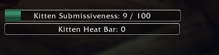

Under the submissiveness bar she can read today's orgasms, today's denials, and when that day resets.

When you put something on her, a picture of it appears in front of her for a moment. What she is wearing stays as a row of small pictures at the top of her screen. She can drag that row. A piece on a timer shows the time left under its picture. A strike from your hands shows a smaller picture. Taking something off leaves the row, and the big picture stays away.

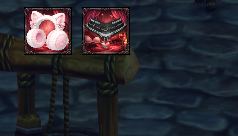

Other things live on her screen when they are needed. A dim veil when she is leashed. A dark or a mask when she is blindfolded. A paw at her cursor when her mittens are on. A reminder when a bell is on her. A small window for her cat. A small window for her maid work. A warning across the screen when it is time to nap.

Guild lines about a headpet, a nap, slacking, a heel fall, or her cat stay in her own words. A gag does not rewrite them.

## The owner window

The window is Catgirl Control. Close sits at the top right. Under the title, one line names her and shows her heat and her submissiveness, the same two feelings as her bars. The tabs are Stats, Control, Toys, Discipline, and Settings. The tab you are on is the quiet one. The others stay red.

With no kitten assigned, the kitten buttons stay quiet. Stats says that most functions are not available. Advertise, debug, and the module switches stay yours, because they belong to this character.

Once she is yours, that top line names her. If it has not heard from her yet, it says there is no snapshot. Refresh, on Stats, asks again. The page fills in as she reports, and it keeps painting while the window is open.

Control, Toys, and Discipline keep each group closed until you open it. A closed group reads `[+]`. An open group reads `[-]`. The window scrolls, so the later groups are under the ones you can see.

Open a group and the pieces split into Apply and Remove. A small picture sits beside a piece that has one. Rest the cursor on the name, or on that small picture, and a large picture of it opens beside the window.

A timed removal has a little box beside it, under Remove. The box starts at 1.5. Type the hours you want, then click the line. That box belongs to that removal.

The picture has Gags and Masks open. Leash is the group above it. Blindfolds, Earmuffs, and Bells are the next closed groups. Mittens, Chastity, Heels, and Tracking are the groups under those. Scroll to reach them.

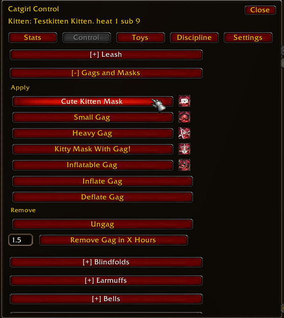

## What the stats page shows

Stats is the first tab. Refresh is at the top.

Kitten Skills lists her three heel levels: maid heels, high heels, and ballet boots.

Kitten Heat Status lists her heat, her orgasm counter, the last time she came, orgasms today, orgasms this week, and denied orgasms. Denied orgasms is the lifetime. The two bars sit under that list, the same bars she has on her own screen.

Kitten Gear is the row of pictures of what she is wearing. Under that, timed removals say none, or they name each piece and the time left on it.

Controls Status is the plain list. The picture starts it: gag, blindfold, earmuffs, paw mittens. Scroll for the rest. Heels, the collar bell, the tail bell, the tracking jewel, the chastity belt, the chastity bra, and the leash follow. If a toy is in her, a Toys block names it, and whether it is humming or filled. If the tracking jewel is on and you are on the same map, the page also says how far she is. Otherwise that distance stays unknown.

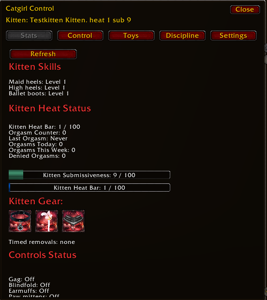

## Heat, submissiveness, orgasms, and spanks

Heat and submissiveness are two different feelings, and they tug on each other.

Heat is how worked up she is. It rises while she is dressed, while a worn toy is left in her, while she is on her leash, and while her owner handles her. Left alone, it fades, even if she logs out. When the bar fills, she is right on the edge. If her chastity belt is set to allow, she comes, and the heat empties. If the belt is set to deny, the orgasm is refused. Heat falls back from the top, and that denial stays with her for the rest of the day.

Submissiveness is how deeply she is in it right now. It comes from her heel training, from how much she is wearing, and from how the day has gone between denials and orgasms. A high bar does not add heat by itself, but it changes how she responds to being toyed with.

### Raising submissiveness

Keep her dressed. Gear, worn toys, and the leash all lift the bar. The more she is in, the higher it sits. Take something off and that part falls at once.

Let her practice her heels. All three styles count, even the ones she is not wearing. That skill stays with her. An orgasm does not take it away, and midnight does not take it away.

Deny her when heat fills. Each denial today makes her more sensitive for the rest of that day. She feels the next toy more deeply.

### Lowering submissiveness

Allow the orgasm. An orgasm today offsets the denials from today.

Wait for midnight for the kitten's orgasms and denials to clear.

Take gear off. That eases her at once. She does not have to wait for midnight.

### Her owner's hands, and a toy

Her owner's hands add heat. A spank does. The rest of that discipline does too. It never cools her, and it does not change her submissiveness on its own. This is how you walk her up to the top of the heat bar, where she will either come for you or be denied.

A kitten being punished by a toy, and not by the hand of her loving owner, can be a rather negative experience for a kitten. If your kitten's submissiveness is low and you punish her with an automated toy, it will decrease her heat, as the pain or panic overwhelms her. Though if she is submissive enough, those automated toys can add a lot to your kitten's heat bar all on their own, and for hours on end. Also keep in mind the intensity matters. She might have enough submissiveness to get turned on by a mild shock, but getting a big zap might make her more scared than turned on, depending on how submissive she feels.

### How an owner uses this

If you want her soft and deep in it, leave her dressed, let her keep practicing her heels, and deny her when heat fills. A denial makes the next automated toy more likely to arouse her instead of scare her. The heat climbs again. Deny her again, and the day stacks on itself.

If you want her to come down, allow the orgasm, take the gear off, and wait for midnight. Her owner's hands will still warm her. They are not a way to lower the bar.

She can see today's orgasms, today's denials, and when those counts reset, under her submissiveness bar. You can see the same day on the stats tab, as orgasms today, and you can see denied orgasms as the lifetime.

### Names used above

| Name | What she feels | Which things |
| --- | --- | --- |
| Her owner's hands | Discipline from you. It always warms her. | Spank Hand, Pinch, Crop, Paddle, Heart Crop, Whip, Vibrating Wand, Shock Wand |
| Worn toys | Left in or on her. They warm her for as long as they stay. | Small Butplug, Large Butplug, Taill Butplug, Inflatable Butplug, Inflatable Dildo, Vibes Pussy, Vibes Nipples |
| Automated toys | They can zap her without your hand. A mild zap and a big zap are not the same, and her submissiveness right now decides which way it goes. Left in, they also warm her on their own. | Dildo, Vibes Ears, Nipple Piercings, Ear Piercings, Pussy Lipps Piercings |

When she is allowed to come, the moment flashes over her and the heat empties. When the belt refuses her, it shocks her, the heat falls back from the top, and the denial is kept. That lifetime of denials is Denied Orgasms on the stats page. The day underneath her bar is only today.

## Dressing her

Everything you put on her is on the Control tab, in a group you open. Apply is how it goes on. Remove is how it comes off, including a removal you set for later. The open Gags and Masks group in the picture above is the shape of every group.

### Gags

A gag changes the speech everyone hears: say, yell, party, raid, guild, officer, and the instance. A whisper and an emote stay in her own words.

Apply, in that group:

The cute kitten mask leaves the words and pushes nya, and little faces, into every sentence. She will feel the urge. The button is Cute Kitten Mask.

A small gag softens her letters and leaves a nya on the end. She can still be understood, if you listen. The button is Small Gag.

A heavy gag takes the words away. What comes out is only a muffled sound, the same sound a few times. The button is Heavy Gag.

The kitty mask with a gag stops her completely. She is told that nothing can escape, and the line she tried to say never goes out. The button is Kitty Mask With Gag!

An inflatable gag starts soft. The button is Inflatable Gag. Inflate Gag and Deflate Gag are their own buttons under Apply. A little air and she still talks, with a muffled edge. More air and the words break up. All the way up and she can only moan. As it gets fuller she starts to drool on her own.

Remove is Ungag, and Remove Gag in X Hours beside the little hours box.

When a small gag goes on, chat shows the scene. The line to her owner says she has been gagged with a small gag, and hopefully that will be a lesson. The whisper to her says a small silken gag is over her mouth, and speech is now garbled.

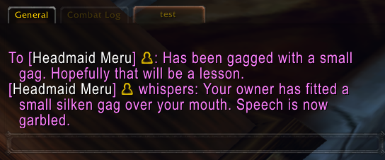

Ungag gives her voice back.

### Blindfolds

The group is Blindfolds.

A light blindfold dims the world. She can still click. The button is Light Blindfold.

A cute kitty blindfold closes a mask over her screen. The world stays in two eye holes. Her bars, the cgcc button, and her cat window stay where she can see them through the left eye. She can still move the cursor in the dark around the mask. The button is Cute Kitty Blindfold.

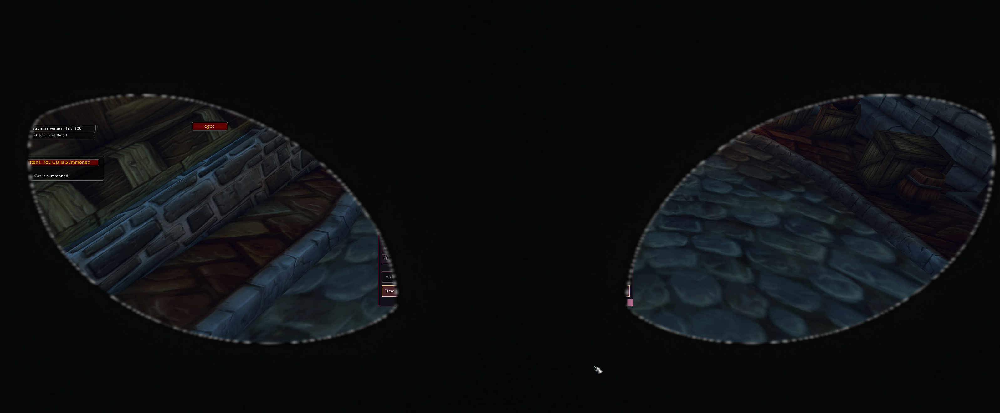

A full blindfold goes black, and she cannot click through it. She is told when she can see again. The button is Full Blindfold.

Remove Blindfold takes it off. Remove Blindfold in X Hours is the timer, with its own hours box.

### Mittens

The group is Mittens.

Lockable Paw Mittens spoil her paws. A paw follows her cursor. A spell on her bar is covered, and it creaks when she tries to cast. The spell is put back, and then the paw takes it again.

Squeking Paw Mittens are lighter. They squeak when she casts, and they only meddle with a spell for a short turn, now and then.

While she is on the leash, that meddling waits. She can follow. When the leash comes off, the paws start again if the mittens are still on.

Remove Paw Mittens gives her paws and claws back, and the covered spell is restored. Remove Paw Mittens in X Hours is the timer.

### Heels

The group is Heels. Three pairs: Locking Maid Heels 3-CM, Locking High Heels 8-CM, and Locking Ballet Boot 12-CM. The higher the heel, the harder it is to walk, and an untrained kitten in the ballet boots will hurt sooner.

While they are on, she watches the balance bar. Walk slowly. If she runs, the bar flares, she falls, a picture of the heels covers her for a moment, and the guild can hear that she fell. She is warned to take it slow.

The level bar fills as she practices the pair she is wearing. All three skills stay with her after the heels come off. You can see each level on Stats. A fall does not wipe the skill. Midnight does not wipe it either. Her steps click while she walks.

Remove Heels takes them off. Remove Heels in X Hours is the timer.

### Ears

The group is Earmuffs. They change what she hears, once she has an owner. Say, yell, party, raid, and guild come through the muffs. Her own typing still follows the gag, if she is wearing one.

Kitten Earmuffs sprinkle nya through other people's sentences. She can follow them, with a lot of nya in the way.

Heavy Earmuffs turn what she reads into a mush of stars and tildes. The meaning is gone until you take them off.

Remove Earmuffs gives her hearing back. Remove Earmuffs in X Hours is the timer.

### Bells

The group is Bells.

Attach Bell puts a collar bell on her. It rings at odd moments while she is moving. The screen reminds her that it might ring at the wrong time.

Attach Tail Bell rings with her steps, and the screen says so. If she stands still, the jingling stops. If you are close enough to be with her, you can hear the bell too.

Remove Bell and Remove Tail Bell each take off their own bell. Each has its own hours box: Remove Bell in X Hours, and Remove Tail Bell in X Hours.

### The leash

The group is Leash. The buttons are Leash and Unleash.

Leash clips her to you. Her screen dims and tells her to press 1 to follow. Once she is following, it tells her to click to stop. The spells that were sitting on her bar are put back when you unleash her. The person who leashed her is the one who can take it off.

The leash warms her for as long as it is on. It also lifts her submissiveness while it is clipped. There is no timer on the leash. You take it off yourself.

### Chastity

The group is Chastity.

Lock Chastity Belt seals her pleasure. Lock Chastity Bra seals her chest. Each has its own removal and its own hours box: Remove Chastity Belt, Remove Chastity Belt in X Hours, Remove Chastity Bra, and Remove Chastity Bra in X Hours.

On the belt, Deny Orgasm and Allow Orgasm are the choice from the heat section. Deny keeps her on the edge when the bar fills. Allow lets her come. Taking the belt off lets her feel again, and the belt returns to allow.

While the belt is locked, a toy or a strike that belongs under it will not go on and will not land. The bra does the same for her chest. You will be told when something is refused. Ears, and anything that is not under the belt or the bra, can still be reached.

### Timed locks

Every piece above, except the leash, can be set to come off later. The jewel and the toys are the other exceptions: they wait for you.

Open the group, look under Remove, and find the line that says the piece comes off in so many hours. The small box beside that line starts at 1.5. Type how long you want, then click the line. That box belongs to that piece. Each timed removal has its own.

The time keeps going if she logs out. If it runs out while she is away, the piece is already off when she returns, and she is told then. On her screen the time sits under the picture. On your stats page it is listed with the other timed removals.

If you take the piece off yourself, the timer is simply gone. She does not get the "time ran out" speech. Changing to another style of the same piece keeps the time you already set. A heavy gag in place of a small one is still that gag's clock.

## Toys

Toys is the second tab. Each toy is a group you open. The picture has the dildo open, and the rest of the list closed under it: Inflatable Butplug, Inflatable Dildo, Small Butplug, Large Butplug, Taill Butplug, Vibes Pussy, Vibes Nipples, Vibes Ears, Nipple Piercings, and Ear Piercings. Pussy Lipps Piercings is the last group. Scroll if the window stops before it.

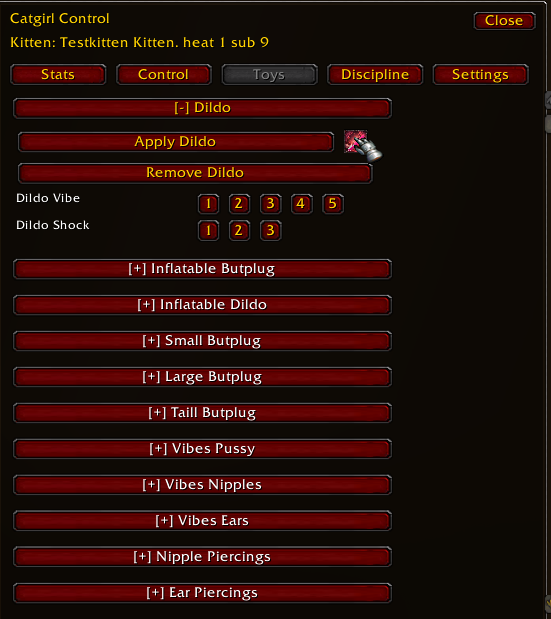

The three names in the heat section are the whole toy box. Worn toys warm her for as long as they stay. Automated toys can zap her, and her submissiveness right now decides whether that zap warms her or scares her. Left in, those warm her too.

You do not need a different ritual for each one. Open it. Apply puts it in her. Remove takes it out. The open dildo is the shape. Apply Dildo and Remove Dildo are the two long buttons. Dildo Vibe is a row of buttons, a light hum up to a hard one. Dildo Shock is a shorter row, a mild zap and then harder ones.

A toy that only hums has the vibe row. A toy that can zap has the shock row too. A toy that fills has Inflate and Deflate as their own buttons, the same idea as Inflate Gag and Deflate Gag on the Control tab.

She wears one buttplug at a time. Putting another in takes the first one out. A toy that belongs under the belt or the bra is refused while that lock is on. Stats lists what is in her, and whether it is humming or filled.

## Her owner's hands

Discipline is the third tab. These are her owner's hands from the heat section. They always warm her. They do not move her submissiveness on their own.

The tools are Spank Hand, Pinch, Vibrating Wand, Shock Wand, Crop, Paddle, Heart Crop, and Whip. Each stays closed until you open it.

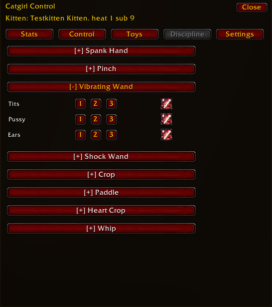

Open a tool and the places it can land are rows. Each place has a short row of strengths. A higher number is a harder stroke, and a harder stroke is a stronger warmth. The picture has the vibrating wand open onto Tits, Pussy, and Ears. The other tools open onto their own places.

You have to be close to her, and the tracking jewel has to be on, or the strike does not land. Step in, and make sure the jewel is clipped to her collar, if the click stays quiet.

A place the belt or the bra is sealing will refuse the stroke. You are told. Pick somewhere the lock is not covering, or take the lock off first.

An emote spank, and an emote pinch of her ear, are a different gesture. Those are covered with headpets, kisses, and hugs. The buttons on this tab are your hands on the heat bar.

## Naps

After she has been online for a good while, a warning crosses her screen. It tells her that good kittens nap, to find an inn, and how long a proper nap is.

She uses the sleep emote while she is resting, inside that window. Stay down for the length the warning asked. Getting up too soon makes her a cranky kitten who woke early. Sleeping on past it makes her a kitten who slept all day. Ignoring the warning means she did not listen, and her owner should punish her. A nap kept properly asks the guild to give her headpets and praise.

Moving, or leaving the rest of the inn, ends the nap. The guild hears which kind it was. Then the wait begins again, and the next warning comes when she has been online long enough once more.

## Slacking at the inn

Resting at an inn out in the world, without having just gone to sleep, is slacking. After she has lingered, the guild hears that she was caught slacking off in the inn again. The time she stays after that is remembered when she finally leaves.

A real nap is quiet on this count. If she has just gone to sleep, that rest is her nap, and the slack call stays away.

A capital is home, and it is not slacking. Orgrimmar, Stormwind, Ironforge, Darnassus, Undercity, Thunder Bluff, Shattrath, Silvermoon, and the Exodar do not count. She has to be resting somewhere else.

This can be turned off with the other modules. It starts on.

## Her cat

A small window asks her to summon her cat. The button reads "Summon your cat Nya !" She needs one of the carrier cats in her collection: a Bombay, a Cornish Rex, a black tabby, an orange tabby, a Siamese, a silver tabby, or a white kitten. A renamed cat of those kinds still counts. A hunter pet does not.

She clicks the button and the cat comes out. Another click puts the cat away. She cannot do it in combat, or while she is dead. While she is dead the button asks her to summon again. When she is alive and the cat is out, the button praises her and the line underneath says the cat is summoned.

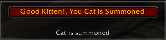

The line also shows how long until the addon looks again. The first time it looks and the cat is missing, she gets a private warning to summon Nya. If the cat is still missing the next time, the guild hears that she forgot. Summoning the cat clears that warning.

The cat window can be turned off with the other modules. It starts on. The guild line about forgetting is a scolding. It is separate from the weekly scorecard.

## Headpets, kisses, and hugs

This listens to emotes aimed at her.

Someone who pets her, hugs her, or blows her a kiss is counted. The guild can hear that she was good and what she received, and from whom. A spank emote and an ear-pinch emote are counted too, as her being a bad kitten, and the guild can hear who did it. Those emotes are this tracker. They are separate from the Discipline tab.

A burst of the same gesture from the same person counts once, until a little time has passed. The week remembers the gestures, and it remembers who gave them.

This starts on. You can turn HeadPetTracker off if the guild should stay quiet and the week should stop counting them.

## Maid tasks

Settings holds the editors. Maid Tasks is where you paste an item and click Add Task. Maid Instructions is where you write what she should do and click Add. Each list can be trimmed with Remove on that line. The same item twice, or the same instruction twice, is left as the one line. If a list is too long to send, it does not go through, and it does not count.

An empty task list says to paste an item and click Add Task. An empty instruction list says to add one above. A line under both counts the items and the instructions. The picture is that empty page.

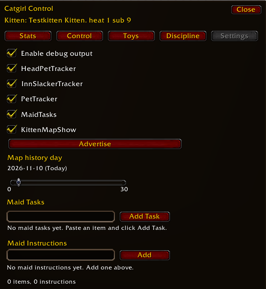

On her screen, a window she can drag shows the instructions as a numbered list, and it shows those items as your inventory, with how many you are carrying. When both lists are empty, her window hides.

Sending the same list again is quiet. Changing it is a task for the week, counted once when the new list arrives. MaidTasks starts on. If you turn it off, she will not take the list.

## Nya

NyaChat is further down the Settings tab, under the maid editors. Scroll to it. The picture above stops at the maid count.

It rewrites chat this character types: say, yell, party, raid, guild, officer, whisper, emote, and channel. It stays off until you enable it. A gag still happens first, so a heavy gag or a full mask still takes the words. The addon's own lines, including maid notes and the cat, stay as they are.

Enable Nya, then choose the habits. Append nya. Tildes. Little ascii faces. Nya sprinkled through the sentence. UwU. Kitty words, so a yes becomes something softer. A stutter. Sparkle on the punctuation. A small action, a purr or a flick of the tail. Lowercase. A face trailing at the end.

Chance is how often a habit takes. A preview under the switches shows a sample of the voice, so you can hear it before she speaks. The choices belong to this character. You can sweeten your own chat, or hers, each on their own settings.

## The map

The tracking jewel is on the Control tab, in Tracking. The buttons are Attach Tracking Jewel, Force Kitty Group, and Remove Tracking Jewel. Clip the jewel to her collar and her walks can be remembered. Take it off and the new walks stop. She does not see her own trail. There is no timer on the jewel.

KittenMapShow starts off. Turn it on from Settings, or with `/cctmodule KittenMapShow`. The picture of Settings has it on, so the map can draw. Then open your world map to the zone she is in. Her walks that day are little cat faces on the map. Hover a face and the time comes up, the day and the hour. Standing in one place for a while is one face, with the span of that stay. Today also shows where she is right now. Your own marker on the map is still you.

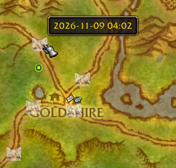

The slider on Settings is Map history day. It prints the date, and it says Today when the slider is on this day. The ends of the slider read 0 and 30. Today is one end. About a month back is the other. A day she did not walk with the jewel on stays empty.

The faces are for you. The guild master does not receive the trail.

Force Kitty Group sits in that same Tracking group. She invites you into a party. If she is already in a group, she leaves it and then invites you. This is how you pull her to you.

Her owner's hands need this jewel, and they need you close. The stats page can tell you the distance while the jewel is on and you share a map.

## The weekly scorecard

The week is kept for the guild master. You do not open a window to read it in the game. There is no copy to click.

Name the master with `/cctmaster` and their name, `First Last` or `First-Last`. Until that name is set, the week is not sent. While the master is online, her week is delivered to them.

For her, the week remembers time in heels, time gagged, maid lists that actually changed, the highest her heat climbed, orgasms, denials, how long she was online, and how submissive she was when the record was sent. It remembers headpets, hugs, kisses, emote spanks, and ear pinches, and who gave them. It remembers how many times she was caught slacking, and how long she lingered. It remembers her naps: kept, cut short, slept through, or ignored. It remembers the places she spent her time.

For you, the week remembers what you put on her and what you took off, the strikes from your hands, and the maid tasks you sent.

When the week turns, that slate starts fresh. Her lifetime of orgasms, and her lifetime of denials, stay on the stats page. Those are hers. They are a different memory from the week. The addon keeps no transcript of guild chat. The scorecard is the memory.

## The small switches

Settings also has debug, the five modules, and Advertise. These stay clickable with no kitten assigned. They are the top of the Settings picture.

Enable debug output, and `/cctdebug`, make the addon talk when you are trying to see why something stayed quiet. Leave it off for roleplay. The picture has it checked so the row is easy to see.

`/cctmodule` with nothing after it lists the five modules. `/cctmodule` and a name turns that one on or off. The same switches are the checkboxes: HeadPetTracker, InnSlackerTracker, PetTracker, MaidTasks, and KittenMapShow.

HeadPetTracker, InnSlackerTracker, PetTracker, and MaidTasks start on. KittenMapShow starts off. What each one does is in the sections above.

Advertise, the red button under the checkboxes, opens a small window of five lines. `/cgcc advertise` opens the same window. You can open it before a kitten is assigned. The lines are kept for a shout, and a gag leaves them in the words you wrote. Shouting from that window stays off.

`/cctmaster` with no name tells you who the guild master is, or that the name is still empty.
